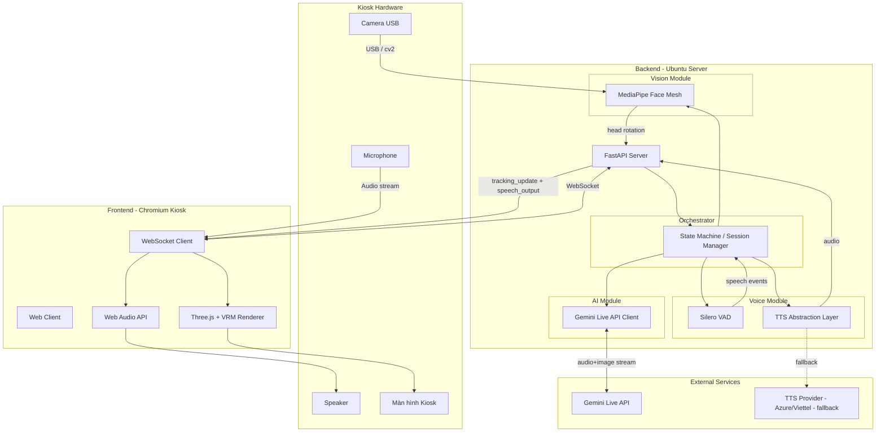
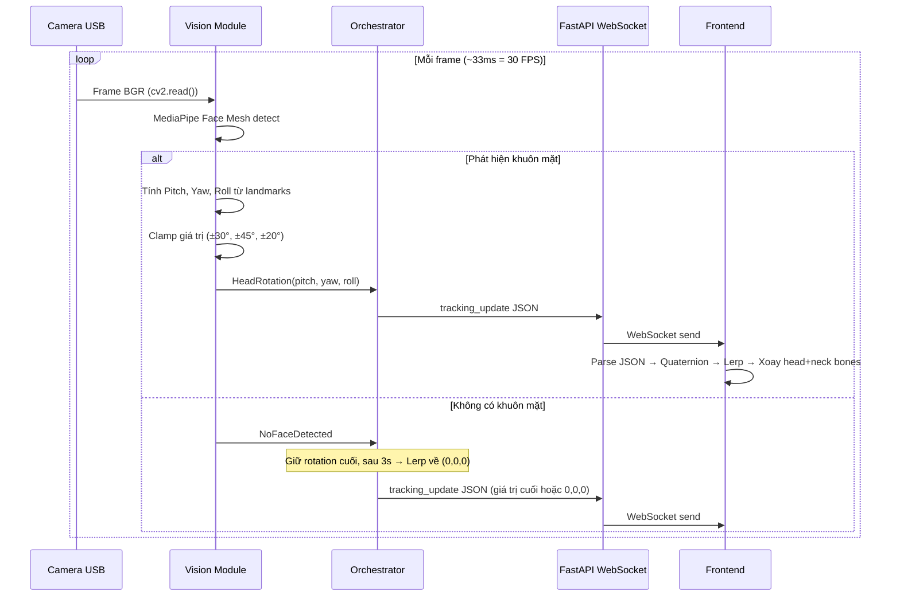
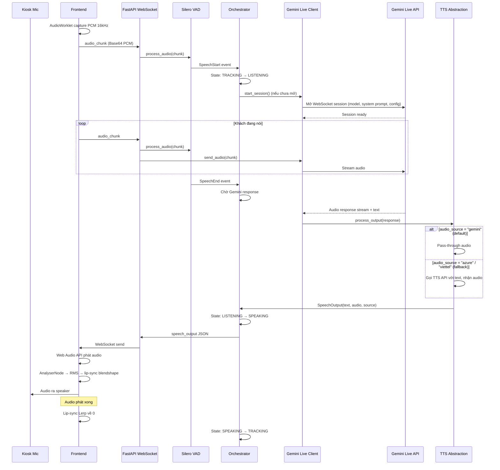
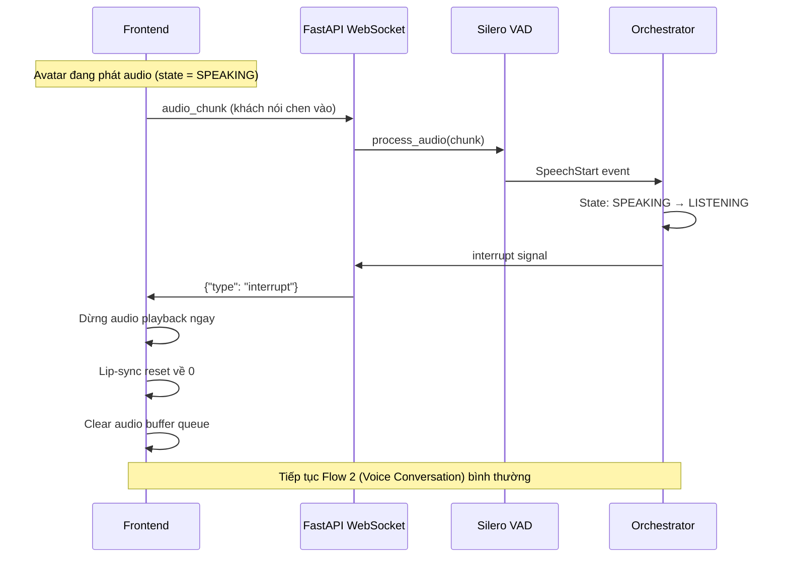
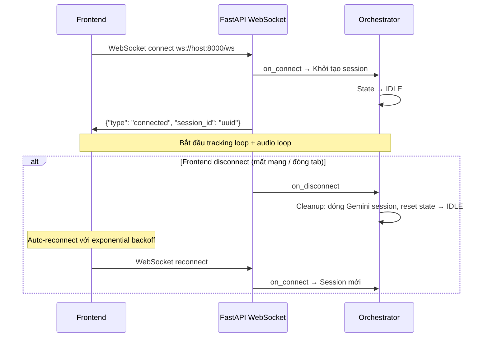
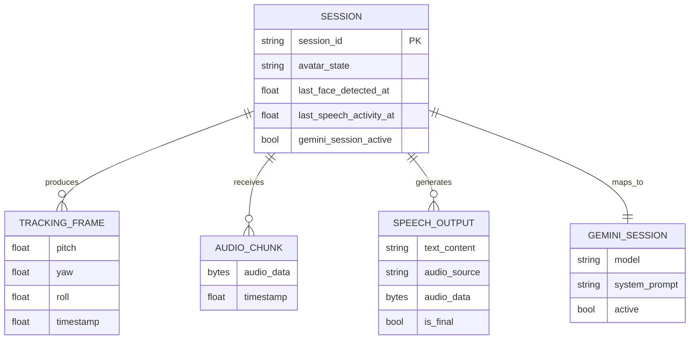
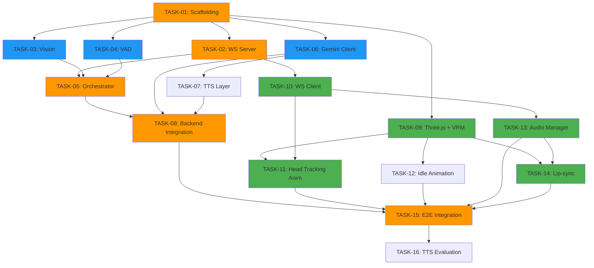

# System Architecture — MAGIC MIRROR AI AVATAR

> **Version:** POC (v0.1)
> **Input:** `docs/01_prd.md`, `first_POC.md`, `init.md`, `init_architecture.md`
> **Status:** Draft — chờ Human Review

---

# Section 1: High-level Architecture

## 1.1. Kiến trúc tổng thể

**Pattern:** Modular Monolith — single backend process, các module tách biệt qua interface rõ ràng.

**Tại sao Modular Monolith:**
- POC chỉ chạy 1 kiosk, 1 server — microservices là overkill.
- Toàn bộ module chạy trong 1 Python process giảm latency inter-module (quan trọng cho real-time tracking 30 FPS).
- Module có interface rõ ràng → dễ tách ra service riêng khi cần scale lên production.
- Đơn giản để deploy, debug, monitor trên 1 máy Ubuntu.

**Communication:**
- Backend ↔ Frontend: **WebSocket** (bidirectional, persistent connection) — bắt buộc cho real-time 30 FPS tracking + audio streaming.
- Backend ↔ Gemini Live API: **WebSocket/gRPC** (streaming bidirectional) — Gemini Live API native protocol.
- Inter-module (backend): **In-process async** — Python asyncio queues, không cần message broker.

**Deployment topology:** Bare metal (Ubuntu + RTX 3070) — Docker container cho reproducibility, không cần orchestration.

## 1.2. System Diagram



## 1.3. Component Cards

### Component: FastAPI Server

| Field | Value |
|---|---|
| **Responsibility** | WebSocket endpoint duy nhất. Nhận audio từ frontend, phân phối tracking data và speech output xuống frontend. |
| **Dependencies** | Vision Module, Voice Module, AI Module, Orchestrator |
| **Exposes** | `ws://host:8000/ws` (WebSocket) |
| **Consumes** | Không — đây là entry point |
| **Scaling** | Vertical (1 instance per kiosk). Không cần horizontal cho POC. |
| **Data owned** | Không. Tất cả data là ephemeral stream. |

### Component: Vision Module (MediaPipe Face Mesh)

| Field | Value |
|---|---|
| **Responsibility** | Capture frame từ camera USB, tính toán head rotation (Pitch/Yaw/Roll) từ 468 face landmarks, chụp JPEG snapshot định kỳ cho Gemini. |
| **Dependencies** | Camera USB (hardware), OpenCV |
| **Exposes** | `get_head_rotation() → HeadRotation` (in-process async), `get_snapshot() → bytes` (JPEG) |
| **Consumes** | Camera USB qua `cv2.VideoCapture(0)` |
| **Scaling** | Vertical. Bị giới hạn bởi 1 camera, 1 GPU. |
| **Data owned** | Không. Frame xử lý xong bỏ ngay. |

### Component: Voice Module (Silero VAD)

| Field | Value |
|---|---|
| **Responsibility** | Phân tích audio stream từ frontend, phát hiện speech start/end, điều khiển lifecycle Gemini session. |
| **Dependencies** | Silero VAD model (local, ~0.1 GB) |
| **Exposes** | `process_audio(chunk) → VadEvent` (in-process async) |
| **Consumes** | Audio chunks từ FastAPI WebSocket handler |
| **Scaling** | Vertical. Silero VAD rất nhẹ, có thể chạy trên CPU. |
| **Data owned** | Không. Audio buffer tạm trong memory, xoá khi xử lý xong. |

### Component: AI Module (Gemini Live API Client)

| Field | Value |
|---|---|
| **Responsibility** | Quản lý session Gemini Live API. Gửi audio + image snapshot, nhận audio response + text. |
| **Dependencies** | Gemini Live API (external), Voice Module (VAD events), Vision Module (JPEG snapshots) |
| **Exposes** | `start_session()`, `send_audio(chunk)`, `send_image(jpeg)`, `on_response(callback)`, `close_session()` |
| **Consumes** | Gemini Live API (`gemini-2.0-flash-live`) qua WebSocket/gRPC |
| **Scaling** | Bị giới hạn bởi API quota. 1 session tại 1 thời điểm. |
| **Data owned** | Không. Session state do Gemini quản lý. |

### Component: TTS Abstraction Layer

| Field | Value |
|---|---|
| **Responsibility** | Chuẩn hóa audio output. Mặc định pass-through từ Gemini. Nếu cần swap → gọi Azure/Viettel TTS API. |
| **Dependencies** | AI Module (text/audio từ Gemini), TTS Provider (nếu swap) |
| **Exposes** | `process_output(gemini_response) → SpeechOutput` |
| **Consumes** | Gemini audio (default) hoặc Azure/Viettel TTS API (fallback) |
| **Scaling** | N/A — thin layer |
| **Data owned** | Không |

### Component: Orchestrator (State Machine / Session Manager)

| Field | Value |
|---|---|
| **Responsibility** | Quản lý Avatar state (IDLE → TRACKING → LISTENING → SPEAKING). Điều phối luồng dữ liệu giữa các module. Xử lý lifecycle session. |
| **Dependencies** | Tất cả module khác |
| **Exposes** | `get_state() → AvatarState`, events qua asyncio |
| **Consumes** | Vision Module (head rotation), Voice Module (VAD events), AI Module (responses) |
| **Scaling** | Vertical. Stateful per kiosk. |
| **Data owned** | Avatar state, session metadata (in-memory) |

### Component: Frontend Web Client

| Field | Value |
|---|---|
| **Responsibility** | Render Avatar 3D (VRM), xử lý head tracking animation, lip-sync, idle animation. Thu audio từ mic, gửi qua WebSocket. Phát audio response qua speaker. |
| **Dependencies** | Three.js, @pixiv/three-vrm, Web Audio API |
| **Exposes** | Không — đây là consumer |
| **Consumes** | `ws://host:8000/ws` (tracking_update, speech_output) |
| **Scaling** | 1 instance per kiosk. Chạy trên Chromium. |
| **Data owned** | VRM model file (static asset), audio buffer (ephemeral) |

## 1.4. Data Flow Overview

```
[Thu âm thanh]
  Mic → Frontend AudioWorklet → PCM 16kHz Base64 → WebSocket → Backend

[Xử lý giọng nói]
  Backend VAD → Phát hiện speech → Mở Gemini session → Stream audio tới Gemini
  Gemini → Audio response + Text → TTS Abstraction → SpeechOutput JSON → WebSocket → Frontend

[Tracking khuôn mặt]
  Camera USB → cv2 → MediaPipe Face Mesh → Pitch/Yaw/Roll → tracking_update JSON → WebSocket → Frontend

[Render Avatar]
  Frontend nhận tracking_update → Quaternion rotation trên head/neck bones
  Frontend nhận speech_output → Web Audio API phát audio + AnalyserNode → lip-sync blendshape
  Frontend tự chạy → Blink + Breathing idle animation
```

---

# Section 2: Module Details & Sequence Diagrams

## Flow 1: Head Tracking (30 FPS liên tục)

### Mermaid Diagram



### Step-by-step Description

| Step | From → To | Action | Input | Output | Error case |
|---|---|---|---|---|---|
| 1 | Camera → Vision | `cv2.VideoCapture(0).read()` | — | Frame BGR numpy array | Camera disconnect → retry 5 lần, mỗi 2s |
| 2 | Vision → Vision | MediaPipe `face_mesh.process(frame_rgb)` | Frame RGB | 468 face landmarks | Không detect → giữ giá trị cuối |
| 3 | Vision → Vision | Tính Pitch/Yaw/Roll từ landmarks (nose, chin, eye corners) | Landmarks | `HeadRotation(p, y, r)` | — |
| 4 | Vision → Vision | `clamp(pitch, -0.52, 0.52)`, tương tự yaw, roll | Raw rotation | Clamped rotation | — |
| 5 | Vision → Orchestrator | Gửi `HeadRotation` qua asyncio queue | HeadRotation | — | Queue full → drop frame cũ nhất |
| 6 | Orchestrator → WebSocket | Tạo `tracking_update` JSON | HeadRotation + state | JSON payload | — |
| 7 | WebSocket → Frontend | `ws.send(json)` | JSON string | — | WS disconnect → frontend auto-reconnect |
| 8 | Frontend → Frontend | Parse → Quaternion → Lerp (smoothing factor ~0.3) → Apply bones | JSON | Avatar head rotation | — |

### Error Handling
- Step 1 fail (camera disconnect): Log error, retry kết nối `cv2.VideoCapture(0)` mỗi 2 giây, tối đa 5 lần. Trong lúc retry, gửi tracking_update với giá trị cuối cùng.
- Step 2 fail (no face): Không phải error — giữ rotation cuối, sau 3s Lerp về trung tâm.
- Step 7 fail (WS disconnect): Frontend reconnect với exponential backoff (3s → 6s → 12s → max 30s).

### Side Effects
- Mỗi 2-3 giây: Vision Module chụp 1 frame JPEG (quality 70%, resize max 640px) lưu tạm, Orchestrator gửi cho AI Module khi Gemini session đang mở.

---

## Flow 2: Voice Conversation (Event-driven)

### Mermaid Diagram



### Step-by-step Description

| Step | From → To | Action | Input | Output | Error case |
|---|---|---|---|---|---|
| 1 | Frontend | AudioWorklet capture, resample to PCM 16kHz mono | Mic raw audio | PCM Int16 array | Mic permission denied → log, no voice feature |
| 2 | Frontend → WS | Gửi `audio_chunk` JSON (Base64 PCM) | PCM bytes | JSON message | WS disconnect → buffer locally, retry |
| 3 | WS → VAD | `vad.process(chunk)` | PCM chunk | `SpeechStart` / `SpeechEnd` / `None` | — |
| 4 | Orchestrator | Nhận `SpeechStart` → chuyển state LISTENING | VAD event | State change | — |
| 5 | Orchestrator → AI | `start_session()` nếu chưa mở | System prompt + config | Session handle | API error → log, retry lượt nói sau |
| 6 | WS → AI | `send_audio(chunk)` — stream liên tục | PCM chunk | — | Session error → close + retry |
| 7 | Orchestrator (định kỳ) | `send_image(jpeg)` — JPEG snapshot mỗi 2-3s | JPEG bytes | — | Bỏ qua nếu lỗi |
| 8 | VAD → Orchestrator | `SpeechEnd` — khách dừng nói | VAD event | — | — |
| 9 | Gemini → AI | Audio response stream + text content | — | Audio bytes + text | Timeout 15s → close session, log |
| 10 | AI → TTS | `process_output(response)` | Gemini response | SpeechOutput | TTS fallback fail → dùng Gemini audio |
| 11 | Orchestrator → WS → FE | Gửi `speech_output` JSON | SpeechOutput | JSON message | WS error → drop, log |
| 12 | Frontend | Decode Base64 → AudioContext → play | Base64 audio | Sound output | Decode error → skip chunk |
| 13 | Frontend | AnalyserNode → RMS → map to blendshape `aa` (0.0-1.0) | Audio signal | Lip-sync | Blendshape missing → skip |
| 14 | Frontend | Audio buffer hết → lip-sync Lerp về 0 (~100ms) | — | Mouth closed | — |

### Error Handling
- Step 5 fail (Gemini API error): Log error, close session. Khi khách nói lại → mở session mới. Không retry ngay lập tức.
- Step 9 fail (Gemini timeout): Sau 15s không có response → đóng session, log warning. Avatar không trả lời lượt nói đó.
- Step 10 fail (TTS fallback error): Nếu Azure/Viettel TTS fail → fallback về Gemini audio (nếu có). Nếu cả hai fail → log error, bỏ qua response.

### Side Effects
- Khi state chuyển LISTENING → SPEAKING: `tracking_update.is_speaking = true` gửi ngay.
- Khi state chuyển SPEAKING → TRACKING: `tracking_update.is_speaking = false` gửi ngay.
- Gemini session timeout (30s không có speech) → tự đóng session.

---

## Flow 3: Barge-in (Khách nói khi Avatar đang nói)

### Mermaid Diagram



### Step-by-step Description

| Step | From → To | Action | Input | Output | Error case |
|---|---|---|---|---|---|
| 1 | Frontend → WS | Audio chunk chứa giọng khách (trong khi đang phát audio) | PCM chunk | — | — |
| 2 | VAD → Orchestrator | `SpeechStart` trong khi state = SPEAKING | VAD event | — | — |
| 3 | Orchestrator | Chuyển state SPEAKING → LISTENING | — | State change | — |
| 4 | Orchestrator → Frontend | Gửi `interrupt` message | — | JSON `{"type": "interrupt"}` | — |
| 5 | Frontend | Dừng AudioContext, clear buffer, reset lip-sync | Interrupt signal | — | — |

---

## Flow 4: WebSocket Connection Lifecycle

### Mermaid Diagram



---

## Flow 5: Idle Animation (Frontend-only)

### Step-by-step Description

| Step | Component | Action | Timing | Detail |
|---|---|---|---|---|
| 1 | Frontend | Blink animation | Random mỗi 3-5 giây | Blendshape blink: 0→1 (100ms) → hold 50ms → 1→0 (100ms) |
| 2 | Frontend | Breathing animation | Liên tục mỗi frame | `Math.sin(time * 0.8) * 0.003` trên xương chest Y-axis |
| 3 | Frontend | Cả hai chạy song song với tracking + lip-sync | Mỗi `requestAnimationFrame` | Blendshape mắt/miệng độc lập. Breathing cộng dồn lên chest bone. |

> Idle animation hoàn toàn chạy trên frontend, không cần data từ backend.

---

# Section 3: Tech Stack Selection

## 3.1. Language & Runtime (Backend): Python 3.10+

| Criteria | **Python 3.10+** | Node.js 20 | Go 1.21 |
|---|---|---|---|
| Phù hợp scope | Tốt — MediaPipe, Silero, google-genai đều có SDK Python | Trung bình — MediaPipe có JS nhưng yếu hơn | Kém — không có SDK MediaPipe/Silero native |
| Performance | Đủ — asyncio cho I/O bound, MediaPipe binding C++ | Tốt cho I/O | Tốt nhất |
| Learning curve | Thấp | Thấp | Trung bình |
| Community/Docs | Xuất sắc cho AI/ML | Tốt cho web | Tốt cho infra |
| Cost | Free | Free | Free |

**Chọn Python vì:** Toàn bộ AI stack (MediaPipe, Silero VAD, google-genai) có first-class Python SDK. Ecosystem ML/AI của Python không thể thay thế. Asyncio đủ performance cho real-time WebSocket.
**Không chọn Node.js vì:** MediaPipe JS binding kém hơn Python, Silero VAD không có JS SDK.
**Không chọn Go vì:** Không có SDK cho MediaPipe, Silero. Phải tự wrap C++ binding — tốn thời gian, không phù hợp POC.

**Overkill check:** Python cho POC real-time? Không — asyncio + native C++ bindings (MediaPipe, OpenCV) đủ nhanh. Bottleneck là Gemini API latency, không phải Python.
**Scale check:** 10x = 10 kiosk → mỗi kiosk 1 server riêng. Python process đủ cho 1 kiosk.

## 3.2. Web Framework (Backend): FastAPI

| Criteria | **FastAPI** | Flask + flask-sock | Django Channels |
|---|---|---|---|
| Phù hợp scope | Tốt — native WebSocket + async | Trung bình — WebSocket qua extension | Kém — quá nặng cho real-time streaming |
| Performance | Tốt — async native, uvicorn | Trung bình — WSGI + adapter | Trung bình |
| Learning curve | Thấp | Rất thấp | Cao |
| Community/Docs | Tốt | Tốt | Tốt |
| Cost | Free | Free | Free |

**Chọn FastAPI vì:** Native async WebSocket support, tích hợp tốt với asyncio (core của pipeline). Type hints + auto-validation giúp code rõ ràng.
**Không chọn Flask vì:** WebSocket là afterthought, phải dùng extension. Không async native.
**Không chọn Django Channels vì:** Overkill — cần ORM, admin, migration system mà POC không dùng.

**Overkill check:** Không. FastAPI nhẹ, chỉ dùng WebSocket endpoint. Không dùng ORM, auth, middleware phức tạp.
**Scale check:** 10x → vẫn đủ. FastAPI xử lý tốt concurrency qua asyncio.

## 3.3. Frontend Framework: Vanilla JS + Three.js + Vite

| Criteria | **Vanilla JS + Three.js** | React + React-Three-Fiber | Vue + TresJS |
|---|---|---|---|
| Phù hợp scope | Tốt — 1 page duy nhất, full 3D | Overkill — virtual DOM không cần cho 3D render | Overkill |
| Performance | Tốt nhất — không overhead framework | Tốt — R3F có overhead nhỏ | Tốt |
| Learning curve | Thấp (Three.js thuần) | Trung bình (R3F abstraction) | Trung bình |
| Community/Docs | Three.js: xuất sắc | R3F: tốt | TresJS: nhỏ |
| Cost | Free | Free | Free |

**Chọn Vanilla JS + Three.js vì:** Frontend là 1 page duy nhất chạy Kiosk — không cần routing, state management, component system. Three.js + VRM là toàn bộ UI. Framework React/Vue chỉ thêm overhead vô ích.
**Không chọn React vì:** Không có UI components cần manage state. Toàn bộ là 3D render loop — React reconciliation là overhead không cần thiết.
**Không chọn Vue vì:** Cùng lý do React.

**Overkill check:** Vanilla JS cho project này? Không — đây là đúng mức. 1 file HTML + 1 file JS + Three.js là đủ.
**Scale check:** 10x → mỗi kiosk 1 instance frontend. Không có shared state giữa các kiosk.

**Build tool: Vite** — dev server nhanh, HMR tốt, bundle production đơn giản. Không cần Webpack.

## 3.4. 3D Engine: Three.js + @pixiv/three-vrm

| Criteria | **Three.js + three-vrm** | Babylon.js | Unity WebGL |
|---|---|---|---|
| Phù hợp scope | Tốt — chuẩn VRM, lightweight | Tốt — nhưng VRM support yếu | Overkill |
| Performance | Tốt — ~60 FPS cho 1 model VRM | Tốt | Nặng — build size lớn |
| Learning curve | Trung bình | Trung bình | Cao |
| Community/Docs | Xuất sắc | Tốt | Xuất sắc nhưng web ≠ native |
| Cost | Free | Free | License phức tạp |

**Chọn Three.js + three-vrm vì:** `@pixiv/three-vrm` là thư viện production-ready duy nhất cho VRM trên web. Chuẩn VRM Consortium, hỗ trợ blendshape, bone hierarchy, spring bones.
**Không chọn Babylon.js vì:** VRM loader không official, phải dùng community plugin kém ổn định.
**Không chọn Unity WebGL vì:** Build size ~30MB+, loading time dài, licensing phức tạp. Overkill cho 1 avatar tĩnh với head tracking.

**Overkill check:** Không — Three.js là right-sized cho WebGL avatar rendering.
**Scale check:** N/A — frontend chạy isolated per kiosk.

## 3.5. Database: KHÔNG CẦN (POC)

**Lý do không cần database:**
- Tất cả data là ephemeral streaming (xem PRD Section 8b) — tracking frames, audio chunks, speech output đều stream qua và bỏ.
- Không có user accounts, không có persistent state.
- Configuration qua environment variables + config file.

**Escape hatch:** Nếu production cần persist (conversation logs, VIP profiles) → thêm SQLite hoặc PostgreSQL. Module interface đã tách biệt, chỉ cần thêm repository layer.

## 3.6. Cache: KHÔNG CẦN (POC)

**Lý do:** Không có data nào cần cache. Tất cả là real-time stream.

## 3.7. Message Queue: KHÔNG CẦN (POC)

**Lý do:** Tất cả modules chạy trong 1 process, dùng `asyncio.Queue` cho inter-module communication. Không cần external message broker cho 1 kiosk.

**Escape hatch:** Nếu production cần tách modules ra services riêng → thêm Redis Pub/Sub hoặc NATS.

## 3.8. Authentication: KHÔNG CẦN (POC)

**Lý do:** 1 kiosk duy nhất trên LAN nội bộ. Không có multi-user, không có API public.

## 3.9. Deployment & Hosting: Docker + Docker Compose

| Criteria | **Docker Compose** | Bare metal systemd | Kubernetes |
|---|---|---|---|
| Phù hợp scope | Tốt — reproducible, GPU passthrough | Đủ nhưng khó reproduce | Overkill |
| Performance | ~Native (NVIDIA Container Toolkit) | Native | Overhead |
| Learning curve | Thấp | Rất thấp | Cao |
| Community/Docs | Xuất sắc | — | Xuất sắc nhưng overkill |

**Chọn Docker Compose vì:** Reproducible environment (CUDA, Python deps, model files). `nvidia-container-toolkit` cho GPU passthrough gần native.
**Không chọn K8s vì:** 1 server, 1 kiosk. Kubernetes là absurd overkill.

**Overkill check:** Docker Compose cho 1 server? Có thể hơi overkill so với bare metal — nhưng reproducibility quan trọng khi cần deploy nhiều kiosk sau này. Chấp nhận.
**Scale check:** 10x → mỗi kiosk 1 Docker Compose stack trên 1 server.

## 3.10. Monitoring & Logging

| Component | Tool | Lý do |
|---|---|---|
| Logging | Python `logging` → stdout/file | Đơn giản, đủ cho POC. Structured JSON logs. |
| GPU Monitoring | `nvidia-smi` (cron hoặc inline check) | Giám sát VRAM, phát hiện OOM sớm |
| Health check | FastAPI `GET /health` | Kiểm tra nhanh system alive |

**Không dùng Prometheus/Grafana/ELK** cho POC — overkill. Thêm khi cần production monitoring.

## 3.11. ML Serving: Không cần framework riêng

| Component | Serving method | Lý do |
|---|---|---|
| MediaPipe Face Mesh | In-process Python (mediapipe SDK) | Lightweight, không cần REST wrapper |
| Silero VAD | In-process Python (torch) | ~0.1 GB, chạy được trên CPU |
| Gemini LLM + STT + TTS | Cloud API (google-genai SDK) | Không deploy model local |

**Không dùng TorchServe, Triton, TF Serving** — không có model nào cần serve qua HTTP. Tất cả chạy in-process.

---

# Section 4: API Contracts

> Hệ thống này giao tiếp qua **WebSocket** (không phải REST API). Dưới đây là WebSocket message contracts.

## 4.1. Global Conventions

### WebSocket Endpoint

```
ws://[host]:8000/ws
```

### Message Format

Tất cả messages là JSON UTF-8. Mỗi message BẮT BUỘC có field `type`.

```json
{
  "type": "<message_type>",
  ...payload fields
}
```

### Message Types

| Direction | Type | Frequency | Description |
|---|---|---|---|
| Server → Client | `connected` | 1 lần khi connect | Xác nhận kết nối thành công |
| Server → Client | `tracking_update` | ~30 Hz liên tục | Head rotation + avatar state |
| Server → Client | `speech_output` | Event-driven | Audio response từ AI |
| Server → Client | `interrupt` | Event-driven | Barge-in: dừng phát audio |
| Server → Client | `error` | Event-driven | Thông báo lỗi |
| Client → Server | `audio_chunk` | Liên tục khi thu âm | Audio data từ microphone |

### Error Format

```json
{
  "type": "error",
  "code": "ERROR_CODE",
  "message": "Human readable description",
  "recoverable": true
}
```

| Error Code | Mô tả | Recoverable |
|---|---|---|
| `CAMERA_DISCONNECTED` | Camera USB mất kết nối | Có — tự retry |
| `GEMINI_SESSION_ERROR` | Gemini API lỗi | Có — retry lượt nói sau |
| `GEMINI_TIMEOUT` | Gemini không response trong 15s | Có — retry lượt nói sau |
| `TTS_FALLBACK_FAILED` | Cả Gemini TTS và fallback TTS đều lỗi | Có — bỏ qua response |
| `VRAM_WARNING` | VRAM usage > 6 GB | Có — cảnh báo |
| `INTERNAL_ERROR` | Lỗi không xác định | Có thể không |

## 4.2. Server → Client Messages

### `connected`

Gửi 1 lần khi client kết nối WebSocket thành công.

```json
{
  "type": "connected",
  "session_id": "550e8400-e29b-41d4-a716-446655440000",
  "config": {
    "tracking_fps": 30,
    "audio_format": "pcm_16khz_mono"
  }
}
```

| Field | Type | Required | Description |
|---|---|---|---|
| `session_id` | string (UUID v4) | Yes | ID session hiện tại |
| `config.tracking_fps` | int | Yes | Tần suất tracking server gửi xuống |
| `config.audio_format` | string | Yes | Format audio mà server expect từ client |

### `tracking_update`

Gửi liên tục ~30 Hz.

```json
{
  "type": "tracking_update",
  "timestamp": 1709400000.123,
  "avatar_control": {
    "head_rotation": {
      "pitch": 0.12,
      "yaw": -0.05,
      "roll": 0.01
    },
    "is_speaking": false
  }
}
```

| Field | Type | Required | Constraints | Description |
|---|---|---|---|---|
| `timestamp` | float | Yes | Unix epoch, monotonically increasing | Thời điểm capture frame |
| `avatar_control.head_rotation.pitch` | float | Yes | [-0.52, 0.52] rad | Gật đầu (up/down) |
| `avatar_control.head_rotation.yaw` | float | Yes | [-0.78, 0.78] rad | Lắc đầu (left/right) |
| `avatar_control.head_rotation.roll` | float | Yes | [-0.35, 0.35] rad | Nghiêng đầu (tilt) |
| `avatar_control.is_speaking` | bool | Yes | — | Avatar đang phát audio? |

### `speech_output`

Gửi khi AI có câu trả lời. Có thể gửi nhiều chunks cho 1 câu trả lời dài.

```json
{
  "type": "speech_output",
  "text_content": "Chào mừng anh quay trở lại.",
  "audio_source": "gemini",
  "audio_data": "<base64 encoded audio>",
  "is_final": true
}
```

| Field | Type | Required | Constraints | Description |
|---|---|---|---|---|
| `text_content` | string | Yes | UTF-8, tiếng Việt | Nội dung text của câu trả lời |
| `audio_source` | string | Yes | Enum: `"gemini"`, `"azure"`, `"viettel"` | Nguồn audio |
| `audio_data` | string | Yes | Base64 encoded PCM/MP3 | Audio data |
| `is_final` | bool | Yes | — | Chunk cuối cùng của response? |

### `interrupt`

Gửi khi phát hiện barge-in (khách nói chen khi Avatar đang nói).

```json
{
  "type": "interrupt"
}
```

Không có field bổ sung. Frontend nhận → dừng audio ngay.

## 4.3. Client → Server Messages

### `audio_chunk`

Gửi liên tục khi client đang thu âm.

```json
{
  "type": "audio_chunk",
  "audio_data": "<base64 encoded PCM 16kHz mono Int16>"
}
```

| Field | Type | Required | Constraints | Description |
|---|---|---|---|---|
| `audio_data` | string | Yes | Base64 PCM, 16kHz, mono, Int16LE | Audio chunk từ microphone |

**Chunk size recommendation:** 20-40ms audio mỗi chunk (~640-1280 bytes PCM trước Base64).

## 4.4. Consistency Check với Section 2

| Sequence Diagram | Messages sử dụng | Defined ở |
|---|---|---|
| Flow 1: Head Tracking | `tracking_update` | 4.2 |
| Flow 2: Voice Conversation | `audio_chunk`, `speech_output`, `tracking_update` | 4.2, 4.3 |
| Flow 3: Barge-in | `interrupt`, `audio_chunk` | 4.2, 4.3 |
| Flow 4: WS Lifecycle | `connected` | 4.2 |

Tất cả messages trong sequence diagrams đều có contract tương ứng.

---

# Section 5: Data Schema

> POC không có database. Section này mô tả **in-memory data structures** mà code agents cần implement.

## 5.1. Core Data Structures

### Python Backend

```python
# === Enums ===

class AvatarState(str, Enum):
    IDLE = "idle"
    TRACKING = "tracking"
    LISTENING = "listening"
    SPEAKING = "speaking"

class AudioSource(str, Enum):
    GEMINI = "gemini"
    AZURE = "azure"
    VIETTEL = "viettel"

# === Data Classes ===

@dataclass
class HeadRotation:
    pitch: float  # [-0.52, 0.52] rad
    yaw: float    # [-0.78, 0.78] rad
    roll: float   # [-0.35, 0.35] rad
    timestamp: float  # Unix epoch

@dataclass
class VadEvent:
    event_type: str  # "speech_start" | "speech_end"
    timestamp: float
    confidence: float  # [0.0, 1.0]

@dataclass
class SpeechOutput:
    text_content: str
    audio_source: AudioSource
    audio_data: bytes  # Raw audio bytes (trước Base64)
    is_final: bool

@dataclass
class SessionState:
    session_id: str  # UUID v4
    avatar_state: AvatarState
    last_head_rotation: HeadRotation
    last_face_detected_at: float  # Unix epoch
    gemini_session_active: bool
    last_speech_activity_at: float  # Unix epoch, cho timeout 30s
```

### TypeScript Frontend

```typescript
// === Interfaces ===

interface TrackingUpdate {
  type: "tracking_update";
  timestamp: number;
  avatar_control: {
    head_rotation: {
      pitch: number;  // [-0.52, 0.52] rad
      yaw: number;    // [-0.78, 0.78] rad
      roll: number;   // [-0.35, 0.35] rad
    };
    is_speaking: boolean;
  };
}

interface SpeechOutput {
  type: "speech_output";
  text_content: string;
  audio_source: "gemini" | "azure" | "viettel";
  audio_data: string;  // Base64
  is_final: boolean;
}

interface InterruptMessage {
  type: "interrupt";
}

interface ConnectedMessage {
  type: "connected";
  session_id: string;
  config: {
    tracking_fps: number;
    audio_format: string;
  };
}

interface AudioChunk {
  type: "audio_chunk";
  audio_data: string;  // Base64 PCM 16kHz mono
}

type ServerMessage = TrackingUpdate | SpeechOutput | InterruptMessage | ConnectedMessage | ErrorMessage;
type ClientMessage = AudioChunk;
```

## 5.2. ER Diagram (In-Memory Relationships)



## 5.3. Configuration Schema

```python
# config.py — Environment variables

@dataclass
class AppConfig:
    # Server
    HOST: str = "0.0.0.0"
    PORT: int = 8000

    # Camera
    CAMERA_INDEX: int = 0  # cv2.VideoCapture index
    TRACKING_FPS: int = 30
    SNAPSHOT_INTERVAL_SEC: float = 2.5  # JPEG snapshot mỗi N giây
    SNAPSHOT_QUALITY: int = 70  # JPEG quality %
    SNAPSHOT_MAX_WIDTH: int = 640  # Resize max width

    # VAD
    VAD_THRESHOLD: float = 0.5  # Confidence threshold
    VAD_SILENCE_TIMEOUT_SEC: float = 30.0  # Đóng Gemini session sau N giây im lặng

    # Gemini
    GEMINI_API_KEY: str = ""  # Bắt buộc, từ env var
    GEMINI_MODEL: str = "gemini-2.0-flash-live"
    GEMINI_RESPONSE_TIMEOUT_SEC: float = 15.0

    # TTS
    TTS_MODE: str = "gemini"  # "gemini" | "azure" | "viettel"
    AZURE_TTS_KEY: str = ""  # Nếu TTS_MODE = "azure"
    AZURE_TTS_REGION: str = ""
    VIETTEL_TTS_KEY: str = ""  # Nếu TTS_MODE = "viettel"

    # Head rotation clamp (radians)
    HEAD_PITCH_MAX: float = 0.52  # ~30°
    HEAD_YAW_MAX: float = 0.78  # ~45°
    HEAD_ROLL_MAX: float = 0.35  # ~20°

    # Face detection
    NO_FACE_TIMEOUT_SEC: float = 3.0  # Sau N giây không có mặt → Lerp về 0

    # System prompt
    SYSTEM_PROMPT: str = (
        "Bạn là Chuyên viên tài chính VIP. "
        "Trả lời bằng tiếng Việt, phong cách chuyên nghiệp, trang trọng. "
        "Câu trả lời ngắn gọn, rõ ràng, tối đa 2-3 câu mỗi lượt."
    )
```

## 5.4. Migration Strategy

Không áp dụng cho POC (không có database). Khi chuyển production:
- Conversation logs → PostgreSQL, migration tool: Alembic
- VIP profiles → PostgreSQL + pgvector cho face embedding search
- Configuration → di chuyển từ env vars sang config service nếu cần

---

# Section 6: Design Rules & Constraints

## 6A. Coding Conventions

### Naming

| Scope | Convention | Ví dụ |
|---|---|---|
| Files (Python) | snake_case | `vision_module.py`, `gemini_client.py` |
| Files (JS/TS) | kebab-case | `avatar-renderer.js`, `ws-client.js` |
| Functions (Python) | snake_case | `get_head_rotation()`, `process_audio()` |
| Functions (JS) | camelCase | `parseTrackingUpdate()`, `startLipSync()` |
| Classes (Python) | PascalCase | `VisionModule`, `GeminiLiveClient` |
| Classes (JS) | PascalCase | `AvatarRenderer`, `AudioManager` |
| Constants | UPPER_SNAKE_CASE | `MAX_PITCH`, `VAD_THRESHOLD` |
| Env variables | UPPER_SNAKE_CASE | `GEMINI_API_KEY` |

### Folder Structure

```
avatar_AI/
├── backend/
│   ├── Dockerfile
│   ├── requirements.txt
│   ├── config.py              — AppConfig dataclass, load env vars
│   ├── main.py                — FastAPI app, WebSocket endpoint, startup/shutdown
│   ├── orchestrator.py        — AvatarState machine, session manager, module coordination
│   ├── modules/
│   │   ├── __init__.py
│   │   ├── vision.py          — MediaPipe Face Mesh, head rotation, JPEG snapshot
│   │   ├── vad.py             — Silero VAD wrapper
│   │   ├── gemini_client.py   — Gemini Live API session management
│   │   └── tts.py             — TTS Abstraction Layer (gemini passthrough / azure / viettel)
│   ├── models.py              — Dataclasses: HeadRotation, VadEvent, SpeechOutput, etc.
│   └── utils/
│       └── logging.py         — Structured JSON logger setup
├── frontend/
│   ├── index.html             — Single page, canvas + script import
│   ├── vite.config.js         — Vite config
│   ├── package.json
│   └── src/
│       ├── main.js            — Entry point: init Three.js scene, WS, audio
│       ├── avatar-renderer.js — VRM loader, head tracking, idle animation
│       ├── lip-sync.js        — Web Audio API, AnalyserNode, blendshape mapping
│       ├── ws-client.js       — WebSocket connection, reconnect, message dispatch
│       └── audio-manager.js   — AudioContext, AudioWorklet, playback queue
├── frontend/public/
│   └── models/
│       └── avatar.vrm         — VRM model file
├── docker-compose.yml
├── .env.example
└── docs/
    ├── 01_prd.md
    └── 02-system-architecture.md
```

### Error Handling

**Backend (Python):**

```python
# Custom exception hierarchy
class AvatarError(Exception):
    """Base exception"""
    def __init__(self, code: str, message: str, recoverable: bool = True):
        self.code = code
        self.message = message
        self.recoverable = recoverable

class CameraError(AvatarError):
    """Camera disconnect hoặc read fail"""

class GeminiError(AvatarError):
    """Gemini API errors"""

class TTSError(AvatarError):
    """TTS provider errors"""
```

Mọi exception bắt ở `orchestrator.py` → chuyển thành WebSocket error message → gửi frontend.

**Frontend (JS):**
- WebSocket disconnect → auto-reconnect (exponential backoff).
- Audio decode error → skip chunk, log warning to console.
- VRM load error → hiện fallback message trên canvas.

### Logging

```python
# Format: structured JSON
{
    "timestamp": "2024-03-03T10:00:00.123Z",
    "level": "INFO",
    "module": "vision",
    "message": "Face detected",
    "data": {"pitch": 0.12, "yaw": -0.05, "fps": 30.1}
}
```

| Level | Khi nào dùng |
|---|---|
| DEBUG | Mỗi frame tracking data, raw VAD output |
| INFO | State transitions, session open/close, module startup |
| WARNING | No face > 3s, VRAM > 4GB, VAD false positive suspected |
| ERROR | Camera disconnect, Gemini error, TTS fail, WebSocket error |
| CRITICAL | VRAM OOM, unrecoverable crash |

## 6B. API Design Rules

> Hệ thống này dùng WebSocket, không dùng REST. Các rules adapt cho WebSocket.

- Mỗi message PHẢI có field `type` (string).
- Message type dùng snake_case: `tracking_update`, `speech_output`, `audio_chunk`.
- Server → Client messages luôn có `timestamp` (trừ `interrupt` vì cần gửi nhanh nhất có thể).
- Client → Server messages tối giản — chỉ chứa data cần thiết.
- Binary data (audio) encode Base64 trong JSON. Không dùng binary WebSocket frames (đơn giản hơn cho POC).
- Một WebSocket connection duy nhất cho tất cả message types (multiplexing qua `type` field).

**Health Check REST endpoint (ngoại lệ):**

```
GET /health
Response: {"status": "ok", "vram_used_gb": 0.9, "uptime_seconds": 1800}
```

## 6C. Database Rules

> Không áp dụng cho POC (không có database). Khi chuyển production, tuân thủ:
> - Table naming: snake_case, plural (`conversations`, `vip_profiles`)
> - Column naming: snake_case (`created_at`, `face_embedding`)
> - Primary key: UUID v4 (distributed-friendly)
> - Audit columns: `created_at`, `updated_at` bắt buộc
> - Soft delete: `deleted_at` nullable
> - Migration tool: Alembic

## 6D. Security Constraints

| Rule | Implementation |
|---|---|
| API keys KHÔNG hardcode | Load từ environment variable. `.env` file gitignored. |
| `.env.example` KHÔNG chứa real keys | Chỉ chứa placeholder: `GEMINI_API_KEY=your_key_here` |
| PII không persist | Video frames, audio, text — xử lý in-memory, không ghi file/DB |
| WebSocket input validation | Validate `type` field, reject unknown types. Validate `audio_data` là valid Base64. |
| Gemini API calls qua HTTPS | google-genai SDK mặc định dùng HTTPS |
| CORS | Không cần — frontend và backend cùng origin hoặc cùng LAN |
| File upload | Không có trong POC |

## 6E. Performance Constraints

| Metric | Target | Cách đo |
|---|---|---|
| Tracking pipeline latency (camera → WS send) | < 50ms | `time.time()` diff |
| WebSocket message delivery | < 10ms (LAN) | Network latency |
| End-to-end tracking (camera → avatar rotation) | < 200ms (bao gồm frontend Lerp) | Visual measurement |
| VAD detection latency | < 50ms | Silero benchmark |
| Gemini first token latency | < 3s (API dependent) | Timestamp diff |
| Voice response latency (speech end → audio start) | < 5s | Timestamp diff |
| Frontend render | ≥ 30 FPS (target 60 FPS) | `requestAnimationFrame` counter |
| WebSocket `tracking_update` payload size | < 200 bytes JSON | `len(json.dumps())` |
| Memory (Python process) | < 2 GB RAM | `psutil` |
| VRAM | < 2 GB (soft limit), < 6 GB (hard limit) | `nvidia-smi` |

**Không N+1 vấn đề** — không có database.
**Caching:** Không cần — tất cả là real-time stream.

## 6F. Module-Specific Constraints

### Module: Vision (`modules/vision.py`)

- PHẢI chạy trong dedicated asyncio task (không block main loop).
- Camera capture ở thread riêng (cv2 blocking) → đẩy frame qua `asyncio.Queue(maxsize=2)`. Queue full → drop frame cũ nhất.
- MediaPipe inference chạy trên thread pool (`loop.run_in_executor`).
- KHÔNG gọi trực tiếp Gemini hoặc VAD — chỉ expose data qua interface.
- JPEG snapshot: resize về max 640px width trước khi encode. Quality 70%.

### Module: VAD (`modules/vad.py`)

- Silero VAD model load 1 lần khi startup.
- `process_audio(chunk)` PHẢI trả về trong < 10ms.
- Confidence threshold configurable (default 0.5).
- KHÔNG quản lý Gemini session — chỉ emit events.

### Module: Gemini Client (`modules/gemini_client.py`)

- Session lifecycle: `start_session()` → `send_audio()` / `send_image()` → `close_session()`.
- PHẢI handle session timeout (30s idle → close).
- PHẢI handle API errors gracefully — không crash process.
- System prompt inject 1 lần khi `start_session()`.
- KHÔNG gọi trực tiếp WebSocket — trả data qua callback.

### Module: TTS Abstraction (`modules/tts.py`)

- Interface: `process_output(gemini_response) → SpeechOutput`.
- Mode switch qua config `TTS_MODE` — không cần restart.
- Nếu fallback TTS fail → return Gemini audio nếu có, hoặc raise `TTSError`.

### Module: Orchestrator (`orchestrator.py`)

- Là nơi DUY NHẤT quản lý `AvatarState`.
- Các module khác KHÔNG được thay đổi state trực tiếp — chỉ emit events.
- State transitions PHẢI log ở level INFO.
- PHẢI enforce state machine rules (xem PRD Section 7, BR-004).

### Module: Frontend Avatar Renderer (`avatar-renderer.js`)

- VRM model load async, hiện loading indicator.
- Head rotation apply qua Quaternion, KHÔNG Euler angles (gimbal lock).
- Lerp smoothing factor: 0.3 (configurable).
- Clamp values PHẢI match backend clamp (±30°, ±45°, ±20°).
- Blink + breathing chạy trong cùng render loop, KHÔNG dùng `setInterval`.

### Module: Frontend Audio Manager (`audio-manager.js`)

- Sử dụng AudioWorklet cho capture (KHÔNG dùng ScriptProcessorNode — deprecated).
- Playback queue: FIFO buffer cho `speech_output` chunks.
- Queue overflow (> 5 chunks): drop chunks cũ nhất.
- Khi nhận `interrupt`: `audioContext.close()` current, tạo mới, clear queue.

## 6G. Infrastructure & Deployment

### Environments

| Environment | Mô tả | Khác biệt |
|---|---|---|
| **dev** | Laptop/PC developer, có thể không có GPU | `CAMERA_INDEX=-1` (dùng fake camera), Gemini API dùng sandbox/mock |
| **staging** | Server Ubuntu + RTX 3070, kết nối camera thật | Full pipeline, test với người thật |
| **production** | Giống staging, đặt tại vị trí demo | Tối ưu logging (giảm DEBUG), monitor VRAM |

### Chromium Kiosk Launch Flags

Frontend chạy trên Chromium Kiosk mode. BẮT BUỘC khởi chạy với các cờ sau:

```bash
chromium-browser \
  --kiosk \
  --enable-webgl \
  --ignore-gpu-blocklist \
  --autoplay-policy=no-user-gesture-required \
  http://localhost:3000
```

| Flag | Lý do |
|---|---|
| `--kiosk` | Full-screen, ẩn UI (address bar, tabs, close button) |
| `--enable-webgl` | Đảm bảo WebGL bật (một số bản Chromium trên Linux tắt mặc định) |
| `--ignore-gpu-blocklist` | Cho phép GPU acceleration ngay cả khi driver bị blocklist (Ubuntu + NVIDIA) |
| `--autoplay-policy=no-user-gesture-required` | **QUAN TRỌNG** — Web Audio API mặc định block phát âm thanh nếu không có user gesture (click/touch). Kiosk không có tương tác click → cờ này bắt buộc để Avatar phát giọng nói tự động. |

> Không có `--autoplay-policy=no-user-gesture-required` → `AudioContext` sẽ ở trạng thái `suspended` → Avatar không phát được audio → lip-sync không hoạt động.

### Docker Compose Structure

```yaml
# docker-compose.yml
version: "3.8"

services:
  backend:
    build:
      context: ./backend
      dockerfile: Dockerfile
    ports:
      - "8000:8000"
    devices:
      - /dev/video0:/dev/video0  # Camera USB passthrough
    deploy:
      resources:
        reservations:
          devices:
            - driver: nvidia
              count: 1
              capabilities: [gpu]
    env_file:
      - .env
    volumes:
      - ./backend:/app  # Dev mode: hot reload
    restart: unless-stopped

  frontend:
    build:
      context: ./frontend
      dockerfile: Dockerfile
    ports:
      - "3000:3000"
    depends_on:
      - backend
    restart: unless-stopped
```

### Secrets Management

- `.env` file ở project root, gitignored.
- `.env.example` committed — chứa key names + placeholder values.
- Trong Docker: env_file inject vào container.

### Health Check

```
GET http://host:8000/health

Response 200:
{
  "status": "ok",
  "uptime_seconds": 1800,
  "vram_used_gb": 0.9,
  "avatar_state": "tracking",
  "camera_connected": true,
  "gemini_session_active": false
}
```

---

# Section 7: Task Breakdown

> Mỗi task < 4h estimate. Dependencies rõ ràng. Critical path highlighted.

## Phase 1: Foundation (Backend Core)

### TASK-01: Project Scaffolding

| Field | Value |
|---|---|
| **Module** | Backend + Frontend |
| **Estimate** | 2h |
| **Dependencies** | Không |
| **Reference** | Section 6A (folder structure), Section 6G (Docker) |
| **Critical Path** | Có — mọi task khác phụ thuộc |

**Scope:**
- Tạo folder structure theo Section 6A
- Setup `requirements.txt` (fastapi, uvicorn, websockets, opencv-python, mediapipe, torch, google-generativeai)
- Setup `Dockerfile` backend (Python 3.10 + CUDA base image)
- Setup `package.json` + `vite.config.js` frontend (three, @pixiv/three-vrm)
- Setup `Dockerfile` frontend (Node + nginx)
- Setup `docker-compose.yml` theo Section 6G
- Tạo `.env.example`
- Tạo `config.py` với `AppConfig` dataclass (Section 5.3)
- Tạo `models.py` với data classes (Section 5.1)

**Acceptance Criteria:**
- [ ] `docker compose build` thành công
- [ ] `docker compose up` khởi động cả backend + frontend
- [ ] Backend respond `GET /health` → 200
- [ ] Frontend serve `index.html` trên port 3000

---

### TASK-02: WebSocket Server + Connection Lifecycle

| Field | Value |
|---|---|
| **Module** | Backend — `main.py` |
| **Estimate** | 2h |
| **Dependencies** | TASK-01 |
| **Reference** | Section 4 (API Contracts), Section 2 Flow 4 (WS Lifecycle) |
| **Critical Path** | Có |

**Scope:**
- Implement FastAPI WebSocket endpoint `ws://host:8000/ws`
- Handle `on_connect`: tạo session, gửi `connected` message (Section 4.2)
- Handle `on_disconnect`: cleanup session
- Handle incoming messages: parse JSON, dispatch theo `type` field
- Validate message format (reject unknown types)
- Implement `GET /health` endpoint

**Acceptance Criteria:**
- [ ] WebSocket client kết nối → nhận `connected` message với `session_id`
- [ ] Client gửi JSON hợp lệ → server parse không lỗi
- [ ] Client gửi JSON không hợp lệ → server gửi `error` message
- [ ] Client disconnect → server log + cleanup
- [ ] `/health` trả về JSON status

---

### TASK-03: Vision Module — MediaPipe Face Mesh

| Field | Value |
|---|---|
| **Module** | Backend — `modules/vision.py` |
| **Estimate** | 3h |
| **Dependencies** | TASK-01 |
| **Reference** | Section 2 Flow 1 (Head Tracking), Section 6F (Vision constraints) |
| **Critical Path** | Có |

**Scope:**
- Camera capture trong dedicated thread → `asyncio.Queue(maxsize=2)`
- MediaPipe Face Mesh initialization (static_image_mode=False, max_num_faces=1)
- Tính Pitch/Yaw/Roll từ face landmarks (nose tip, chin, eye corners)
- Clamp values theo config (Section 5.3)
- Multi-face handling: chọn face lớn nhất (Section 9, EC-004)
- JPEG snapshot function: resize + encode (Section 6F)
- Camera disconnect handling: retry 5 lần mỗi 2s (Section 9, EC-001)
- Expose `async get_head_rotation()` và `get_snapshot()`

**Acceptance Criteria:**
- [ ] Camera capture hoạt động ≥ 30 FPS
- [ ] Face detection trả về HeadRotation với giá trị hợp lý
- [ ] Không có mặt → trả về `None`
- [ ] Nhiều mặt → chọn mặt lớn nhất
- [ ] Clamp giá trị trong phạm vi cho phép
- [ ] JPEG snapshot ≤ 640px width, quality 70%
- [ ] Camera disconnect → retry + log error
- [ ] VRAM < 0.5 GB (kiểm tra bằng nvidia-smi)

---

### TASK-04: VAD Module — Silero

| Field | Value |
|---|---|
| **Module** | Backend — `modules/vad.py` |
| **Estimate** | 2h |
| **Dependencies** | TASK-01 |
| **Reference** | Section 2 Flow 2 (Voice), Section 6F (VAD constraints) |
| **Critical Path** | Có |

**Scope:**
- Load Silero VAD model (torch.hub)
- `process_audio(chunk: bytes) → VadEvent | None`
- Confidence threshold configurable (default 0.5)
- Emit `SpeechStart` / `SpeechEnd` events
- Processing time < 10ms per chunk

**Acceptance Criteria:**
- [ ] Model load thành công (CPU hoặc GPU)
- [ ] Phát hiện speech start khi có giọng nói
- [ ] Phát hiện speech end khi có khoảng lặng
- [ ] Không trigger với tiếng ồn nền nhẹ (threshold 0.5)
- [ ] Processing time < 10ms per chunk
- [ ] VRAM < 0.2 GB (hoặc 0 nếu chạy CPU)

---

### TASK-05: Orchestrator — State Machine

| Field | Value |
|---|---|
| **Module** | Backend — `orchestrator.py` |
| **Estimate** | 3h |
| **Dependencies** | TASK-02, TASK-03, TASK-04 |
| **Reference** | Section 7 BR-004 (State Machine), Section 2 tất cả Flows |
| **Critical Path** | Có |

**Scope:**
- Implement `AvatarState` machine: IDLE → TRACKING → LISTENING → SPEAKING
- Tích hợp Vision Module: nhận HeadRotation → tạo `tracking_update` → gửi qua WS
- Tích hợp VAD Module: nhận VadEvent → trigger state transitions
- No-face timeout: 3s → Lerp về (0,0,0) → IDLE
- Gemini session timeout: 30s idle → close session
- Barge-in handling: SPEAKING + SpeechStart → LISTENING + gửi `interrupt`
- Asyncio coordination: main loop orchestrate tất cả modules

**Acceptance Criteria:**
- [ ] State transitions đúng theo BR-004
- [ ] `tracking_update` gửi ~30 Hz khi có face
- [ ] No-face > 3s → values Lerp về 0
- [ ] SpeechStart → state LISTENING
- [ ] SpeechEnd + response → state SPEAKING → rồi TRACKING
- [ ] Barge-in: interrupt gửi đúng lúc
- [ ] Mọi state transition log ở level INFO

---

## Phase 2: AI Integration

### TASK-06: Gemini Live API Client

| Field | Value |
|---|---|
| **Module** | Backend — `modules/gemini_client.py` |
| **Estimate** | 4h |
| **Dependencies** | TASK-01 |
| **Reference** | Section 2 Flow 2 (Voice), Section 6F (Gemini constraints) |
| **Critical Path** | Có |

**Scope:**
- `google-generativeai` SDK integration với Gemini Live API
- `start_session(system_prompt, config)` → mở WebSocket/gRPC session
- `send_audio(chunk)` → stream audio tới Gemini
- `send_image(jpeg_bytes)` → gửi JPEG snapshot cho visual context
- `on_response(callback)` → nhận audio + text response
- `close_session()` → cleanup
- Error handling: timeout 15s, API errors, session disconnects
- Model: `gemini-2.0-flash-live`, config: `response_modalities: ["AUDIO"]`

**Acceptance Criteria:**
- [ ] Session mở thành công với Gemini Live API
- [ ] Gửi audio → nhận audio response
- [ ] Gửi image kèm audio → response có context thị giác
- [ ] System prompt hoạt động (trả lời tiếng Việt, phong cách VIP)
- [ ] Timeout 15s → close session + log
- [ ] API error → không crash, log error

---

### TASK-07: TTS Abstraction Layer

| Field | Value |
|---|---|
| **Module** | Backend — `modules/tts.py` |
| **Estimate** | 2h |
| **Dependencies** | TASK-06 |
| **Reference** | Section 2 Flow 2 step 10, PRD Section 7 BR-009/BR-010 |
| **Critical Path** | Không (mặc định pass-through Gemini) |

**Scope:**
- Interface: `process_output(gemini_response) → SpeechOutput`
- Mode `gemini` (default): pass-through audio từ Gemini, đóng gói thành `SpeechOutput`
- Mode `azure`: gọi Azure TTS API với `text_content`, nhận audio
- Mode `viettel`: gọi Viettel AI TTS API với `text_content`, nhận audio
- Mode switch qua `TTS_MODE` config — không cần restart
- Fallback logic: nếu TTS provider fail → dùng Gemini audio nếu có

**Acceptance Criteria:**
- [ ] Mode gemini: audio pass-through chính xác
- [ ] Mode azure: gọi API thành công (nếu có key)
- [ ] Mode viettel: gọi API thành công (nếu có key)
- [ ] Fallback khi TTS fail → dùng Gemini audio
- [ ] `SpeechOutput` format nhất quán bất kể mode

---

### TASK-08: Pipeline Integration (Backend)

| Field | Value |
|---|---|
| **Module** | Backend — `orchestrator.py`, `main.py` |
| **Estimate** | 3h |
| **Dependencies** | TASK-05, TASK-06, TASK-07 |
| **Reference** | Section 2 tất cả Flows |
| **Critical Path** | Có |

**Scope:**
- Kết nối Orchestrator với Gemini Client: VAD SpeechStart → start session → stream audio
- Kết nối Orchestrator với TTS: Gemini response → TTS process → speech_output qua WS
- JPEG snapshot integration: Vision snapshot → Gemini send_image mỗi 2-3s
- End-to-end test: nói vào mic → nhận audio response
- Barge-in test: nói khi Avatar đang phát audio

**Acceptance Criteria:**
- [ ] Nói vào mic → VAD detect → Gemini xử lý → audio response gửi qua WS
- [ ] JPEG snapshot gửi định kỳ khi Gemini session mở
- [ ] Barge-in hoạt động: interrupt gửi, audio dừng
- [ ] Session timeout 30s hoạt động
- [ ] Pipeline chạy ổn định ≥ 10 phút
- [ ] VRAM tổng < 2 GB

---

## Phase 3: Frontend

### TASK-09: Three.js Scene + VRM Loader

| Field | Value |
|---|---|
| **Module** | Frontend — `avatar-renderer.js`, `main.js` |
| **Estimate** | 3h |
| **Dependencies** | TASK-01 |
| **Reference** | Section 1.3 (Frontend component), Section 6F (Avatar Renderer constraints) |
| **Critical Path** | Có (frontend) |

**Scope:**
- Three.js scene setup: camera, lighting, renderer (WebGL)
- VRM model loader (`@pixiv/three-vrm`): load `.vrm` file async
- Loading indicator khi model đang load
- Render loop (`requestAnimationFrame`)
- Canvas fullscreen (Kiosk mode ready)
- VRM model validation: kiểm tra blendshape availability (EC-008)

**Acceptance Criteria:**
- [ ] Avatar VRM hiển thị trên canvas fullscreen
- [ ] Lighting tự nhiên (ambient + directional)
- [ ] Loading indicator hiện khi đang load
- [ ] 60 FPS render (trống, chưa có animation)
- [ ] Blendshape check: log warning nếu thiếu `aa` hoặc blink

---

### TASK-10: WebSocket Client + Message Dispatch

| Field | Value |
|---|---|
| **Module** | Frontend — `ws-client.js` |
| **Estimate** | 2h |
| **Dependencies** | TASK-02 (server WS phải sẵn sàng để test) |
| **Reference** | Section 4 (API Contracts), Section 2 Flow 4 (WS Lifecycle) |
| **Critical Path** | Có (frontend) |

**Scope:**
- WebSocket connect tới `ws://host:8000/ws`
- Auto-reconnect với exponential backoff (3s → 6s → 12s → max 30s)
- Message parser: JSON parse → dispatch theo `type`
- Callback registration: `on("tracking_update", handler)`, `on("speech_output", handler)`, `on("interrupt", handler)`
- Connection status indicator (connected/disconnected)

**Acceptance Criteria:**
- [ ] Kết nối thành công → nhận `connected` message
- [ ] Server disconnect → auto-reconnect với backoff
- [ ] `tracking_update` messages dispatch đúng handler
- [ ] `speech_output` messages dispatch đúng handler
- [ ] `interrupt` messages dispatch đúng handler

---

### TASK-11: Head Tracking Animation

| Field | Value |
|---|---|
| **Module** | Frontend — `avatar-renderer.js` |
| **Estimate** | 3h |
| **Dependencies** | TASK-09, TASK-10 |
| **Reference** | Section 2 Flow 1 (Head Tracking), Section 6F (Avatar Renderer constraints) |
| **Critical Path** | Có |

**Scope:**
- Nhận `tracking_update` → parse `head_rotation`
- Convert Pitch/Yaw/Roll → `THREE.Quaternion`
- Apply Quaternion lên VRM bone nodes: head + neck (chia tỷ lệ: head 70%, neck 30%)
- **Neck bone fallback:** Một số model `.vrm` từ VRoid Hub không định nghĩa node xương cổ (neck). Cần kiểm tra:
  ```javascript
  const headNode = vrm.humanoid.getNormalizedBoneNode('head');
  const neckNode = vrm.humanoid.getNormalizedBoneNode('neck');

  if (neckNode) {
    // Chia tỷ lệ: head 70%, neck 30%
    applyRotation(headNode, rotation, 0.7);
    applyRotation(neckNode, rotation, 0.3);
  } else {
    // Fallback: dồn 100% vào head
    applyRotation(headNode, rotation, 1.0);
  }
  ```
- Lerp smoothing (factor 0.3, configurable)
- Clamp validation (match backend clamp values)
- No-data handling: giữ vị trí cuối cùng, không jitter

**Acceptance Criteria:**
- [ ] Avatar quay đầu theo tracking data real-time
- [ ] Chuyển động mượt (không jitter) nhờ Lerp
- [ ] Không "gãy cổ" — clamp hoạt động
- [ ] Kết hợp head + neck tạo chuyển động tự nhiên
- [ ] Neck bone null → fallback 100% head, không crash
- [ ] Không có tracking data → Avatar giữ vị trí cuối

---

### TASK-12: Idle Animation (Blink + Breathing)

| Field | Value |
|---|---|
| **Module** | Frontend — `avatar-renderer.js` |
| **Estimate** | 1h |
| **Dependencies** | TASK-09 |
| **Reference** | Section 2 Flow 5 (Idle), PRD FR-004 |
| **Critical Path** | Không |

**Scope:**
- Blink: random interval 3-5s, blendshape 0→1→0 (~250ms cycle)
- Breathing: `Math.sin(time * 0.8) * 0.003` trên chest bone Y-axis
- Cả hai chạy trong cùng render loop, KHÔNG dùng `setInterval`
- Không xung đột với head tracking hoặc lip-sync

**Acceptance Criteria:**
- [ ] Avatar chớp mắt ngẫu nhiên mỗi 3-5s
- [ ] Avatar có chuyển động thở nhẹ
- [ ] Cả hai chạy song song với head tracking
- [ ] Không ảnh hưởng lip-sync khi Avatar đang nói

---

### TASK-13: Audio Manager (Capture + Playback)

| Field | Value |
|---|---|
| **Module** | Frontend — `audio-manager.js` |
| **Estimate** | 3h |
| **Dependencies** | TASK-10 |
| **Reference** | Section 2 Flow 2 (Voice), Section 6F (Audio Manager constraints) |
| **Critical Path** | Có |

**Scope:**
- **Capture:** AudioWorklet capture mic → resample PCM 16kHz mono → Base64 → gửi `audio_chunk` qua WS
- **Echo Cancellation:** `getUserMedia` PHẢI bật các cờ xử lý âm thanh native của trình duyệt để tránh mic thu lại tiếng loa Avatar → VAD false-positive liên tục:
  ```javascript
  navigator.mediaDevices.getUserMedia({
    audio: {
      echoCancellation: true,
      noiseSuppression: true,
      autoGainControl: true,
      sampleRate: 16000,
      channelCount: 1
    }
  })
  ```
  > Nếu không bật `echoCancellation`, Avatar sẽ nghe lại chính giọng mình → VAD trigger → Gemini nhận audio rác → vòng lặp vô hạn.
- **Playback:** Nhận `speech_output` → decode Base64 → AudioContext play
- **Queue:** FIFO buffer cho speech_output chunks. Overflow > 5 → drop cũ nhất
- **Interrupt:** Nhận `interrupt` → stop playback, clear queue
- Mic permission request + error handling

**Acceptance Criteria:**
- [ ] Mic capture hoạt động (AudioWorklet, PCM 16kHz mono)
- [ ] Echo cancellation bật — Avatar nói không trigger VAD
- [ ] Audio chunks gửi qua WS đúng format
- [ ] Speech output decode + playback thành công
- [ ] Queue buffer hoạt động: chunks play tuần tự
- [ ] Interrupt: audio dừng ngay, queue clear
- [ ] Mic permission denied → log warning, app vẫn chạy (chỉ mất voice)

---

### TASK-14: Lip-sync

| Field | Value |
|---|---|
| **Module** | Frontend — `lip-sync.js` |
| **Estimate** | 2h |
| **Dependencies** | TASK-09, TASK-13 |
| **Reference** | Section 2 Flow 2 step 13, PRD FR-003 |
| **Critical Path** | Có |

**Scope:**
- Kết nối AudioContext playback → AnalyserNode
- Trích xuất RMS amplitude mỗi `requestAnimationFrame`
- Map RMS → blendshape `aa` value (0.0-1.0)
- Audio kết thúc → Lerp mouth về 0 (~100ms)
- Graceful degradation: nếu VRM không có blendshape `aa` → skip

**Acceptance Criteria:**
- [ ] Miệng Avatar mấp máy đồng bộ với audio
- [ ] Biên độ miệng tỷ lệ với âm lượng
- [ ] Audio hết → miệng đóng mượt (Lerp)
- [ ] Không có blendshape `aa` → skip lip-sync, log warning

---

## Phase 4: Integration & Polish

### TASK-15: End-to-End Integration Test

| Field | Value |
|---|---|
| **Module** | Full system |
| **Estimate** | 3h |
| **Dependencies** | TASK-08, TASK-11, TASK-12, TASK-13, TASK-14 |
| **Reference** | PRD Section 8 (Tiêu chí thành công) |
| **Critical Path** | Có |

**Scope:**
- Docker compose up → full pipeline chạy
- Test: camera tracking → avatar quay đầu (latency < 200ms)
- Test: nói vào mic → avatar trả lời + lip-sync (latency < 5s)
- Test: barge-in → avatar dừng nói, nghe
- Test: chạy liên tục ≥ 30 phút không crash
- Test: VRAM < 2 GB suốt phiên
- Fix bugs phát hiện trong quá trình test

**Acceptance Criteria:**
- [ ] Tất cả 4 tiêu chí thành công POC (PRD Section 8) đạt
- [ ] Không crash trong 30 phút
- [ ] VRAM ổn định < 2 GB

---

### TASK-16: TTS Quality Evaluation & Swap (nếu cần)

| Field | Value |
|---|---|
| **Module** | Backend — `modules/tts.py`, `config.py` |
| **Estimate** | 2h |
| **Dependencies** | TASK-15 |
| **Reference** | PRD Section 7 BR-009, PRD Section 4.3 |
| **Critical Path** | Không (chỉ cần nếu Gemini TTS kém) |

**Scope:**
- Đánh giá giọng Gemini TTS tiếng Việt theo 4 tiêu chí (PRD Section 4.3)
- Nếu fail → config `TTS_MODE=azure` hoặc `TTS_MODE=viettel`
- Test lại full pipeline với TTS mới

**Acceptance Criteria:**
- [ ] Giọng tiếng Việt nghe tự nhiên (human evaluation)
- [ ] Hoặc: swap thành công sang TTS khác, pipeline vẫn hoạt động

---

## Dependency Graph & Critical Path



**Chú thích màu:**
- Cam: Critical path (backbone)
- Xanh dương: Backend modules (có thể phát triển song song)
- Xanh lá: Frontend modules (có thể phát triển song song)

### Critical Path

```
TASK-01 → TASK-02 → TASK-05 → TASK-08 → TASK-15
                                  ↑
                    TASK-06 ──────┘
```

**Estimated total:** ~40h (1 developer). Với 2 developers (1 BE + 1 FE): ~25h.

### Parallel Execution Plan

**Developer 1 (Backend):**
```
TASK-01 (2h) → TASK-02 (2h) → TASK-03 (3h) → TASK-04 (2h) → TASK-05 (3h)
                                                                    ↓
TASK-06 (4h, song song với 03+04) → TASK-07 (2h) → TASK-08 (3h)
```

**Developer 2 (Frontend):**
```
(Chờ TASK-01 xong)
TASK-09 (3h) → TASK-12 (1h) → TASK-11 (3h)
TASK-10 (2h, song song với 09) → TASK-13 (3h) → TASK-14 (2h)
```

**Cùng nhau:** TASK-15 (3h) → TASK-16 (2h nếu cần)

---

## GATE CHECKLIST — G2B: Architecture Approved

### Auto checks

- [x] Mọi user flow có sequence diagram tương ứng (Section 2: 5 flows)
- [x] Mọi component có: responsibility, dependencies, interfaces, scaling (Section 1.3: 7 components)
- [x] Mọi tech choice có: comparison table, rationale, overkill check, scale check (Section 3: 11 categories)
- [x] Design rules cover: naming, errors, API format, DB rules, security, performance (Section 6A-6F)
- [x] Module-specific constraints defined cho mọi module (Section 6F: 7 modules)
- [x] API contracts consistent với sequence diagrams (Section 4.4 cross-check)
- [x] Data schema supports tất cả data trong sequences (Section 5)
- [x] Task breakdown covers tất cả components (Section 7: 16 tasks)
- [x] KHÔNG có placeholder "TBD"
- [x] Folder structure defined cụ thể (Section 6A)

### Human Review: BẮT BUỘC

- [ ] Architecture phù hợp budget và team size
- [ ] Tech stack không overkill cho MVP
- [ ] Có escape hatch nếu cần migrate
- [ ] Sequence diagrams đúng business logic
- [ ] Performance constraints hợp lý
- [ ] Security constraints đầy đủ
