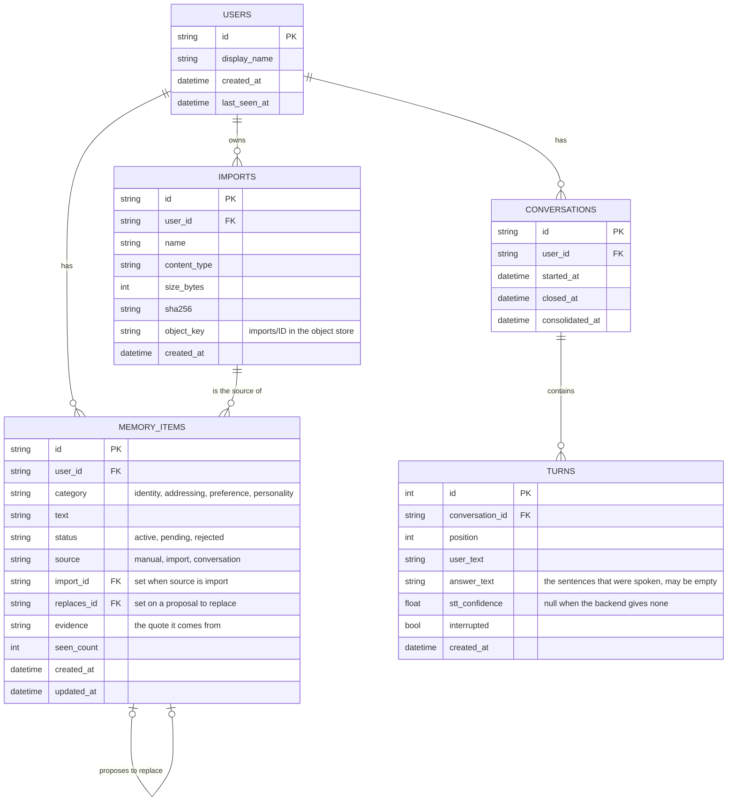

# Conversation memory — application database, identity and object store

## Scope

Part of [Conversation memory](plan.md): the problem, the requirements, the diagrams of
the whole system and the slices are there. This file holds where the
data of a user lives and how a user is named; what is stored there and why is in
`plan-memory.md`.


## Decisions made

### Application database

- **One database for system and user information**, reached through `DATABASE_URL`
  (default: a SQLite file, `backend/data/app.db`, gitignored). At deployment the same
  key points at PostgreSQL. It holds the users, everything of the memory (items,
  imports, conversations, turns) and, later, whatever else is per user or system-wide
  (the persona configuration of the roleplay work is expected here; it is not designed
  in this plan).
- **SQLite first, to verify the whole flow locally; the engine is decided at
  deployment.** What keeps that later move cheap is decided now:
  - **SQLAlchemy Core** (`backend/utils/database.py`): one engine built from
    `DATABASE_URL`. Features keep the existing rule — all the SQL of a feature is in its
    `store.py` — and write it against SQLAlchemy, so no store names an engine and
    nothing SQLite-only is used. This applies to the new tables only.
  - **No migration tool yet.** The tables are created at startup when they are missing.
    Local data is disposable while the schema still moves; Alembic comes with the first
    deployment that has data to keep.
  - The store tests take the database from `DATABASE_URL`, so the same tests run against
    PostgreSQL the day there is one.
  - **A synchronous engine.** Stores are plain blocking classes and the services call
    them through `asyncio.to_thread`, like the knowledge base; there is no async driver.
  - **`utils/database.py` is the only module that knows engines.** It owns the one
    `MetaData` every feature declares its tables on, and hands a store a transaction
    (`Database.begin()`); a failure reaches the caller as `DatabaseError`, so no store
    or service names SQLAlchemy's errors, an engine or `sqlite3`. For a SQLite file it
    creates the parent directory and turns foreign keys on for each connection.
  - **Created inside the lifespan, never at import.** `backend.main` stays importable
    with no side effect. An unreachable `DATABASE_URL` stops the startup with the
    reason (the password of the URL left out); a URL that cannot be parsed (no dialect,
    a port that is no number) takes the same path, with a fixed text that repeats no
    part of the URL.
  - Ids are `uuid4().hex`; timestamps are timezone-aware UTC on every engine (SQLite
    keeps no timezone: a column type of `utils/database.py` restores it).
  - Slice 2 creates `users` and `memory_items` only, the latter with all its columns
    at once (there is no migration tool). `replaces_id` is a self foreign key;
    `import_id` is a plain nullable column until the table `imports` arrives (slice 3).
    `imports`, `conversations` and `turns` come with their slices.
  - Slice 3 creates `imports`, and `memory_items.import_id` becomes a foreign key to
    it. There is still no migration tool and no migration code: a database file created
    by slice 2 is disposable. Opened as it is, it gains the table `imports` and keeps
    its old `memory_items` without the constraint; deleting the file gives the new
    shape.
  - Slice 4 creates `conversations` and `turns`, as in the data model below. A
    conversation's row is written with its first recorded turn; `turns` reaches its
    user through its conversation, the one per-user table without a `user_id` column
    of its own. `turns.id` is the one integer key (it only orders the rows).
- Every per-user table carries `user_id` (a foreign key to `users`) and every store
  method takes it: no query reads across users. Two housekeeping methods of the memory
  store run at startup for every user and name none: deleting the turns past their TTL
  and listing the conversations left to consolidate. They give back ids and a count.
- **The knowledge base keeps its own sqlite-vec file**: it is a vector index, replaced
  on its own schedule, and it is shared by all users today. Making documents per user
  is a separate change.
- Not solved by the database: the backend serves **one** WebSocket connection and one
  camera (a kiosk). Many simultaneous users need a session per connection in the
  orchestrator; that is its own plan.

### Identity

- Table `users`: `id, display_name, created_at, last_seen_at`. A guest has no row.
- The user id reaches the backend through one function, `current_user_id()`
  (`features/accounts/identity.py`), used by the WebSocket endpoint and the memory
  routes. Until the login exists it returns `AUTH_DEV_USER_ID` from the config (empty =
  guest, the default) and creates that user's row on first use. The login replaces the
  body of that function and nothing else.
- `main.py` resolves the id and hands it to `Orchestrator.handle_connect`; the core
  never resolves identity itself. `None` means guest.
- `current_user_id(config, users)` is a plain blocking function: it is given the config
  and the users store, returns `None` for a guest, and sets `last_seen_at` on each
  call. Its callers run it in a thread: the `/ws` endpoint before `handle_connect`, and
  one FastAPI dependency shared by every memory route (a guest → `401`).
- The display name of the development user is its id.
- A database failure while resolving the user does not refuse the WebSocket: the
  person is connected as a guest and the error is logged (the memory never costs the
  turn). On the memory routes the same failure is a `502`.

### Object store

- **One object store for all users** (`backend/utils/object_store.py`): `put`, `get`,
  `delete` by key. The first backend is a directory, `OBJECT_STORE_DIR`
  (`backend/data/objects/`, gitignored); an S3-compatible store replaces that one class.
  The store knows nothing about users: the key is `imports/<import_id>`, and who owns
  an object is recorded in the database only.
- Slice 3, the directory backend: one class, `put(key, data)`, `get(key)`,
  `delete(key)`.
  - A key that holds nothing is `ObjectNotFound` on `get`, and harmless on `delete`.
  - A key is a relative path of plain names. `..`, an absolute path, a backslash, an
    empty part or a link leading out of the directory is refused (`InvalidObjectKey`):
    a key can never leave the directory.
  - A write is atomic: the bytes go to a temporary file beside their place, which is
    then renamed. An object is whole or absent.
  - Any other failure of the directory is `ObjectStoreError`; no caller names `OSError`.
  - Every method blocks; callers use a thread. The directory is created by the first
    `put`, not at startup.
  - An object is never served by its key: the memory reads it through the row of the
    import and its `user_id`.

### Data model (application database)



`CONVERSATIONS` and `TURNS` hold rows for logged-in users only, and a conversation's
turns are deleted once it is consolidated. The original bytes of an import are not in
the database: `IMPORTS.object_key` points into the object store.

### Config keys

In `backend/config.py` (per-machine values), listed in `.env.example`: `DATABASE_URL`
(default `sqlite:///backend/data/app.db`; kept out of `repr(config)`, it may hold a
password), `AUTH_DEV_USER_ID` (default empty = guest), `OBJECT_STORE_DIR` (default
`backend/data/objects`, must not be empty).

## Implementation approach

```
backend/
  utils/database.py                  engine from DATABASE_URL, tables created at startup
  utils/object_store.py              ObjectStore: put / get / delete, directory backend
  features/accounts/
    identity.py                      current_user_id()
    store.py                         users
  main.py                            resolves the user id, hands it to handle_connect
```

## To-do

- [x] Slice 2 — `utils/database.py`, `DATABASE_URL`, tables created at startup;
      SQLAlchemy in `requirements.txt`
- [x] Slice 2 — `features/accounts/` (users, `current_user_id()`), `AUTH_DEV_USER_ID`,
      user id through `handle_connect`
- [x] Slice 3 — `utils/object_store.py` (`OBJECT_STORE_DIR`)
- [x] Slice 4 — tables `conversations` and `turns`
- [x] Unit tests per `test-plan.md`: Database, Identity, Object store, Config
