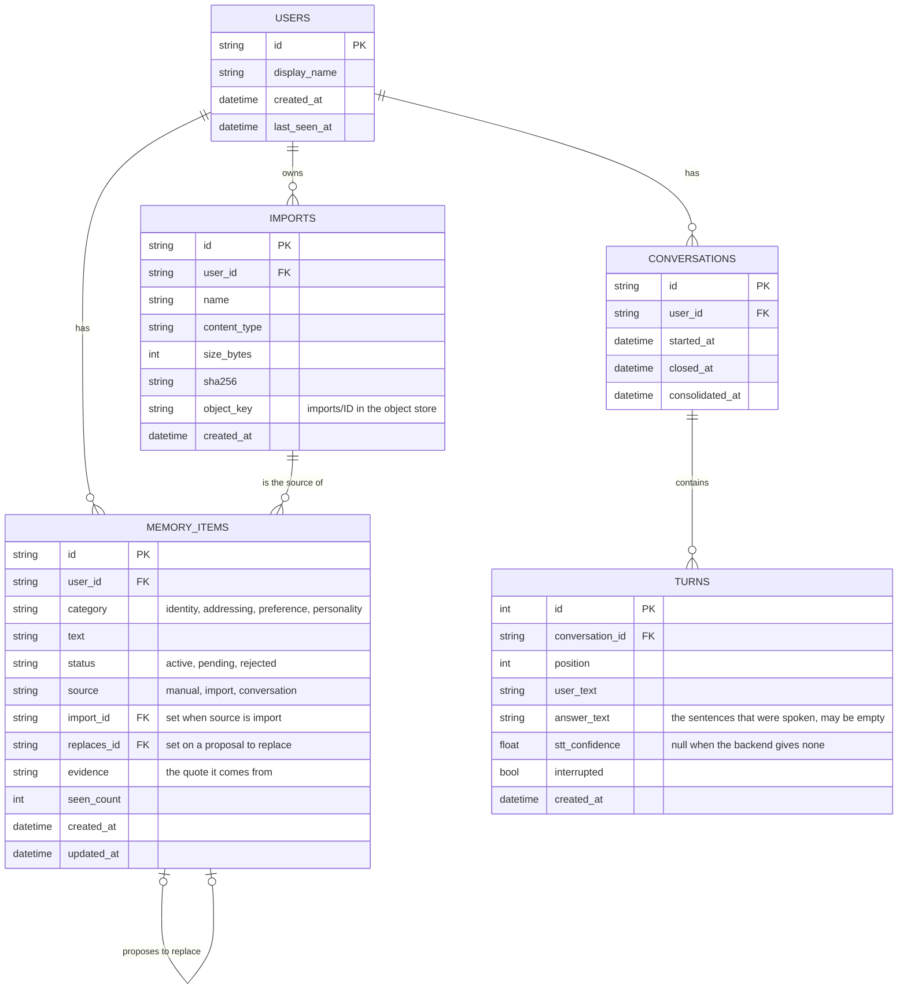

# Conversation memory — application database, identity and object store

## Scope

Part of [Conversation memory](plan.md): the problem, the requirements, the diagrams of
the whole system and the slices are there. This file holds where the
data of a user lives and how a user is named; what is stored there and why is in
`plan-memory.md`.


## Decisions made

### Application database

- **One database for system and user information**, reached through `DATABASE_URL`
  (default: a SQLite file, `backend/data/app.db`, gitignored). At deployment the same
  key points at PostgreSQL. It holds the users, everything of the memory (items,
  imports, conversations, turns) and, later, whatever else is per user or system-wide
  (the persona configuration of the roleplay work is expected here; it is not designed
  in this plan).
- **SQLite first, to verify the whole flow locally; the engine is decided at
  deployment.** What keeps that later move cheap is decided now:
  - **SQLAlchemy Core** (`backend/utils/database.py`): one engine built from
    `DATABASE_URL`. Features keep the existing rule — all the SQL of a feature is in its
    `store.py` — and write it against SQLAlchemy, so no store names an engine and
    nothing SQLite-only is used. This applies to the new tables only.
  - **No migration tool yet.** The tables are created at startup when they are missing.
    Local data is disposable while the schema still moves; Alembic comes with the first
    deployment that has data to keep.
  - The store tests take the database from `DATABASE_URL`, so the same tests run against
    PostgreSQL the day there is one.
- Every per-user table carries `user_id` (a foreign key to `users`) and every store
  method takes it: no query reads across users.
- **The knowledge base keeps its own sqlite-vec file**: it is a vector index, replaced
  on its own schedule, and it is shared by all users today. Making documents per user
  is a separate change.
- Not solved by the database: the backend serves **one** WebSocket connection and one
  camera (a kiosk). Many simultaneous users need a session per connection in the
  orchestrator; that is its own plan.

### Identity

- Table `users`: `id, display_name, created_at, last_seen_at`. A guest has no row.
- The user id reaches the backend through one function, `current_user_id()`
  (`features/accounts/identity.py`), used by the WebSocket endpoint and the memory
  routes. Until the login exists it returns `AUTH_DEV_USER_ID` from the config (empty =
  guest, the default) and creates that user's row on first use. The login replaces the
  body of that function and nothing else.
- `main.py` resolves the id and hands it to `Orchestrator.handle_connect`; the core
  never resolves identity itself. `None` means guest.

### Object store

- **One object store for all users** (`backend/utils/object_store.py`): `put`, `get`,
  `delete` by key. The first backend is a directory, `OBJECT_STORE_DIR`
  (`backend/data/objects/`, gitignored); an S3-compatible store replaces that one class.
  The store knows nothing about users: the key is `imports/<import_id>`, and who owns
  an object is recorded in the database only.

### Data model (application database)



`CONVERSATIONS` and `TURNS` hold rows for logged-in users only, and a conversation's
turns are deleted once it is consolidated. The original bytes of an import are not in
the database: `IMPORTS.object_key` points into the object store.

### Config keys

In `backend/config.py` (per-machine values), listed in `.env.example`: `DATABASE_URL`,
`AUTH_DEV_USER_ID`, `OBJECT_STORE_DIR`.

## Implementation approach

```
backend/
  utils/database.py                  engine from DATABASE_URL, tables created at startup
  utils/object_store.py              ObjectStore: put / get / delete, directory backend
  features/accounts/
    identity.py                      current_user_id()
    store.py                         users
  main.py                            resolves the user id, hands it to handle_connect
```

## To-do

- [ ] Slice 2 — `utils/database.py`, `DATABASE_URL`, tables created at startup;
      SQLAlchemy in `requirements.txt`
- [ ] Slice 2 — `features/accounts/` (users, `current_user_id()`), `AUTH_DEV_USER_ID`,
      user id through `handle_connect`
- [ ] Slice 3 — `utils/object_store.py` (`OBJECT_STORE_DIR`)
- [ ] Unit tests per `test-plan.md`: Database, Identity, Object store, Config
