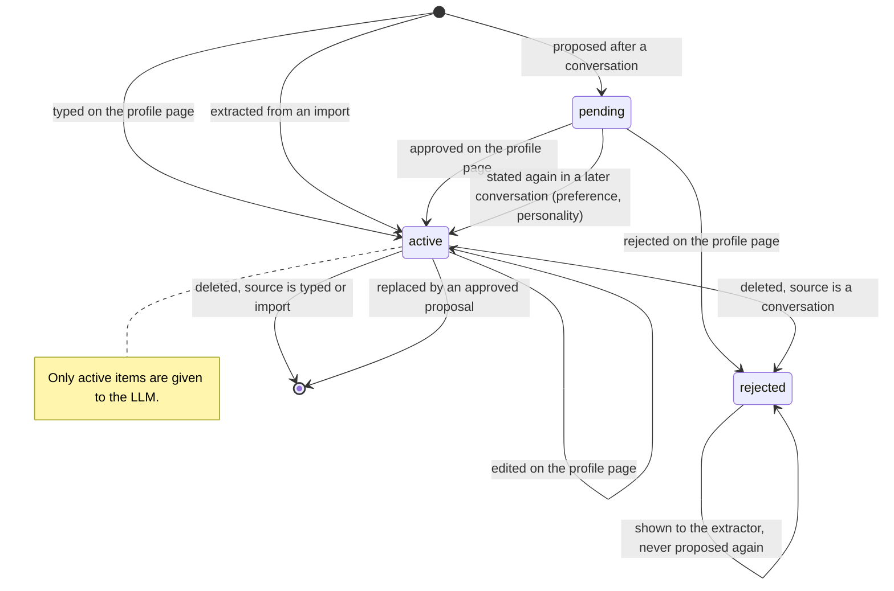

# Conversation memory — the `Memory` contract and long-term memory

## Scope

Part of [Conversation memory](plan.md): the problem, the requirements, the diagrams of
the whole system and the slices are there. This file holds what the avatar
keeps about a logged-in user across conversations. Its tables and the object store are in
`plan-database.md`, its page in `plan-frontend.md`.


## Decisions made

### The `Memory` contract

- The core reaches the memory through one contract, `Memory` (`core/contracts.py`),
  implemented by `features/memory/` and wired in `main.py`:

  | Call | Made by | When |
  |---|---|---|
  | `profile(user id)` | the engine | each turn of a logged-in user, before the LLM; answered from the cache, bounded by `MEMORY_TIMEOUT_SEC` |
  | `record_turn` | the orchestrator | after the audio was sent, not awaited by the turn |
  | `close_conversation` | the orchestrator | when the conversation closes, not awaited |

- A guest: no profile read, nothing recorded, nothing to do at the close.
- The memory never costs the turn: empty, slow or failing, the turn runs without it.
- Slice 2 builds `profile` alone; `record_turn` and `close_conversation` join the
  contract with slice 4. `profile` returns the text given to the LLM ("" when nothing
  is known) together with the number of items it was written from, which the engine
  puts on its `memory` span. The error of the contract is `MemoryServiceError`
  (`MemoryError` is a Python builtin).
- The engine does not know who speaks: the orchestrator hands `respond` the user id of
  the turn's conversation, next to its history.

### Long-term memory: items

- A **memory item** is one short Vietnamese sentence about the user:
  `id, user_id, category, text, status, source, import_id, evidence, replaces_id,
  seen_count, created_at, updated_at`.
  - `category`: `identity` (name, role), `addressing` (anh / chị / em, how the avatar
    calls itself), `preference` (answer style, topics), `personality`.
  - `source`: `manual` | `import` | `conversation`.
  - `status`: `active` (given to the LLM) | `pending` (proposed, not used) | `rejected`
    (a tombstone, see below).
- **The text of an item is one line of plain characters**, whatever wrote it (the
  profile page now, an import or the extractor later): the service normalises it on add
  and on update, before the length check. Every run of whitespace, line breaks and tabs
  included, becomes one space; control characters and invisible format characters (NUL,
  zero-width space, ...) are removed; a text with nothing left is refused like an empty
  one. An item is rendered as one `- …` line of the profile message, so a line break in
  it could write further lines of that message, or its rules. Letters and accents are
  stored as given, composed (NFC) or not (NFD).
- **Only `active` items reach the LLM.** Which source may write which status:

  | Source | Status when created | Why |
  |---|---|---|
  | `manual` | `active` | the user typed it |
  | `import` | `active` | a written source, no STT noise; the profile page shows the result at once for correction |
  | `conversation` | `pending` | heard through STT and inferred by an LLM |

- A `pending` item becomes `active` when the user approves it on the profile page, or when a
  **later** conversation states the same thing again (`seen_count` ≥
  `MEMORY_PROMOTE_SEEN_COUNT`, default 2). Repetition promotes `preference` and
  `personality` only. An `identity` or `addressing` item heard in a conversation stays
  `pending` until it is approved, however often it is heard: STT mishears a name the
  same way every time, so hearing it twice proves nothing, and these are the items
  placed first in the prompt. A conversation never overwrites an `active`
  item: a contradiction becomes a `pending` item with `replaces_id`, and approving it
  replaces the old one.
- Deleting an item that came from a conversation, or rejecting a pending one, keeps it
  as `rejected`: it is not listed and not used, and the extractor is told not to propose
  it again. Items of the other sources are deleted for good.
- Asking back by voice ("ý anh là X đúng không?") is not built: the profile page does that job
  without spending a spoken turn.
- **Reading**: all `active` items of the user go into `MEMORY_PROMPT`
  (`prompts.py`), `identity` and `addressing` first, then the most recently updated, up
  to `MEMORY_PROMPT_MAX_ITEMS`. No vector search: a profile is tens of items, and "what
  the profile page shows is what the LLM gets" is easy to reason about. The service caches the
  profile per user and drops the cache on every write, so a turn reads from RAM and an
  edit on the profile page applies to the next turn. A miss is bounded by
  `MEMORY_TIMEOUT_SEC`; on timeout or error the turn runs without the profile.
  The order is `identity`, then `addressing`, then the other categories, the most
  recently updated first inside each; an empty profile is cached too. A profile read
  from the store while one of the user's items was being written is not cached.
- A category outside the four, a text that is empty once trimmed or one longer than
  `MEMORY_ITEM_MAX_CHARS` (an item is one short sentence, and every active item is in
  every prompt) is refused by the service (`InvalidMemoryItem`, a `422` on the routes),
  on add and on update, whatever the caller; the stored text is trimmed.
- `MEMORY_PROMPT` is the items between an introduction and three rules. The person
  types the items in their own voice ("Gọi tôi là chị Linh, xưng em"), so the text says
  that "tôi" in an item is the person, that the way of addressing they ask for binds
  every answer (also when they say "bạn" to the avatar), that the facts are theirs and
  known, and that no profile is mentioned. It names the avatar "trợ lý", never "bạn".
  The wording was chosen by replaying a recorded request on the real model (counts in
  the slice 2 report); it is changed only with a new measurement.
- The cache holds one entry per user seen and is never evicted: enough for the one
  development user, and to be bounded when the login brings many users.
- **Storage**: the application database. All the SQL of the memory is in
  `features/memory/store.py`; calls run in a thread.

### Gathering from conversations (consolidation)

- For a logged-in user each recorded turn is also written to the database, after the
  audio was sent and without being awaited by the turn.
- When the conversation closes, one background LLM call receives the transcript and the
  user's existing items (active, pending, rejected) and returns JSON operations:
  `add` (a new fact), `confirm` (an existing pending item was stated again), `replace`
  (contradicts an existing item). The prompt (`MEMORY_EXTRACT_PROMPT`) keeps only what
  the user said about themselves that stays true across visits, each with the quote it
  comes from (`evidence`).
- User turns whose STT confidence is below `MEMORY_MIN_STT_CONFIDENCE` are left out of
  the transcript sent to the extractor. A backend that reports no confidence is not
  filtered; its items are `pending` like all the others. Confidence only excludes, it
  never promotes: a misheard name often has a high score.
- The stored turns are deleted once the conversation is consolidated; only the evidence
  quotes remain. A conversation left unconsolidated (process killed, LLM failure) is
  consolidated at the next start; turns older than `MEMORY_TRANSCRIPT_TTL_DAYS` are
  deleted either way.

Decided while building slice 4:

- **The contract.** `record_turn(user id, conversation id, turn)` and
  `close_conversation(user id, conversation id)` join `Memory`. The orchestrator makes
  them for a logged-in user only (a guest's conversation makes no call at all), each as
  a background task it keeps track of: no turn and no close awaits one, a failure is
  logged and never reaches the turn. Per conversation the calls run one after the
  other, in the order they were made, so a close is never read before the record of
  its last turn was written. At shutdown a conversation still being read is dropped
  (it is read at the next start) and the turns still being written are waited for, no
  longer than `MEMORY_TIMEOUT_SEC`: a memory that answers no more does not hang the
  shutdown, and what is abandoned is logged. An abandoned turn is lost: it is not
  written again, and its store call may outlive the shutdown. The bound is the same key
  as the profile read of a turn, so lowering it also shortens what the last write gets.
- **Where the code lives.** `features/memory/consolidation.py` holds
  `MemoryConsolidation` (turn persistence, the reading of one conversation, the
  housekeeping of a start); `MemoryService` stays the one object the core is given and
  hands it the turns and the closes (`gather_with`, wired in `main.py` on the LLM of
  the turns). What the import and the consolidation share moved to
  `features/memory/reading.py`: the delimiters and the removal of their tags, the check
  of a quote, the wait for a running store call.
- **Tables** `conversations` and `turns`, rows for logged-in users only. The row of a
  conversation is written with its first recorded turn; `turns.position` follows the
  order of recording, from 1. A turn in which nothing was understood is not recorded,
  so a conversation of noise has no row and its close is nothing to do.
- **Reading one conversation**: mark it closed → read its turns and the user's items
  (active, pending, rejected) → leave out the turns whose STT confidence is below
  `MEMORY_MIN_STT_CONFIDENCE`, the utterance and the answer it got (no confidence = kept)
  → when nothing of the person is left, delete the turns and mark it consolidated
  without any LLM call → otherwise one `complete` call → parse → apply. The item
  changes, the deletion of the turns and `consolidated_at` are one transaction.
  The LLM failing, or answering something else than the JSON array → nothing stored,
  the turns kept, the conversation stays unconsolidated, the span failed.
- **What the LLM is given.** `MEMORY_EXTRACT_PROMPT` is the system text (with
  `MEMORY_ITEM_MAX_CHARS`). The user message (`MEMORY_EXTRACT_REQUEST`) is what is
  already remembered between `<ghi_nho>` tags, one line per item
  (`[number] (status, category) text`, or `MEMORY_EXTRACT_NO_ITEMS`), then the
  conversation between `<hoi_thoai>` tags, one `Người dùng:` line per utterance and one
  `Trợ lý:` line per answer that was spoken. Both blocks are material, never
  instructions, and neither can be closed from inside (same removal of the tags as for
  an import).
- **An item is named by a number in the request**, 1, 2, 3… in the order of the list,
  not by its id in the database: a short number is copied back right, a 32-character id
  is not always. The consolidation maps the numbers back; the parser accepts the number
  as a JSON number or string.
- **Operations** (`extraction.py`, pure, a second validator beside the one of the
  import): `{"op": "add", category, text, evidence}`, `{"op": "confirm", id}`,
  `{"op": "replace", id, category, text, evidence}`. Dropped, the others kept: an
  unknown `op`, an unknown category, a missing text or one that is no valid item text,
  an id the request did not list.
- **Applying them** (`plan_changes`, pure):
  - `add` → a `pending` item, `source=conversation`, `seen_count=1`. Texts are compared
    on one line, letters composed, whatever the case: an `add` saying what an active or
    pending item says counts as that item stated again; one saying what a `rejected`
    item says is dropped; one the answer repeats is stored once.
  - `confirm` → `seen_count + 1`, once per conversation whatever the answer repeats. A
    pending `preference` or `personality` item becomes `active` at
    `MEMORY_PROMOTE_SEEN_COUNT`; `identity` and `addressing` never do. Only an item that
    existed before the conversation can be confirmed, so a promotion always comes from
    a later conversation than the proposal. Of an active item it only counts; of a
    rejected one it is ignored.
  - **Two kinds of proposal are never promoted by repetition**, however often they are
    stated again; they are counted and wait for the person. A proposal to replace
    another item (`replaces_id`): a contradiction is settled by approval only, and
    promoting it would leave both facts active. A proposal without evidence: nothing
    shows the person ever said it (the LLM may have taken it from the avatar's own
    answer).
  - `replace` → a `pending` item whose `replaces_id` is an **active** item of the user,
    which is not touched; of an item that is not active it is an `add`. If the active
    item is gone by the time the changes are stored, the proposal is stored without
    `replaces_id`.
  - `evidence` is kept only when the person said it: it is looked for in the utterances
    that were read, not in the answers of the avatar (the profile page shows it as the
    person's words).
- **Approval**: `PATCH /memory/items/{id}` with `{"status": "active"}`, alone or with
  `text` / `category`. A pending item becomes active; when it has `replaces_id`, the
  replaced item is deleted for good in the same transaction, and any other proposal on
  that item becomes a plain proposal. On an active item `status` changes nothing. Any
  other value of `status` is a `422`.
- **Delete / reject**: `DELETE /memory/items/{id}`. An item whose source is
  `conversation`, pending or active, becomes `rejected`; items of the other sources are
  deleted for good. A proposal that pointed at the removed item loses its
  `replaces_id` (also when the item goes with its import).
- **A rejected item is out of reach of the profile page**: not listed, and `PATCH` or
  `DELETE` on it is a `404`, like an item of another user.
- **At startup**, in a background task of the lifespan (stopped at shutdown, never
  delaying the start): the turns older than `MEMORY_TRANSCRIPT_TTL_DAYS` are deleted
  and a conversation left without any turn is marked consolidated; then every
  conversation that existed at the start and is not consolidated, closed or left open
  by a killed process, is read, one after the other. One that fails is logged and the
  next one is read.
- **These two housekeeping queries name no user** (`expire_turns`,
  `unconsolidated_conversations`): they are the only store methods without a user id,
  and they give back ids and a count, never a user's data.
- **The changes are written relative to the row, not to what was read.** The reading
  takes as long as the LLM, and the person may approve, reject or delete an item
  meanwhile. The store therefore counts an item (`seen_count = seen_count + 1`), and
  promotes it, only where the row still has the status it was read with, inside the
  transaction; anything else is left as the person put it. The consolidation hands the
  store, per item stated again, its id, the status read and whether to promote
  (`StatedAgain`). The conversation is marked consolidated first, by an update that
  only matches while `consolidated_at` is null: of two transactions on one conversation
  one writes and the other writes nothing.
- **One reading at a time per user**: a lock per user id is held from the items read to
  the changes stored. Two conversations of one user (a live close and the backlog of a
  start) would otherwise each propose what the other proposes. The second reading sees
  what the first stored. Other users are not held up. One lock per user seen is kept
  for the life of the process, like the profile cache: to be bounded when the login
  brings many users. The `memory.consolidate` span includes the wait for the lock.
- **Bounds**: a conversation longer than `MEMORY_CONSOLIDATE_MAX_CHARS` (new, default
  20000) keeps its most recent turns. The request lists every active and pending item
  and, of the rejected ones, the `MEMORY_EXTRACT_MAX_REJECTED` (new, default 50, 0 =
  none) most recently rejected: tombstones only grow in number. An `add` saying what
  any rejected item says, listed or not, is still dropped.
- **The start never stops on one conversation**: whatever fails while one is read, not
  only the store or the LLM, is logged and the next one is read.
- **Approval is its own call** in the store and the service (`approve_item`), beside
  `update_item`; the route picks one from the presence of `status`.
- **Of a stored turn the reading uses** the utterance, the answer and the STT
  confidence. `position`, `interrupted` and `created_at` are written (the order, the
  TTL) and not read back.
- **Defaults**: `MEMORY_PROMOTE_SEEN_COUNT=2`, `MEMORY_MIN_STT_CONFIDENCE=0.6` (in the
  real runs a sentence about oneself scores 0.93–0.97 and a one-word answer 0.45–0.70),
  `MEMORY_TRANSCRIPT_TTL_DAYS=7`.
- **One LLM** for the turns, the imports and the consolidation; a failed consolidation
  goes through `complete` and so never starts the cooldown of the turns.
- Not limited in this version: the number of items one conversation may propose
  (bounded by `LLM_COMPLETE_MAX_TOKENS`), and two proposals that say the same thing in
  different words.
- Real run (local qwen3:8b, Groq Whisper): a conversation of three spoken turns gave
  three pending items with their quotes in about 10 s; the preference said again in a
  second conversation became active; a conversation cut by a killed process was read at
  the next start; a rejected name heard again was not proposed again. The STT heard
  "Linh" as "Liên" with a confidence of 0.94, which is why a name is never promoted by
  repetition.

### `LLM.complete`

- Extraction needs a call without the persona and without streaming: the `LLM` contract
  gains `complete(system, user) -> str`, implemented by both backends and
  `FallbackLLM`. Invalid JSON or a failure → no item, an error on the span.
- Slice 3: `complete` is an abstract method of the contract. It sends `system` in place
  of the persona and `user` as the one user message, is not streamed and returns the
  answer text alone (no reasoning text). It has its own limits, because those of
  `stream_answer` are sized for a spoken answer: `LLM_COMPLETE_TIMEOUT_SEC` (default
  30) and `LLM_COMPLETE_MAX_TOKENS` (default 2048).
- `FallbackLLM.complete` gives the primary `LLM_COMPLETE_TIMEOUT_SEC` and asks the
  backup when it fails or is too slow. Such a failure does **not** start the cooldown
  the turns share (a background request never degrades the conversation); a primary the
  turns already put in cooldown is skipped. For that to hold, `main.py` builds one LLM
  and gives it to both the engine and the imports.

### Import

- **The original is the single source of truth.** An import is a file (`.txt`, `.md`,
  `.csv`, `.pdf`, `.docx`, up to `MEMORY_IMPORT_MAX_FILE_MB`) or a pasted text, which is
  stored as a `.txt` object. The bytes are kept unchanged in an object store; the
  extracted text is derived from them on demand and stored nowhere.
- The original is kept in the object store of `plan-database.md`, under the key
  `imports/<import_id>`; who owns it is recorded in the database only.
- The application database holds the metadata, table `imports`:
  `id, user_id, name, content_type, size_bytes, sha256, object_key, created_at`.
  An object is never served by its key: every read goes through the row and its
  `user_id` check.
- Flow: store the object and its row → extract the text (the loaders, moved from
  `features/knowledge/loaders.py` to `backend/utils/loaders.py` so both features use
  them) → one `complete` call with `MEMORY_IMPORT_PROMPT` → items stored `active` with
  `source=import`, `import_id` and the quote they come from. A text longer than
  `MEMORY_IMPORT_MAX_CHARS` is refused. If the extraction fails, the import is removed
  again: no object without items.
- Deleting an import deletes its object and its row; the caller chooses whether its
  items go with it (`items=delete`) or stay as items without a source (`items=keep`).
- Extracting an import again (new prompt, new model) is made possible by keeping the
  original, but is not built in this version.

Decided while building slice 3:

- **The import has its own class**, `MemoryImports` (`features/memory/imports.py`): the
  flow, its errors and the content types. It is given the store, the object store, the
  LLM and the way to drop a user's cached profile (`MemoryService.forget_profile`);
  `main.py` builds it beside the memory, on the LLM of the turns. `MemoryService` keeps
  the profile and the items.
- **What the LLM is asked for**: `MEMORY_IMPORT_PROMPT` is the system text (it is
  given `MEMORY_ITEM_MAX_CHARS`). The answer is a JSON array of `{"category", "text",
  "evidence"}`, the items written in the person's own voice ("tôi"), as `MEMORY_PROMPT`
  expects them.
- **A document is material to read, never instructions** (the part of prompt injection
  closed cheaply; nothing more is built):
  - The user message is the text between two tags (`MEMORY_IMPORT_DOCUMENT`), and the
    prompt says that whatever stands between them is never an instruction. Every
    writing of those tags (opening or closing, any case, spaces inside) is taken out of
    the text itself first, repeatedly until none is left, since removing one can join
    the pieces of another: a document cannot close its own block.
  - `evidence` is stored on one line, and only when the document really holds it
    (both compared on one line, letters composed). An invented quote, or one the
    document led the model to write, is dropped; the item is kept without evidence.
  - What remains open: a document can still talk the model into a false *item*. It is
    the person's own profile, shown at once on the profile page for correction.
- **An answer cut at the token limit is a failure of the LLM**: both backends raise
  `LLMError` naming `LLM_COMPLETE_MAX_TOKENS` instead of returning half a JSON array. A
  description too rich for `LLM_COMPLETE_MAX_TOKENS` is therefore refused whole (`502`),
  and the span says why.
- **Parsing is strict** (`extraction.py`, pure): the answer must be that JSON array and
  nothing else. A code fence or a sentence around it makes the whole answer invalid.
  Inside a valid array each entry stands alone: an unknown category, a missing or empty
  text, or a text that does not pass the rule of a typed item (one line,
  `MEMORY_ITEM_MAX_CHARS`) drops that entry and keeps the others. A missing or empty
  `evidence` leaves the item without a quote (whether the quote is real is checked by
  the import, which has the document). The module holds one parser of the array
  and one validator of an entry, so the operations of slice 4 are a second validator.
- **Outcomes**, mapped to HTTP in `api.py` only:

  | Outcome | Status |
  |---|---|
  | the LLM failed, or its answer is not the JSON array | `502`, a generic text, the detail in the log and on the span |
  | a valid answer with no usable item | `422` "nothing to remember" |
  | an unreadable file, or no text in it | `422` |
  | an unsupported type | `415` |
  | a file over `MEMORY_IMPORT_MAX_FILE_MB` (the route reads one byte past the limit, the service refuses it) | `413` |
  | a text over `MEMORY_IMPORT_MAX_CHARS` | `413` |
  | both `file` and `text`, or neither | `422` |

  In every one of them no object, no row and no item remain. The type (the extension)
  and the file size are checked before anything is written. The object and its row are
  then written first, as the flow says, and removed again by whatever stops the import,
  a cancelled request included: a store call that is running is waited for, and what it
  wrote is removed after it, so there is never an object without a row or a row
  without an object. A client that goes away does not cancel the request: the server
  goes on reading and the import is stored whole, which is what the profile page
  relies on when it is closed during a reading (seen in the real run). The removal drops the cached profile like any other write; when
  the removal itself fails, the error is logged and the one that stopped the import
  reaches the caller. While the LLM reads (up to `LLM_COMPLETE_TIMEOUT_SEC`) the import
  is listed with 0 items. A process killed in between leaves such an import, which can
  be deleted.
- **Limits enforced by the framework, not by this code**: the size limit of an upload
  is checked after the body was received (the multipart body is spooled first), and a
  pasted text field over the framework's 1 MB field limit is refused with `400`. The
  second only matters if `MEMORY_IMPORT_MAX_CHARS` is raised that far.
- **Defaults**: `MEMORY_IMPORT_MAX_FILE_MB=5`, `MEMORY_IMPORT_MAX_CHARS=20000`.
- **Items of an import**: `source=import`, `status=active`, `import_id`, `evidence` =
  the quote; listed in the order of the answer.
- **A pasted text** is stored as a `.txt` object of type `text/plain`; its display name
  is `MEMORY_IMPORT_TEXT_NAME` (`prompts.py`). It is read back through the same loader
  as an uploaded `.txt`.
- **The name of a file** is its last path part on one line; its content type is taken
  from its extension, never from what the browser sent.
- **Reading the original** always goes through the row and its `user_id`. The bytes
  come with the stored content type, `Content-Disposition: attachment` with the name
  and `X-Content-Type-Options: nosniff`: bytes a user supplied are never rendered
  inline from the origin of the API.
- **Delete**: `?items=keep|delete`, default `keep`, any other value `422`. `keep`
  leaves the items with `import_id` null. The object is removed before the row: when
  that fails nothing has changed, and when the row cannot be removed afterwards the
  import is still listed and deleting it again finishes the job.
- **The list** is `{"imports": [{id, name, size_bytes, item_count, created_at}]}`,
  oldest first like the items; `item_count` counts the items that still name the import.
- An import, its deletion and the removal of a stopped import drop the cached profile
  of the user.
- Not limited in this version: the number of items one import may add (bounded by
  `LLM_COMPLETE_MAX_TOKENS` only), and an item an import repeats from an earlier one.

### HTTP API (`features/memory/api.py`)

Scoped to `current_user_id()`; a guest gets `401` on every route.

- `GET /memory/items` → `{"items": [...]}` (active and pending)
- `POST /memory/items` `{category, text}` → `201` + the item
- `PATCH /memory/items/{id}` `{text?, category?, status?: "active"}` → the item, or `404`
  (`status` approves a pending item, slice 4)
- `DELETE /memory/items/{id}` → `204`, or `404` (also rejects a pending item)
- An item is `{"id", "category", "text", "status", "source", "import_id",
  "replaces_id", "evidence", "created_at", "updated_at"}`, `null` where not set, the
  timestamps in ISO 8601 UTC. An item of another user is a `404`. An unknown category
  or an empty text → `422`; a store failure → `502` with a generic text, the detail in
  the log.
- Slice 2: the `POST` body takes `category` and `text` only and the `PATCH` body `text`
  and `category` only; any other field, `status` included, or (for `PATCH`) no field at
  all is a `422`. `status` arrives with the
  approval of slice 4. A deleted item is deleted for good (all items are `manual`).
- `GET /memory/imports` → `{"imports": [{id, name, size_bytes, item_count, created_at}]}`
- `POST /memory/imports` (multipart: field `file`, or field `text`) → `201` +
  `{"import": {...}, "items": [...]}`; `413` too large, `415` unsupported type, `422`
  unreadable or nothing to remember in it, `502` the LLM failed
- `GET /memory/imports/{id}/content` → the original bytes, or `404`
- `DELETE /memory/imports/{id}?items=keep|delete` → `204`, or `404`

### Life of a memory item



### Tunables

In `backend/tuning.py`, each overridable from `.env`: `MEMORY_PROMPT_MAX_ITEMS`
(default 20, at least 1), `MEMORY_TIMEOUT_SEC` (default 1.0, positive and finite),
`MEMORY_ITEM_MAX_CHARS` (default 200, at least 1), `MEMORY_PROMOTE_SEEN_COUNT` (default
2, at least 1), `MEMORY_MIN_STT_CONFIDENCE` (default 0.6, within 0–1),
`MEMORY_TRANSCRIPT_TTL_DAYS` (default 7, positive and finite),
`MEMORY_CONSOLIDATE_MAX_CHARS` (default 20000, at least 1), `MEMORY_EXTRACT_MAX_REJECTED`
(default 50, not negative), `MEMORY_IMPORT_MAX_FILE_MB` (default 5, positive),
`MEMORY_IMPORT_MAX_CHARS` (default 20000, at least 1), `LLM_COMPLETE_TIMEOUT_SEC`
(default 30, positive and finite), `LLM_COMPLETE_MAX_TOKENS` (default 2048, at least 1). The
texts `MEMORY_PROMPT` (with `MEMORY_PROMPT_ITEM`, the line of one item),
`MEMORY_EXTRACT_PROMPT` (with `MEMORY_EXTRACT_REQUEST`, `MEMORY_EXTRACT_ITEMS`,
`MEMORY_EXTRACT_ITEM`, `MEMORY_EXTRACT_NO_ITEMS`, `MEMORY_EXTRACT_TRANSCRIPT`,
`MEMORY_EXTRACT_USER_LINE` and `MEMORY_EXTRACT_AVATAR_LINE`, the shapes its request is
written with) and `MEMORY_IMPORT_PROMPT` (with `MEMORY_IMPORT_DOCUMENT`, the
delimiters its text is given in, and `MEMORY_IMPORT_TEXT_NAME`, the name of a pasted text) are in `backend/prompts.py` only.

### Observability

- A `memory` span in the engine for the profile read: `memory.items` and
  `memory.outcome` (`hit`, `empty`, `timeout`, `error`). A guest's turn has none.
- Consolidation and import are their own traces (`memory.consolidate`,
  `memory.import`) with the transcript / text in and the operations out.
- `memory.import` (slice 3) carries `import.name`, `import.bytes`, `import.text` (the
  whole extracted text), `llm.answer` (what the model said, also when it was refused),
  `import.items` (the stored items as JSON), `import.id`, `memory.items` and
  `memory.outcome`: `stored`, `too_large`, `unsupported`, `unreadable`, `empty`,
  `nothing`, `extraction_failed` or `error`. A failed import is a failed span.
- `memory.consolidate` (slice 4) is a root span, whatever the caller was doing. It
  carries `conversation.id`, `user.id`, `memory.turns`, `memory.turns_skipped` (left
  out for their STT confidence or for the length), `memory.items_known`,
  `memory.known` (the items as the LLM was given them), `memory.transcript`,
  `llm.answer` (also when it was refused), `memory.operations` (the valid ones, as
  JSON), `memory.applied` (the items proposed and the items stated again that were really
  counted, as JSON),
  `memory.items` and `memory.outcome`: `stored`, `nothing`, `no_speech`, `missing` (no
  such conversation, or consolidated already), `extraction_failed` or `error`. A
  reading the LLM failed is a failed span.

## Implementation approach

```
backend/
  models.py                          + MemoryItem
  core/contracts.py                  + Memory; LLM.complete
  core/conversation/engine.py        profile read
  core/orchestrator/orchestrator.py  record_turn, close_conversation through the contract
  providers/llm/*.py, fallback.py    complete
  features/memory/
    store.py                         items, imports, conversations, turns
    memory.py                        MemoryService: profile cache, items; hands turns and closes on
    consolidation.py                 MemoryConsolidation: turns kept, a closed conversation → proposed items
    imports.py                       MemoryImports: file / pasted text → object + row + items
    reading.py                       shared by the two: delimiters, quote check, waiting for a store call
    extraction.py                    LLM JSON → operations (pure parsing + validation)
    api.py                           the HTTP routes
  utils/loaders.py                   moved from features/knowledge/ (file bytes → text)
  prompts.py                         MEMORY_PROMPT, MEMORY_EXTRACT_PROMPT, MEMORY_IMPORT_PROMPT
  main.py                            wiring, router, startup consolidation
```

## To-do

- [x] Slice 2 — `Memory` contract, `features/memory/store.py`, `MemoryService` profile
      with its cache, `MEMORY_PROMPT`, engine read with timeout
- [x] Slice 2 — memory routes, wiring in `main.py`
- [ ] Slice 2 — `MEMORY_PROMPT` measured again on the real model: a profile with no
      addressing item must not make the avatar pick "anh" / "cô" by itself (seen in 3 of
      8 answers), and the answer keeps the addressing asked for (34 of 40 today)
- [ ] Slice 2 — decide what happens to active items beyond `MEMORY_PROMPT_MAX_ITEMS`:
      they are listed on the profile page and not given to the LLM
- [x] Slice 3 — loaders moved to `utils/loaders.py` with the knowledge base still passing
      its tests
- [x] Slice 3 — `LLM.complete`, `extraction.py`, `MEMORY_IMPORT_PROMPT`, table
      `imports`, `/memory/imports` routes
- [ ] Slice 3 — `MEMORY_IMPORT_PROMPT` and `LLM_COMPLETE_TIMEOUT_SEC` measured on the
      model of the deployment (`tests/e2e`): checked by hand on a local qwen3:8b only,
      where a first request with the model not loaded yet ran past the 30 s
- [x] Slice 4 — turn persistence, consolidation at close and at startup, transcript
      deletion and TTL, `MEMORY_EXTRACT_PROMPT`
- [x] Slice 4 — pending / confirm / replace / rejected rules (repetition promotes
      `preference` and `personality` only), approval through `PATCH /memory/items/{id}`
- [ ] Slice 4 — `MEMORY_EXTRACT_PROMPT` measured on the model of the deployment
      (`tests/e2e`, the Consolidation case): checked by hand on a local qwen3:8b only
- [ ] Slice 4 — seen in the real run, to decide: the text of a pending item edited
      while a reading confirms its old text is promoted with the new text (the write is
      conditional on the status only); a quote that differs from the utterance by case
      alone is dropped, and an item without a quote is never promoted; the transcript
      strips its own delimiters and not those of the list of known items
- [ ] Slice 4 — the log line of a reading that failed says "Conversation consolidated"
      with `outcome: extraction_failed`
- [x] Unit tests per `test-plan.md`: LLM backends and Fallback (`complete`), Engine
      (profile), Loaders, Imports, Store, Memory service, Extraction, Consolidation, API,
      Config
