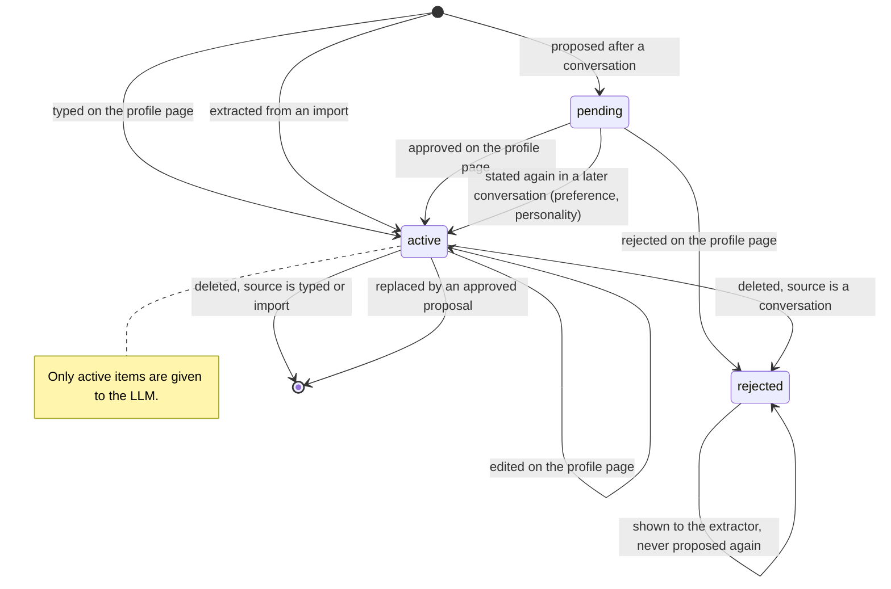

# Conversation memory — the `Memory` contract and long-term memory

## Scope

Part of [Conversation memory](plan.md): the problem, the requirements, the diagrams of
the whole system and the slices are there. This file holds what the avatar
keeps about a logged-in user across conversations. Its tables and the object store are in
`plan-database.md`, its page in `plan-frontend.md`.


## Decisions made

### The `Memory` contract

- The core reaches the memory through one contract, `Memory` (`core/contracts.py`),
  implemented by `features/memory/` and wired in `main.py`:

  | Call | Made by | When |
  |---|---|---|
  | `profile(user id)` | the engine | each turn of a logged-in user, before the LLM; answered from the cache, bounded by `MEMORY_TIMEOUT_SEC` |
  | `record_turn` | the orchestrator | after the audio was sent, not awaited by the turn |
  | `close_conversation` | the orchestrator | when the conversation closes, not awaited |

- A guest: no profile read, nothing recorded, nothing to do at the close.
- The memory never costs the turn: empty, slow or failing, the turn runs without it.
- Slice 2 builds `profile` alone; `record_turn` and `close_conversation` join the
  contract with slice 4. `profile` returns the text given to the LLM ("" when nothing
  is known) together with the number of items it was written from, which the engine
  puts on its `memory` span. The error of the contract is `MemoryServiceError`
  (`MemoryError` is a Python builtin).
- The engine does not know who speaks: the orchestrator hands `respond` the user id of
  the turn's conversation, next to its history.

### Long-term memory: items

- A **memory item** is one short Vietnamese sentence about the user:
  `id, user_id, category, text, status, source, import_id, evidence, replaces_id,
  seen_count, created_at, updated_at`.
  - `category`: `identity` (name, role), `addressing` (anh / chị / em, how the avatar
    calls itself), `preference` (answer style, topics), `personality`.
  - `source`: `manual` | `import` | `conversation`.
  - `status`: `active` (given to the LLM) | `pending` (proposed, not used) | `rejected`
    (a tombstone, see below).
- **The text of an item is one line of plain characters**, whatever wrote it (the
  profile page now, an import or the extractor later): the service normalises it on add
  and on update, before the length check. Every run of whitespace, line breaks and tabs
  included, becomes one space; control characters and invisible format characters (NUL,
  zero-width space, ...) are removed; a text with nothing left is refused like an empty
  one. An item is rendered as one `- …` line of the profile message, so a line break in
  it could write further lines of that message, or its rules. Letters and accents are
  stored as given, composed (NFC) or not (NFD).
- **Only `active` items reach the LLM.** Which source may write which status:

  | Source | Status when created | Why |
  |---|---|---|
  | `manual` | `active` | the user typed it |
  | `import` | `active` | a written source, no STT noise; the profile page shows the result at once for correction |
  | `conversation` | `pending` | heard through STT and inferred by an LLM |

- A `pending` item becomes `active` when the user approves it on the profile page, or when a
  **later** conversation states the same thing again (`seen_count` ≥
  `MEMORY_PROMOTE_SEEN_COUNT`, default 2). Repetition promotes `preference` and
  `personality` only. An `identity` or `addressing` item heard in a conversation stays
  `pending` until it is approved, however often it is heard: STT mishears a name the
  same way every time, so hearing it twice proves nothing, and these are the items
  placed first in the prompt. A conversation never overwrites an `active`
  item: a contradiction becomes a `pending` item with `replaces_id`, and approving it
  replaces the old one.
- Deleting an item that came from a conversation, or rejecting a pending one, keeps it
  as `rejected`: it is not listed and not used, and the extractor is told not to propose
  it again. Items of the other sources are deleted for good.
- Asking back by voice ("ý anh là X đúng không?") is not built: the profile page does that job
  without spending a spoken turn.
- **Reading**: all `active` items of the user go into `MEMORY_PROMPT`
  (`prompts.py`), `identity` and `addressing` first, then the most recently updated, up
  to `MEMORY_PROMPT_MAX_ITEMS`. No vector search: a profile is tens of items, and "what
  the profile page shows is what the LLM gets" is easy to reason about. The service caches the
  profile per user and drops the cache on every write, so a turn reads from RAM and an
  edit on the profile page applies to the next turn. A miss is bounded by
  `MEMORY_TIMEOUT_SEC`; on timeout or error the turn runs without the profile.
  The order is `identity`, then `addressing`, then the other categories, the most
  recently updated first inside each; an empty profile is cached too. A profile read
  from the store while one of the user's items was being written is not cached.
- A category outside the four, a text that is empty once trimmed or one longer than
  `MEMORY_ITEM_MAX_CHARS` (an item is one short sentence, and every active item is in
  every prompt) is refused by the service (`InvalidMemoryItem`, a `422` on the routes),
  on add and on update, whatever the caller; the stored text is trimmed.
- `MEMORY_PROMPT` is the items between an introduction and three rules. The person
  types the items in their own voice ("Gọi tôi là chị Linh, xưng em"), so the text says
  that "tôi" in an item is the person, that the way of addressing they ask for binds
  every answer (also when they say "bạn" to the avatar), that the facts are theirs and
  known, and that no profile is mentioned. It names the avatar "trợ lý", never "bạn".
  The wording was chosen by replaying a recorded request on the real model (counts in
  the slice 2 report); it is changed only with a new measurement.
- The cache holds one entry per user seen and is never evicted: enough for the one
  development user, and to be bounded when the login brings many users.
- **Storage**: the application database. All the SQL of the memory is in
  `features/memory/store.py`; calls run in a thread.

### Gathering from conversations (consolidation)

- For a logged-in user each recorded turn is also written to the database, after the
  audio was sent and without being awaited by the turn.
- When the conversation closes, one background LLM call receives the transcript and the
  user's existing items (active, pending, rejected) and returns JSON operations:
  `add` (a new fact), `confirm` (an existing pending item was stated again), `replace`
  (contradicts an existing item). The prompt (`MEMORY_EXTRACT_PROMPT`) keeps only what
  the user said about themselves that stays true across visits, each with the quote it
  comes from (`evidence`).
- User turns whose STT confidence is below `MEMORY_MIN_STT_CONFIDENCE` are left out of
  the transcript sent to the extractor. A backend that reports no confidence is not
  filtered; its items are `pending` like all the others. Confidence only excludes, it
  never promotes: a misheard name often has a high score.
- The stored turns are deleted once the conversation is consolidated; only the evidence
  quotes remain. A conversation left unconsolidated (process killed, LLM failure) is
  consolidated at the next start; turns older than `MEMORY_TRANSCRIPT_TTL_DAYS` are
  deleted either way.

### `LLM.complete`

- Extraction needs a call without the persona and without streaming: the `LLM` contract
  gains `complete(system, user) -> str`, implemented by both backends and
  `FallbackLLM`. Invalid JSON or a failure → no item, an error on the span.

### Import

- **The original is the single source of truth.** An import is a file (`.txt`, `.md`,
  `.csv`, `.pdf`, `.docx`, up to `MEMORY_IMPORT_MAX_FILE_MB`) or a pasted text, which is
  stored as a `.txt` object. The bytes are kept unchanged in an object store; the
  extracted text is derived from them on demand and stored nowhere.
- The original is kept in the object store of `plan-database.md`, under the key
  `imports/<import_id>`; who owns it is recorded in the database only.
- The application database holds the metadata, table `imports`:
  `id, user_id, name, content_type, size_bytes, sha256, object_key, created_at`.
  An object is never served by its key: every read goes through the row and its
  `user_id` check.
- Flow: store the object and its row → extract the text (the loaders, moved from
  `features/knowledge/loaders.py` to `backend/utils/loaders.py` so both features use
  them) → one `complete` call with `MEMORY_IMPORT_PROMPT` → items stored `active` with
  `source=import`, `import_id` and the quote they come from. A text longer than
  `MEMORY_IMPORT_MAX_CHARS` is refused. If the extraction fails, the import is removed
  again: no object without items.
- Deleting an import deletes its object and its row; the caller chooses whether its
  items go with it (`items=delete`) or stay as items without a source (`items=keep`).
- Extracting an import again (new prompt, new model) is made possible by keeping the
  original, but is not built in this version.

### HTTP API (`features/memory/api.py`)

Scoped to `current_user_id()`; a guest gets `401` on every route.

- `GET /memory/items` → `{"items": [...]}` (active and pending)
- `POST /memory/items` `{category, text}` → `201` + the item
- `PATCH /memory/items/{id}` `{text?, category?, status?: "active"}` → the item, or `404`
- `DELETE /memory/items/{id}` → `204`, or `404`
- An item is `{"id", "category", "text", "status", "source", "import_id",
  "replaces_id", "evidence", "created_at", "updated_at"}`, `null` where not set, the
  timestamps in ISO 8601 UTC. An item of another user is a `404`. An unknown category
  or an empty text → `422`; a store failure → `502` with a generic text, the detail in
  the log.
- Slice 2: the `POST` body takes `category` and `text` only and the `PATCH` body `text`
  and `category` only; any other field, `status` included, or (for `PATCH`) no field at
  all is a `422`. `status` arrives with the
  approval of slice 4. A deleted item is deleted for good (all items are `manual`).
- `GET /memory/imports` → `{"imports": [{id, name, size_bytes, item_count, created_at}]}`
- `POST /memory/imports` (multipart: field `file`, or field `text`) → `201` +
  `{"import": {...}, "items": [...]}`; `413` too large, `415` unsupported type, `422`
  unreadable or nothing to remember in it, `502` the LLM failed
- `GET /memory/imports/{id}/content` → the original bytes, or `404`
- `DELETE /memory/imports/{id}?items=keep|delete` → `204`, or `404`

### Life of a memory item



### Tunables

In `backend/tuning.py`, each overridable from `.env`: `MEMORY_PROMPT_MAX_ITEMS`
(default 20, at least 1), `MEMORY_TIMEOUT_SEC` (default 1.0, positive and finite),
`MEMORY_ITEM_MAX_CHARS` (default 200, at least 1), `MEMORY_PROMOTE_SEEN_COUNT` (default 2), `MEMORY_MIN_STT_CONFIDENCE`,
`MEMORY_TRANSCRIPT_TTL_DAYS`, `MEMORY_IMPORT_MAX_FILE_MB`, `MEMORY_IMPORT_MAX_CHARS`. The
texts `MEMORY_PROMPT` (with `MEMORY_PROMPT_ITEM`, the line of one item),
`MEMORY_EXTRACT_PROMPT` and `MEMORY_IMPORT_PROMPT` are in `backend/prompts.py` only.

### Observability

- A `memory` span in the engine for the profile read: `memory.items` and
  `memory.outcome` (`hit`, `empty`, `timeout`, `error`). A guest's turn has none.
- Consolidation and import are their own traces (`memory.consolidate`,
  `memory.import`) with the transcript / text in and the operations out.

## Implementation approach

```
backend/
  models.py                          + MemoryItem
  core/contracts.py                  + Memory; LLM.complete
  core/conversation/engine.py        profile read
  core/orchestrator/orchestrator.py  record_turn, close_conversation through the contract
  providers/llm/*.py, fallback.py    complete
  features/memory/
    store.py                         items, imports, conversations, turns
    memory.py                        MemoryService: profile cache, record, consolidate, import
    extraction.py                    LLM JSON → operations (pure parsing + validation)
    api.py                           the HTTP routes
  utils/loaders.py                   moved from features/knowledge/ (file bytes → text)
  prompts.py                         MEMORY_PROMPT, MEMORY_EXTRACT_PROMPT, MEMORY_IMPORT_PROMPT
  main.py                            wiring, router, startup consolidation
```

## To-do

- [x] Slice 2 — `Memory` contract, `features/memory/store.py`, `MemoryService` profile
      with its cache, `MEMORY_PROMPT`, engine read with timeout
- [x] Slice 2 — memory routes, wiring in `main.py`
- [ ] Slice 2 — `MEMORY_PROMPT` measured again on the real model: a profile with no
      addressing item must not make the avatar pick "anh" / "cô" by itself (seen in 3 of
      8 answers), and the answer keeps the addressing asked for (34 of 40 today)
- [ ] Slice 2 — decide what happens to active items beyond `MEMORY_PROMPT_MAX_ITEMS`:
      they are listed on the profile page and not given to the LLM
- [ ] Slice 3 — loaders moved to `utils/loaders.py` with the knowledge base still passing
      its tests
- [ ] Slice 3 — `LLM.complete`, `extraction.py`, `MEMORY_IMPORT_PROMPT`, table
      `imports`, `/memory/imports` routes
- [ ] Slice 4 — turn persistence, consolidation at close and at startup, transcript
      deletion and TTL, `MEMORY_EXTRACT_PROMPT`
- [ ] Slice 4 — pending / confirm / replace / rejected rules (repetition promotes
      `preference` and `personality` only), approval through `PATCH /memory/items/{id}`
- [ ] Unit tests per `test-plan.md`: LLM backends and Fallback (`complete`), Engine
      (profile), Loaders, Imports, Store, Memory service, Extraction, Consolidation, API,
      Config
