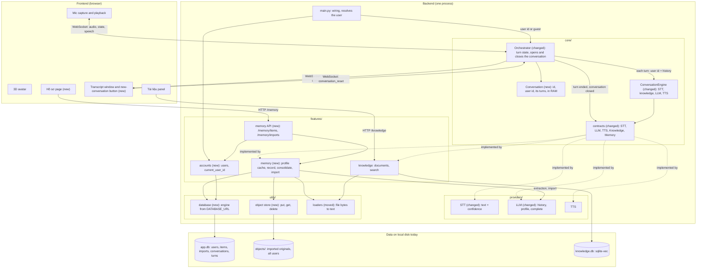
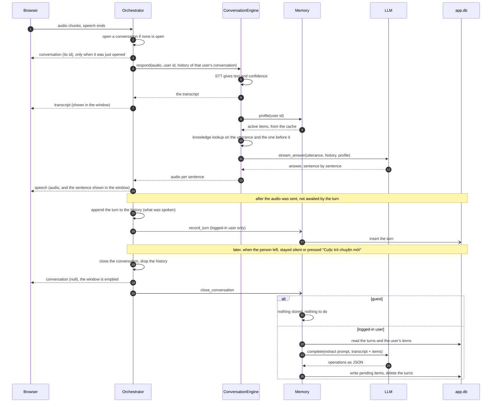

# Conversation memory (short-term and long-term)

This file is the overview: why, what, the shape of the whole and the order of the work.
The decisions and the tasks of each part are in a sub-plan next to it.

## Problem statement

- Every turn is answered alone: the `LLM` contract takes one utterance ("no history",
  `core/contracts.py`), so a follow-up question ("còn cái kia thì sao?") has no meaning
  for the model.
- The avatar knows nothing about the person in front of it: no name, no way of
  addressing them, no preferred answer style. It starts from zero at every visit.
- There is no "conversation" to hang a history on. `session_id` names one WebSocket
  connection (`ws_manager.py`): a kiosk tab open all day is one session, a page reload
  is a new one.
- Voice makes memory risky: a misheard transcript stored as a fact stays wrong for
  every later visit. `Transcript` carries no confidence today.
- The person sees neither what the avatar heard nor what it answered (the transcript is
  only logged), and has no way to start over: once there is a history, a wrong context
  stays until the avatar decides the conversation is over.

## Requirements

- **Short-term**: inside one conversation the LLM sees the earlier turns. A
  conversation is the **session of one user**: its history is reached through the user
  id (or guest) and the conversation id, never through the connection alone.
- The person can end the session by hand: a button on the page closes the conversation,
  and the next utterance starts a new one with an empty history.
- The page shows the conversation as it happens: what the avatar heard and what it
  answers, in a window on the right that keeps the most recent lines.
- **Long-term**: facts about one user (identity, way of addressing, preferences,
  personality) are kept across conversations and given to the LLM at every turn.
- Long-term memory has three sources:
  1. typed by the user on the profile page;
  2. imported: the user uploads a file or pastes a text describing themselves, the LLM
     turns it into memory items. The imported original is kept: it is the source of
     truth of the items made from it;
  3. gathered from conversations, after they end.
- A profile page ("Hồ sơ") shows what the avatar remembers about the person as their
  configuration: they add, edit, delete and approve items there. It is the place where
  a voice mistake is corrected by hand.
- The app runs on one local machine today and will be deployed for many users. System
  and user information therefore lives in one application database whose engine is a
  configuration choice: a local file now, a database server at deployment, without
  rewriting the features that use it.
- The user id will come from a login that does not exist yet. A guest has short-term
  memory only; nothing about a guest is written to disk.
- Nothing on the memory path delays the first audio: reads are a cache hit, writes and
  extraction happen after the audio was sent.
- A turn still works when the memory is empty, slow or failing.

## Decisions made

Each part has its own file, with its decisions, its files and its To-do:

| Sub-plan | Holds | Slices |
|---|---|---|
| [`plan-turn.md`](plan-turn.md) | the conversation as a user session, the history, what is recorded of a turn, the `LLM` contract, the knowledge lookup of a follow-up, STT confidence, the WebSocket contract, the turn tunables | 1 |
| [`plan-database.md`](plan-database.md) | the application database, identity (`users`, `current_user_id()`), the object store, the data model | 2, 3 |
| [`plan-memory.md`](plan-memory.md) | the `Memory` contract, memory items and the profile given to the LLM, gathering from conversations, import, the HTTP API | 2, 3, 4 |
| [`plan-frontend.md`](plan-frontend.md) | the transcript window, the "Cuộc trò chuyện mới" button, the profile page | 1, 2, 3, 4 |

The tests of all parts are in one file, [`test-plan.md`](test-plan.md).

### Not in this version

Login itself; several simultaneous users (one session per connection); partial
transcripts while the person is still speaking (needs a streaming STT); showing the
avatar's text in step with the playback; restoring the transcript window after a page
reload (the backend keeps the history, the screen starts empty); a list of past
conversations to return to; documents of
the knowledge base per user; a run on PostgreSQL and a migration tool (the schema is
exercised on SQLite only until there is a deployment); identity by face or voice; rolling summary of long conversations;
rewriting a follow-up with an LLM for the knowledge lookup; vector retrieval of memory items;
extracting an import again; an S3 backend for the object store; keeping the originals of
the knowledge documents in it; asking back by voice; memory of past conversations as
episodes.

## Architecture

The whole system — perception, the turn, the model backends, the knowledge base,
failure behaviour and deployment — is drawn in `docs/ARCHITECTURE.md` (§3–§5). The
diagrams below show only what this plan adds to it or changes in it.

### Components

What is new or changed is marked `(new)` / `(changed)`. Arrows show who calls whom; the
core still imports nothing from `providers/` or `features/` — it reaches them through
the contracts, wired in `main.py`.

### One turn, and what happens after it

Everything above the first note is on the path to the first audio; everything below it
runs after the audio was sent.

The life of a memory item is drawn in `plan-memory.md`, the data model in
`plan-database.md`.

## Implementation approach

Four slices, each one usable alone:

1. **Short-term**: the conversation as a user session (boundary, reset), history, LLM
   contract, STT confidence, transcript window and new-conversation button. Usable by a
   guest; needs no database and no login.
2. **Long-term by hand**: application database, users, store, profile in the prompt,
   API, profile page (add / edit / delete).
3. **Import**: object store, loaders moved, `LLM.complete`, extraction parsing, import
   routes and the imports part of the profile page.
4. **Gathering**: turn persistence, consolidation at close and at startup, pending
   items and approval on the profile page.

A slice cuts across the sub-plans: every task there carries the number of its slice, and
a slice is finished when its tasks are ticked in each of them.

## To-do

The tasks of each part are in its sub-plan. Here: what belongs to the whole.

- [ ] Every To-do of `plan-turn.md`, `plan-database.md`, `plan-memory.md` and
      `plan-frontend.md` ticked
- [x] `.env.example`, `CLAUDE.md` + `AGENTS.md` (module `memory`, structure, layering),
      `ARCHITECTURE.md` backlog, `quality-gates.md`
- [x] `CHANGELOG.md` entry under `[Unreleased]` with each slice's commit
- [ ] Real run: a follow-up question answered from the history; the same follow-up
      after "Cuộc trò chuyện mới" no longer answered from it; both sides of the turn
      shown in the transcript window; a follow-up about an uploaded document, then a
      change of subject, both answered from the right passages; a barge-in after the
      first sentence recorded with that sentence only; a value for
      `STT_NO_SPEECH_MAX_PROB` read from the traces; a typed item used in the
      answer; an import; a conversation that produces a pending item. First audio under
      3.5 s and end to end under 10 s with a full history and profile, numbers reported;
      Groq `verbose_json` confirmed
- [ ] Human verification
