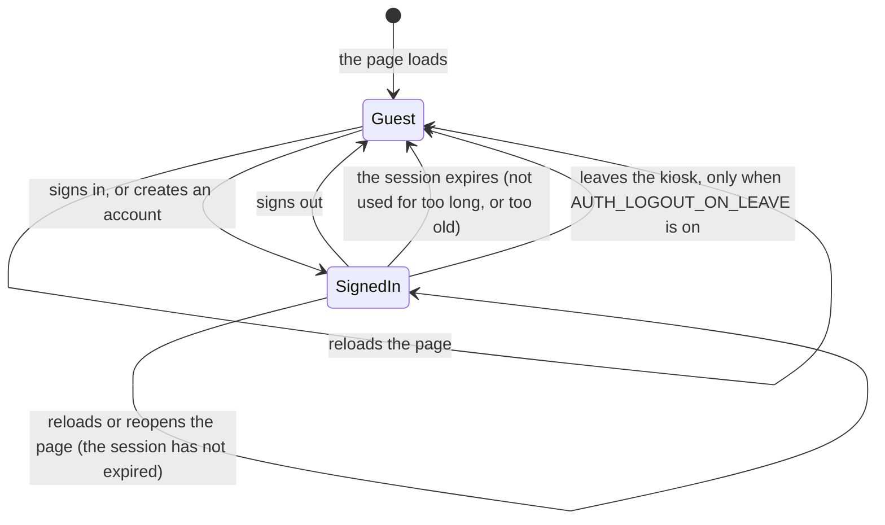
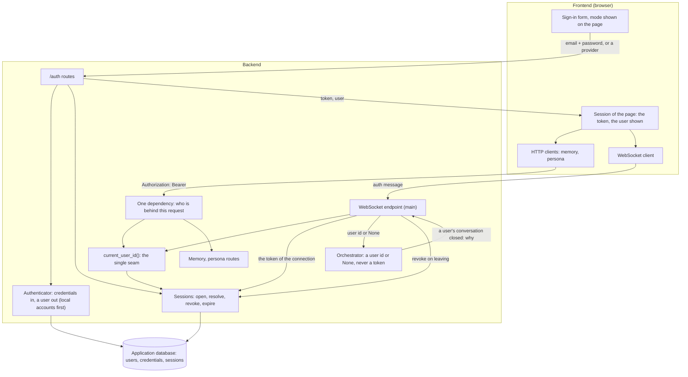
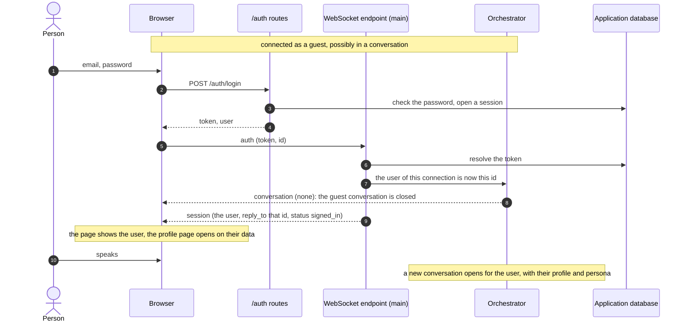
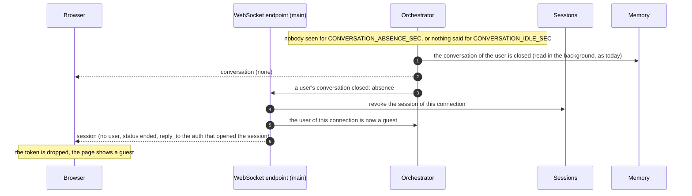
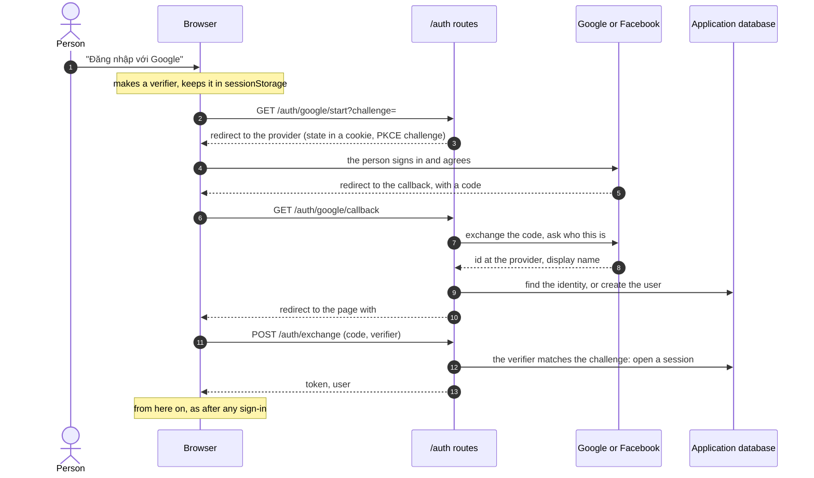
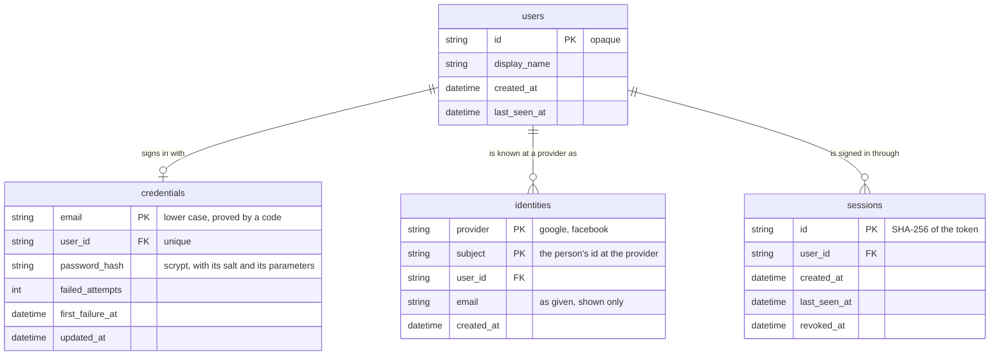

# Sign-in — design

Why and what are in [`plan.md`](plan.md). This file is the shape.

## 1. The two modes

| | Guest | Signed-in user |
|---|---|---|
| How one gets there | Default: first page load, sign-out, an invalid or expired token | Signing in (a local account, or Google / Facebook), then the token is presented; or opening the page with a session that has not expired |
| User id in the backend | `None` | The opaque id of the `users` row |
| Talks to the avatar | Yes | Yes |
| Short-term memory (the conversation in progress) | Yes, in RAM | Yes, in RAM |
| Knowledge base answers | Yes | Yes |
| Profile in the prompt (long-term memory) | No | Yes |
| Persona | The default one | Their fields over the default ones |
| Turns recorded, gathered into proposed facts | No, nothing is written | Yes |
| `/memory`, `/persona` | `401` | Their own data only |
| Profile page | The sign-in form | Their profile and their avatar's persona |

There is no third state. A request or a connection that cannot be tied to a valid
session is a guest; it is never an error to be a guest.

Every arrow starts a new conversation: a conversation belongs to one mode and one user
from its first utterance to its close.

## 2. Where identity is resolved

- `current_user_id()` answers "who is this" for every HTTP request. Order:
  `AUTH_DEV_USER_ID` when it is set (development, tests); otherwise the token → its
  session, if it exists, is not revoked and has not expired → its user; otherwise
  `None`.
- The HTTP routes of the memory and the persona take the user from one shared
  dependency in `features/accounts/`; it reads the `Authorization` header. A guest is
  `401` there, as today.
- The WebSocket endpoint in `main.py` handles the `auth` message itself: it asks
  `current_user_id()` for the configured user, then the session service directly for
  the token, because it has to tell the page why it is a guest (no token, a token that
  opens no session, or a database that could not answer: §7), which a user id or `None`
  cannot say. It calls the orchestrator with a user id or `None`. Every other message
  goes to the orchestrator untouched.
- The token kept for the connection, the user the orchestrator answers and the
  `session` message sent to the page are changed under one lock, from the look at the
  token to the message, so two changes close together cannot leave them disagreeing.
  The end of a session is given the token that ended and does nothing when the
  connection no longer holds it.
- The core imports nothing of this. The orchestrator gains one operation (change the
  user of the open connection) and one notification to its wiring (a user's
  conversation closed, and why).

## 3. The session

- **Token**: 32 random bytes from the system generator, given once to the page. The
  database holds its SHA-256, so a copy of the database does not sign anyone in.
- **Kept by the page** in `localStorage`: the person stays signed in across a reload,
  a closed tab and a restart of the browser, until the session expires. The page
  writes every text with `textContent`, which is what keeps a token readable by
  scripts acceptable here; one origin over HTTPS with an HttpOnly cookie is the
  stronger form and is left for the deployment.
- **The session is kept and expires by time.** Whichever comes first ends it:

  | What ends it | Rule | Key |
  |---|---|---|
  | Signing out | The session is revoked at once | |
  | No use | No request and no turn for this long; every use pushes the end back | `AUTH_SESSION_IDLE_MINUTES` (30) |
  | Age | Whatever happened, counted from the sign-in | `AUTH_SESSION_MAX_HOURS` (12) |
  | Leaving the kiosk (optional) | The orchestrator closed the user's conversation for `absence` or `idle` | `AUTH_LOGOUT_ON_LEAVE` (0 = off) |

  Both durations are settings: a kiosk in a public place takes minutes, a device used
  by one person takes days (`AUTH_SESSION_IDLE_MINUTES=43200`,
  `AUTH_SESSION_MAX_HOURS=720`). The expiry is enforced by the server on every use of
  the token; the page is only told.
- **What a kept session means on a shared kiosk**: between the moment a person walks
  away and the moment the session expires, whoever stands in front of the kiosk talks
  to the avatar as that person, with their profile, and can open their profile page.
  The timeout is the only thing that bounds it, unless `AUTH_LOGOUT_ON_LEAVE` is
  switched on. The page shows who is signed in beside the "Hồ sơ" button at all times,
  with "Đăng xuất" one click away.

- **One session per sign-in.** Signing in again elsewhere does not end the first one;
  each ends by the rules above. Expired and revoked rows are deleted at startup and
  every `AUTH_SESSION_CLEANUP_MINUTES` (60) while the backend runs, in a thread; a
  round that finds the database failing is tried again at the next one.

### Signing in while talking

### Leaving the kiosk (only with `AUTH_LOGOUT_ON_LEAVE=1`)

Off by default: the session is kept and ends by its timeouts. Switched on, for a kiosk
where nobody should inherit a session:

A conversation closed by the "Cuộc trò chuyện mới" button (`reset`) does not sign out:
the person is still there.

## 4. Accounts

- **Authenticator**: one boundary, a proof of who one is in → a user id, or a refusal.
  Two kinds: `local` (an email address and a password kept here) and external providers
  (Google, Facebook: §4.1). Whatever the kind, the outcome is the same session.
- **Local accounts**: an email address (compared without case) and a password
  (`AUTH_PASSWORD_MIN_CHARS`, 8). The password is stored as an scrypt hash with its own
  random salt and its parameters, so they can be raised later; the comparison takes the
  same time whether it matches or not.
- **Creating an account** at the kiosk takes two steps, allowed while
  `AUTH_ALLOW_REGISTRATION` is 1 (the default):
  1. `POST /auth/register` with the email only: a six-digit code is sent to the
     address. Nothing is created; what waits is the code, hashed, in RAM, and nothing
     of a password.
  2. `POST /auth/register/verify` with the email, the code, the password and an
     optional display name: the account is created and the person signed in. The
     password is given here and never before, so whoever reads the mailbox sets it;
     somebody else asking for the same address can only replace the code. A password
     or a name that cannot be accepted answers `422` and uses no try. The password is
     hashed outside the lock, and only for who gave the code back. The code is good
     for `AUTH_OTP_TTL_MINUTES` (10) and `AUTH_OTP_MAX_ATTEMPTS` (5) tries, after which
     a new one has to be asked for; a new one can be asked for every
     `AUTH_OTP_RESEND_SEC` (60) and replaces the one before. The wrong tries made on a
     replaced code that was still valid stay counted on the new one, so guessing is
     bounded by codes per window × tries per code.
- **Mails are limited**, in RAM: one address gets `AUTH_OTP_MAX_CODES` (5) codes and
  all addresses together `AUTH_OTP_MAX_MAILS` (30) mails per `AUTH_OTP_WINDOW_MINUTES`
  (60); past either, and while a code was just sent, the answer is `429` with
  `Retry-After`. The wait and the limits are checked and the code recorded in one
  critical section, so of the requests made at the same moment one sends a mail; the
  mail is sent outside it, and one that fails removes only what that request wrote and
  is not counted. Known cost: a flood can close registration for the window; a limit
  per client belongs to a reverse proxy.
- **One email, one account.** The email is the key of the local account, so a second
  account on it cannot exist. See §4.1 for what this means with Google and Facebook.
- **Sending the code**: `MAIL_BACKEND=smtp` sends it through an SMTP server (`SMTP_*`
  keys, standard library). `MAIL_BACKEND=log`, the default, writes the mail to the
  backend log and sends nothing, so that a machine without a mail server can create
  accounts; it proves nothing about who owns the address, and the backend says so at
  startup. A mail that cannot be sent answers `502` and leaves nothing waiting.
- **Refusals say nothing useful to a guesser**: a wrong email and a wrong password give
  the same `401` and take the same time. An attempt on an email that has an account is
  charged before its password is looked at, by one conditional statement in the
  database, so attempts made at the same moment are all counted; a success clears the
  count. After `AUTH_LOGIN_MAX_ATTEMPTS` (5) attempts on one email within
  `AUTH_LOGIN_WINDOW_MINUTES` (10), further attempts on it answer `429` until the
  window has passed, right password or not. Asking for an account on
  an email that has one answers `409`: the form has to tell the person to sign in, so
  whether an address has an account can be learned from it.

### 4.1 Google and Facebook

A person can sign in with a Google or a Facebook account instead of a password kept
here, and a signed-in person can link one to the account they already have.

- **How**: the standard OAuth 2 authorization-code flow with PKCE. The backend sends
  the browser to the provider, receives the code on its callback route, exchanges it
  for an access token and asks the provider who the person is (their id at that
  provider, a display name, an email when given). Nothing of the provider is kept
  after that: no access token, no refresh token. The avatar never acts on the person's
  Google or Facebook account; it only learns who they are.
- **No new dependency**: the calls are plain HTTPS requests (`httpx`, already used),
  and the identity is read from the provider's own "who am I" endpoint, so no token
  signature has to be verified here.
- **An identity is (provider, the person's id at that provider)**, never an email. The
  first sign-in with an identity nobody has creates a user; the next ones find it.
- **Linking is explicit, and confirmed by the page.** A signed-in person starts the
  same flow from the profile page, with a one-time ticket naming them. The callback
  attaches nothing: it keeps the proved identity for one minute and leaves a code in
  `#auth_link=<code>`. The page posts it with its token (`POST /auth/identities`), and
  the identity is attached only when the token's user is the user the ticket was given
  to. Afterwards either way of signing in reaches the same user, the same memory, the
  same persona.
- **One email, one account, where both sides proved the address.** An identity nobody
  has yet, whose email the provider says it verified (Google's `email_verified`), and
  which is the email of a local account, signs that account in and is attached to it:
  the address was proved here by a code and there by the provider. Nothing else is
  joined by email: Facebook does not say whether an email is verified, and joining on
  it would hand an account to whoever claims the address, so a Facebook identity with
  the same email stays a user of its own. That gap in "one email, one account" is
  open, as is a person who signs in with a provider first and creates a local account
  on the same email afterwards.
  An identity that already belongs to another account is refused (`409`), and so is a
  second identity of a provider the user has one of already.
- **Unlinking** is allowed while another way of signing in remains. The look at what
  remains and the deletion are one transaction, the user's row locked for it, so two
  unlinks at the same moment cannot remove the last way in.
- **A sign-in is bound to the page that started it.** The page makes a random verifier,
  keeps it in `sessionStorage` (this tab only) and opens
  `GET /auth/{provider}/start?challenge=<base64url(SHA-256(verifier))>`; a sign-in
  started without a challenge is refused (`400`). The challenge travels with the flow.
- **Coming back from the provider**: the callback does not put the session token in a
  URL. It redirects to the page with a one-time code in the fragment
  (`#auth_code=<code>`), valid once and for one minute, which the page exchanges for
  the token together with its verifier (`POST /auth/exchange {code, verifier}`). A
  verifier that does not match, or none, answers `401`, and the code is spent whatever
  the answer: a link made by somebody else signs nobody in. A flow that did not go
  through comes back as `#auth_error=<reason>` (`state`, `denied`, `provider`,
  `link_expired`). The page reads the fragment once and removes it from the address.
  The redirect reloads the page, so the WebSocket reconnects; the conversation starts
  anew, as with any change of mode.
- **In the browser** the verifier needs a random source, SHA-256 and `sessionStorage`:
  a page served over https or from localhost. Elsewhere the page does not start the
  flow and says so.
- **What it needs outside the code**, per provider: an application registered at Google
  / Meta, its client id and secret in `.env`, and the callback URL declared there
  (`https://…` or `http://localhost…`: both providers refuse anything else). The kiosk
  must reach `accounts.google.com` / `facebook.com`. A provider whose keys are not set
  is simply not offered.
- **On a public screen** the person types their Google or Facebook password into the
  kiosk's browser, which they have no reason to trust. Both providers have a flow made
  for this (the kiosk shows a short code or a QR, the person approves on their own
  phone): it plugs in behind the same boundary and is the better form for a shared
  kiosk. It is named here and not designed.

## 5. Data

Three new tables in the application database; `users` is unchanged.

`features/accounts/store.py` keeps all their SQL, on SQLAlchemy Core like the rest. The
end of a session is not stored: it is computed from `created_at`, `last_seen_at` and the
two timeouts each time the token is used, so a change of either timeout applies to the
sessions that are open.

## 6. HTTP routes

A contract between `backend/features/accounts/api.py` and `frontend/src/auth/`.

| Route | Body | Answer |
|---|---|---|
| `POST /auth/register` | `{"email"}` | `202 {"email", "expires_in_sec", "resend_in_sec"}`: a code was sent, no account exists yet; `409` the email has an account; `422` not an email address; `403` registration is switched off; `429` a code was just sent, or too many were in the window (`Retry-After`); `502` the mail could not be sent |
| `POST /auth/register/verify` | `{"email", "code", "password", "display_name"?}` | `201 {"token", "user": {"id", "display_name"}, "expires_at"}`: the account is created, with the password given here; `401` a wrong code; `410` no code waits for this email (expired, tried too often, never asked): ask for a new one; `422` a password or a name that is not acceptable (no try is used); `409` the email got an account meanwhile |
| `POST /auth/login` | `{"email", "password"}` | `200`, same shape as verify; `401` wrong email or password; `429` too many attempts |
| `POST /auth/logout` | | `204`, with or without a valid token |
| `GET /auth/session` | | `200 {"user": {"id", "display_name"}, "expires_at"}`, or `200 {"user": null}` for a guest |
| `GET /auth/providers` | | `200 {"providers": ["google", ...], "registration": true}`: what the form may offer |
| `POST /auth/{provider}/link` | | `200 {"url"}`: where the signed-in user's browser goes to attach the provider to their account (a start with a one-time ticket, since a navigation carries no token); `401` a guest; `404` a provider that is not configured |
| `GET /auth/{provider}/start` | `?challenge=` for a sign-in (the base64url SHA-256 of the page's verifier, 43 characters), or `?ticket=` from the link | `302` to the provider, with the state of the flow in a cookie (`HttpOnly`, `SameSite=Lax`, `Secure` when `AUTH_PUBLIC_URL` is https); `400` a sign-in without a valid challenge; `302` to the page with `#auth_error=link_expired` for a ticket that is unknown or over; `404` a provider that is not configured |
| `GET /auth/{provider}/callback` | the provider's `code` and `state` | `302` to the page with `#auth_code=<code>` (a sign-in), `#auth_link=<code>` (a link, nothing attached yet) or `#auth_error=<reason>` (`state`, `denied`, `provider`) |
| `POST /auth/exchange` | `{"code", "verifier"}` | `200`, same shape as login; `401` an unknown, used or expired code, or a verifier that is not the one of the page that started; the code is spent either way |
| `GET /auth/identities` | | `200 {"identities": [{"provider", "email", "created_at"}]}` of the signed-in user; `401` a guest |
| `POST /auth/identities` | `{"code"}` from `#auth_link` | `200 {"provider"}`: the identity the link flow proved is attached to the signed-in user who asked for it; `401` no session; `403` the flow was started by another user; `409` the identity belongs to another user, or the user has an identity of that provider already; `410` an unknown, used or expired code |
| `DELETE /auth/identities/{provider}` | | `204`; `409` it is the only way left to sign in; `401` a guest |

Every route: `502` when the database fails, without its text. A body with an unknown
field is refused (`422`). The token is read from
`Authorization: Bearer <token>`. `GET /auth/session` is how the page learns, after a
reload, whether the token it kept is still good.

Unchanged: `/memory` and `/persona` (their `401` now means "no valid session"),
`/knowledge` and `/health` (no identity).

## 7. WebSocket messages

| Message | Direction | Shape | Meaning |
|---|---|---|---|
| `auth` | client → server | `{"type": "auth", "token": "<token>" \| null, "id": "<string>"}` | Who is behind this connection from now on; `null` = a guest. `id` is a fresh random value per frame. Sent after `connected`, whenever the page signs in or out, and again after an `unresolved` answer |
| `session` | server → client | `{"type": "session", "user": {"id", "display_name"} \| null, "reply_to": "<id>" \| null, "status": "<status>"}` | The mode the connection is in, and why. Answers every `auth` (`reply_to` is its `id`, `null` when it had none), and is sent unasked when the server ends the session (leaving, expiry): `reply_to` is then the `auth` that opened it |

| `status` | Meaning | `user` |
|---|---|---|
| `signed_in` | The token opened a session (or `AUTH_DEV_USER_ID` is set) | set |
| `guest` | No token was presented | `null` |
| `rejected` | The token opens no session: unknown, revoked, expired | `null` |
| `unresolved` | The database failed while the token was looked at: the connection is a guest's for now, the token may be a good one | `null` |
| `ended` | The server ended the session of the connection | `null` |

- `auth` is the first frame a page sends, before the microphone is streamed, with
  `null` when it has no token. A page that reconnects (a reload, a network drop) is
  taken for the user of the session the connection had until that first frame, so the
  conversation of a signed-in user survives a reload; a connection whose first frame
  is anything else is a guest from that frame on.
- An `auth` that changes the user closes the conversation in progress (`user_changed`)
  and cancels the turn that is running; an `auth` naming the user already set changes
  nothing.
- The page drops its token only when `reply_to` is the last `auth` it sent on this
  connection, that frame carried the token it holds now, and `status` is `rejected` or
  `ended`. It takes `user` only under the same match. Anything else is the late answer
  to an earlier frame (the `auth` of page load, the token of the person before) and
  changes nothing.
- On `unresolved` the page keeps its token and presents it again after
  `VITE_AUTH_RETRY_MS`, unless another `auth` is sent before.

## 8. Keys

In `backend/tuning.py` unless `config.py` is named (secrets and addresses), commented
out in `.env.example`.

| Key | Default | Meaning |
|---|---|---|
| `AUTH_DEV_USER_ID` (`config.py`, existing) | empty | Set: every connection and request is this user, without sign-in (development, tests) |
| `AUTH_ALLOW_REGISTRATION` | 1 | 0: accounts cannot be created at the kiosk |
| `AUTH_PASSWORD_MIN_CHARS` | 8 | Shortest password accepted |
| `AUTH_OTP_TTL_MINUTES` | 10 | How long the code sent to an email is good for |
| `AUTH_OTP_MAX_ATTEMPTS` | 5 | Wrong tries before a new code has to be asked for |
| `AUTH_OTP_RESEND_SEC` | 60 | The wait before another code can be asked for |
| `AUTH_OTP_WINDOW_MINUTES` | 60 | The window the mails carrying a code are counted in |
| `AUTH_OTP_MAX_CODES` | 5 | Codes sent to one address within the window |
| `AUTH_OTP_MAX_MAILS` | 30 | Mails carrying a code sent to all addresses together within the window |
| `MAIL_BACKEND` (`config.py`) | `log` | `smtp` sends the code; `log` writes it to the backend log and sends nothing |
| `SMTP_HOST`, `SMTP_PORT` (587), `SMTP_USERNAME`, `SMTP_PASSWORD`, `SMTP_FROM`, `SMTP_SECURITY` (`starttls`) (`config.py`), `SMTP_TIMEOUT_SEC` (10) | | The SMTP server of `MAIL_BACKEND=smtp` |
| `AUTH_SESSION_IDLE_MINUTES` | 30 | A session without a request or a turn for this long has expired |
| `AUTH_SESSION_MAX_HOURS` | 12 | A session never lives longer, counted from the sign-in |
| `AUTH_LOGOUT_ON_LEAVE` | 0 | 1: the session also ends when the person leaves or goes silent |
| `AUTH_SESSION_CHECK_SEC` | 30 | How often the session of the connected page is looked at, to tell the page when it has expired |
| `AUTH_SESSION_CLEANUP_MINUTES` | 60 | How often the sessions that are over are deleted from the database while the backend runs |
| `AUTH_PROVIDER_TIMEOUT_SEC` | 10 | Max wait for a provider during a sign-in |
| `AUTH_GOOGLE_CLIENT_ID`, `AUTH_GOOGLE_CLIENT_SECRET` (`config.py`) | empty | The application registered at Google; empty = Google is not offered |
| `AUTH_FACEBOOK_CLIENT_ID`, `AUTH_FACEBOOK_CLIENT_SECRET` (`config.py`) | empty | The application registered at Meta; empty = Facebook is not offered |
| `AUTH_PUBLIC_URL` (`config.py`) | empty | The address of the backend as the provider reaches it back, for the callback |
| `AUTH_PAGE_URL` (`config.py`) | empty | The address of the page the callback returns to |
| `AUTH_GOOGLE_*_URL`, `AUTH_GOOGLE_SCOPE`, `AUTH_FACEBOOK_*_URL`, `AUTH_FACEBOOK_SCOPE` (`config.py`) | the public endpoints | Where each provider is asked, and for what |
| `AUTH_LOGIN_MAX_ATTEMPTS` | 5 | Sign-in attempts on one email before it is held |
| `AUTH_LOGIN_WINDOW_MINUTES` | 10 | The window those attempts are counted in, and how long it is held |

The frontend has one value of its own, in `frontend/.env.example`: `VITE_AUTH_RETRY_MS`
(5000), the wait before the page presents its token again after an `unresolved` answer.

## 9. The page

- Beside the "Hồ sơ" button, the mode: "Khách" with "Đăng nhập", or the display name
  with "Đăng xuất".
- The profile page of a guest shows the sign-in form in place of today's note: email,
  password, "Đăng nhập", "Tạo tài khoản" while registration is allowed, and one button
  per provider that is configured ("Đăng nhập với Google", "… với Facebook"). "Tạo tài
  khoản" sends the address only and leads to a second step: the address the code was
  sent to, a field for the code, "Xác nhận", "Gửi lại mã" and "Quay lại". The password
  typed on the first step waits in the memory of the page, never in the hidden input,
  and is sent with the code; the page forgets it when the code expires
  (`expires_in_sec`).
- The profile page of a signed-in user has a block "Tài khoản liên kết": the providers
  attached to the account, "Liên kết" for those that are not, "Gỡ" for those that are.
- `frontend/src/auth/`: the session of the page (the token, the user, who to tell when
  it changes), the client of `/auth`, the form. The memory and persona clients and the
  WebSocket client take the token from it. A `401` on a route of the signed-in user
  puts the page back in guest mode only when the token that was presented is still the
  one the page holds, and reads "Phiên đăng nhập đã hết, vui lòng đăng nhập lại" on the
  session routes of `/auth`; a `session` message does so under the rule of §7.
- **A change of person** (the token or the user id changes) is counted by the session
  of the page. The three HTTP clients (`auth`, `memory`, `persona`) note the count
  before a request and drop the answer when it changed, so nothing of the person
  before is written into the page of the next. On every change the sign-in form
  forgets the email, the password, the code and its messages; the linked accounts are
  emptied when the user changes and when they cannot be read; the profile and the
  persona are emptied and read again.

## 10. What is protected, and what is not

- A password and a token are never written to a log, a span or the capture folder; a
  span names the user by its opaque id only. The one exception is chosen, not
  accidental: with `MAIL_BACKEND=log` the mail carrying a code is the log line.
- Passwords are hashed, tokens are hashed, the comparison of either is constant-time.
- The provider's flow is protected the usual way: a `state` tied to the browser that
  started it, PKCE, a callback URL fixed in the configuration and never taken from the
  request, a one-time code instead of a token in the URL. On top of it, the code is
  redeemed only with the verifier of the page that started, and a link is attached only
  when the signed-in page of the user who asked confirms it.
- The limits that protect an account are in the database and hold across processes
  (sign-in attempts, unlink). What waits in RAM (codes, mail counts, provider flows)
  is per process: one backend process serves one kiosk.
- One user never reaches another's data: this was already true of every store and does
  not change; sign-in only decides which id is used.
- **Not solved here**: the page and the API speak plain HTTP on the dev machine, so a
  password and a token cross the local network in clear; outside `localhost` this needs
  HTTPS (the browser already requires it for the microphone). `CORS_ALLOW_ORIGINS` is
  `*` by default and should name the page's origin in a deployment. The knowledge
  routes stay open to everyone.
