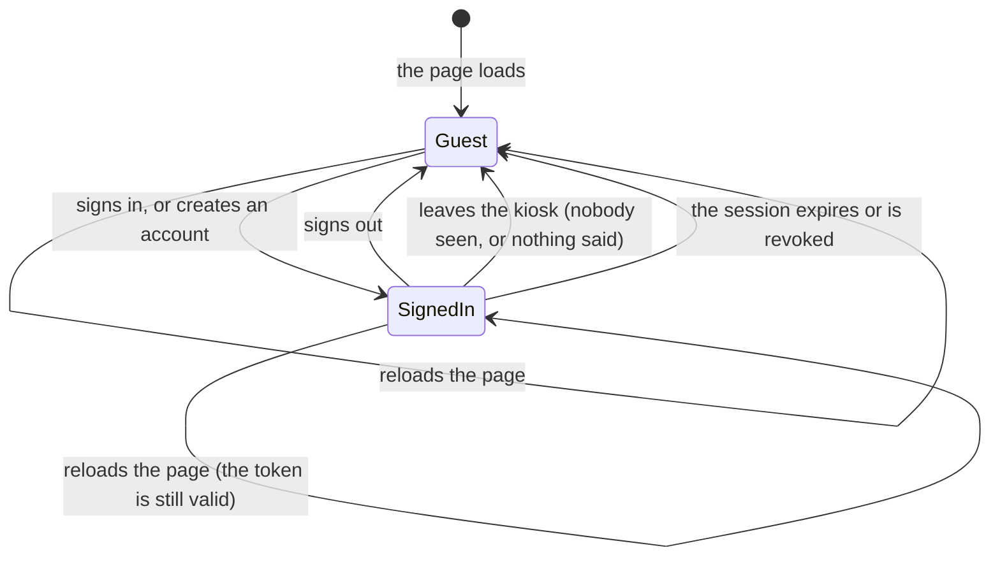
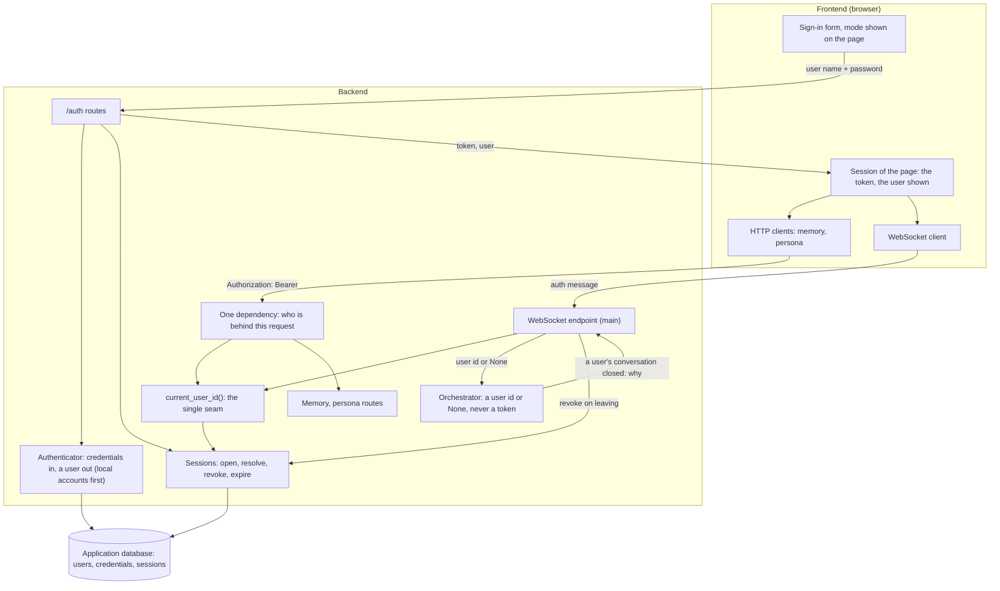
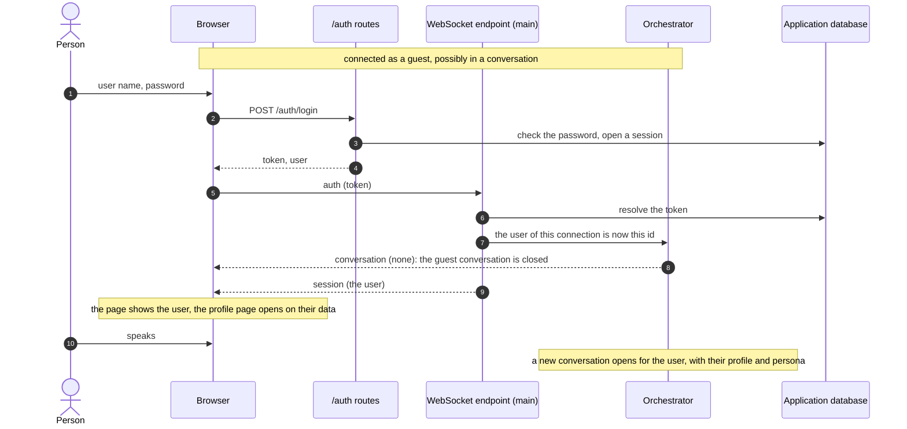
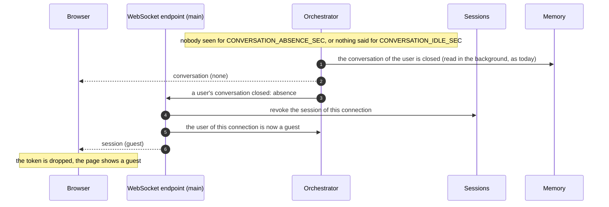
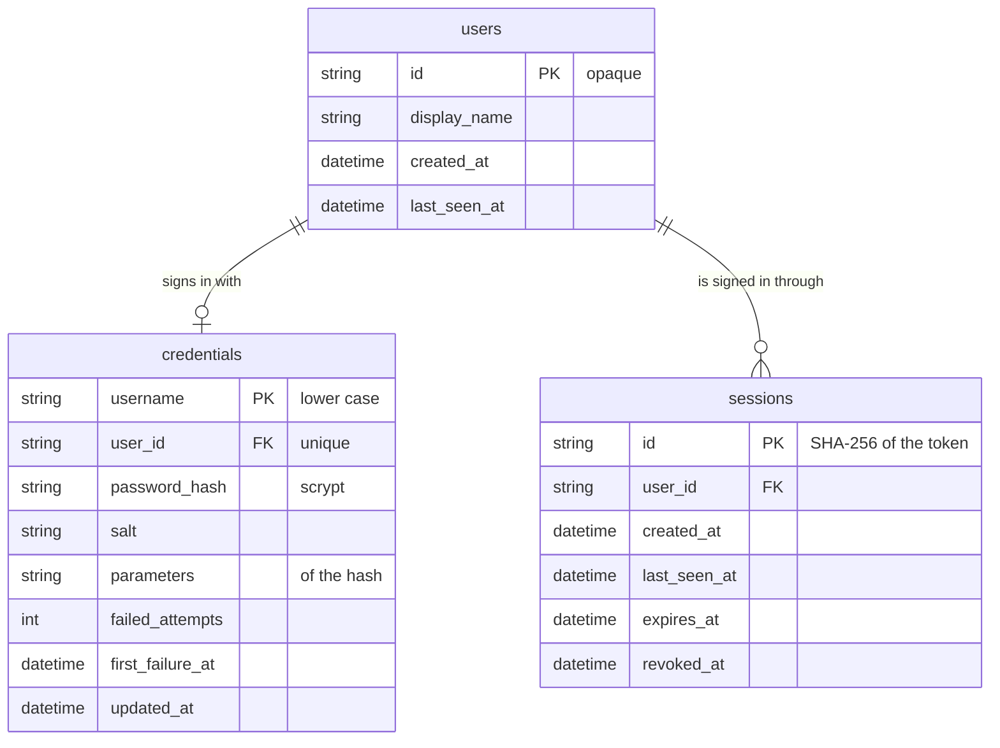

# Sign-in — design

Why and what are in [`plan.md`](plan.md). This file is the shape.

## 1. The two modes

| | Guest | Signed-in user |
|---|---|---|
| How one gets there | Default: page load, sign-out, an invalid or expired token, leaving the kiosk | `POST /auth/login` or `/auth/register`, then the token is presented |
| User id in the backend | `None` | The opaque id of the `users` row |
| Talks to the avatar | Yes | Yes |
| Short-term memory (the conversation in progress) | Yes, in RAM | Yes, in RAM |
| Knowledge base answers | Yes | Yes |
| Profile in the prompt (long-term memory) | No | Yes |
| Persona | The default one | Their fields over the default ones |
| Turns recorded, gathered into proposed facts | No, nothing is written | Yes |
| `/memory`, `/persona` | `401` | Their own data only |
| Profile page | The sign-in form | Their profile and their avatar's persona |

There is no third state. A request or a connection that cannot be tied to a valid
session is a guest; it is never an error to be a guest.

Every arrow starts a new conversation: a conversation belongs to one mode and one user
from its first utterance to its close.

## 2. Where identity is resolved

- `current_user_id()` is still the only function that answers "who is this". Order:
  `AUTH_DEV_USER_ID` when it is set (development, tests); otherwise the token → its
  session, if it exists, is not revoked and has not expired → its user; otherwise
  `None`.
- The HTTP routes of the memory and the persona take the user from one shared
  dependency in `features/accounts/`; it reads the `Authorization` header. A guest is
  `401` there, as today.
- The WebSocket endpoint in `main.py` handles the `auth` message itself: it resolves
  the token and calls the orchestrator with a user id or `None`. Every other message
  goes to the orchestrator untouched.
- The core imports nothing of this. The orchestrator gains one operation (change the
  user of the open connection) and one notification to its wiring (a user's
  conversation closed, and why).

## 3. The session

- **Token**: 32 random bytes from the system generator, given once to the page. The
  database holds its SHA-256, so a copy of the database does not sign anyone in.
- **Held by the page** in `sessionStorage`: it survives a reload and not the closing of
  the page. The page writes every text with `textContent`, which is what keeps a token
  readable by scripts acceptable here; one origin over HTTPS with an HttpOnly cookie is
  the stronger form and is left for the deployment.
- **Lifetime**, whichever comes first:

  | What ends it | Rule | Key |
  |---|---|---|
  | Signing out | The session is revoked at once | |
  | Leaving the kiosk | The orchestrator closed the user's conversation for `absence` or `idle` | `AUTH_LOGOUT_ON_LEAVE` (1) |
  | No use | No request and no turn for this long | `AUTH_SESSION_IDLE_MINUTES` (15) |
  | Age | Whatever happened | `AUTH_SESSION_MAX_HOURS` (12) |

- **One session per sign-in.** Signing in again elsewhere does not end the first one;
  each ends by the rules above. Expired and revoked rows are deleted at startup and
  when a session of the same user is opened.

### Signing in while talking

### Leaving the kiosk

A conversation closed by the "Cuộc trò chuyện mới" button (`reset`) does not sign out:
the person is still there.

## 4. Accounts

- **Authenticator**: one boundary, credentials in → a user id, or a refusal. The first
  one is `local`.
- **Local accounts**: a user name (3 to 32 characters: letters, digits, `.`, `_`, `-`;
  compared without case) and a password (`AUTH_PASSWORD_MIN_CHARS`, 8). The password
  is stored as an scrypt hash with its own random salt and its parameters, so they can
  be raised later; the comparison takes the same time whether it matches or not.
- **Creating an account** at the kiosk: `POST /auth/register`, allowed while
  `AUTH_ALLOW_REGISTRATION` is 1 (the default). It signs the person in at once.
- **Refusals say nothing useful to a guesser**: a wrong user name and a wrong password
  give the same `401` and take the same time. After `AUTH_LOGIN_MAX_ATTEMPTS` (5)
  failures on one user name within `AUTH_LOGIN_WINDOW_MINUTES` (10), further attempts
  on it answer `429` until the window has passed, right password or not.

## 5. Data

Two new tables in the application database; `users` is unchanged.

`features/accounts/store.py` keeps all their SQL, on SQLAlchemy Core like the rest.

## 6. HTTP routes

A contract between `backend/features/accounts/api.py` and `frontend/src/auth/`.

| Route | Body | Answer |
|---|---|---|
| `POST /auth/register` | `{"username", "password", "display_name"?}` | `201 {"token", "user": {"id", "display_name"}, "expires_at"}`; `409` the user name is taken; `422` a name or a password that is not acceptable; `403` registration is switched off |
| `POST /auth/login` | `{"username", "password"}` | `200`, same shape as register; `401` wrong name or password; `429` too many attempts |
| `POST /auth/logout` | | `204`, with or without a valid token |
| `GET /auth/session` | | `200 {"user": {"id", "display_name"}}`, or `200 {"user": null}` for a guest |

Every route: `502` when the database fails, without its text. The token is read from
`Authorization: Bearer <token>`. `GET /auth/session` is how the page learns, after a
reload, whether the token it kept is still good.

Unchanged: `/memory` and `/persona` (their `401` now means "no valid session"),
`/knowledge` and `/health` (no identity).

## 7. WebSocket messages

| Message | Direction | Shape | Meaning |
|---|---|---|---|
| `auth` | client → server | `{"type": "auth", "token": "<token>" \| null}` | Who is behind this connection from now on; `null` = a guest. Sent after `connected` and whenever the page signs in or out |
| `session` | server → client | `{"type": "session", "user": {"id", "display_name"} \| null}` | The mode the connection is in. Answers every `auth`, and is sent unasked when the server ends the session (leaving, expiry) |

- A connection starts as a guest until its `auth` message is resolved; the page sends
  it before the microphone is streamed.
- An `auth` that changes the user closes the conversation in progress (`user_changed`)
  and cancels the turn that is running; an `auth` naming the user already set changes
  nothing.
- A token that resolves to nobody answers `session` with `null`: the page drops it.

## 8. Keys

All in `backend/tuning.py` except the first, commented out in `.env.example`.

| Key | Default | Meaning |
|---|---|---|
| `AUTH_DEV_USER_ID` (`config.py`, existing) | empty | Set: every connection and request is this user, without sign-in (development, tests) |
| `AUTH_ALLOW_REGISTRATION` | 1 | 0: accounts cannot be created at the kiosk |
| `AUTH_PASSWORD_MIN_CHARS` | 8 | Shortest password accepted |
| `AUTH_SESSION_IDLE_MINUTES` | 15 | A session without a request or a turn for this long has expired |
| `AUTH_SESSION_MAX_HOURS` | 12 | A session never lives longer |
| `AUTH_LOGOUT_ON_LEAVE` | 1 | The session ends when the person leaves or goes silent |
| `AUTH_LOGIN_MAX_ATTEMPTS` | 5 | Failed sign-ins on one user name before it is held |
| `AUTH_LOGIN_WINDOW_MINUTES` | 10 | The window those attempts are counted in, and how long it is held |

The frontend needs no new `VITE_*` value.

## 9. The page

- Beside the "Hồ sơ" button, the mode: "Khách" with "Đăng nhập", or the display name
  with "Đăng xuất".
- The profile page of a guest shows the sign-in form in place of today's note: user
  name, password, "Đăng nhập", and "Tạo tài khoản" while registration is allowed.
- `frontend/src/auth/`: the session of the page (the token, the user, who to tell when
  it changes), the client of `/auth`, the form. The memory and persona clients and the
  WebSocket client take the token from it; a `401` on any of them, or a `session`
  message with `null`, puts the page back in guest mode.

## 10. What is protected, and what is not

- A password and a token are never written to a log, a span or the capture folder; a
  span names the user by its opaque id only.
- Passwords are hashed, tokens are hashed, the comparison of either is constant-time.
- One user never reaches another's data: this was already true of every store and does
  not change; sign-in only decides which id is used.
- **Not solved here**: the page and the API speak plain HTTP on the dev machine, so a
  password and a token cross the local network in clear; outside `localhost` this needs
  HTTPS (the browser already requires it for the microphone). `CORS_ALLOW_ORIGINS` is
  `*` by default and should name the page's origin in a deployment. The knowledge
  routes stay open to everyone.
