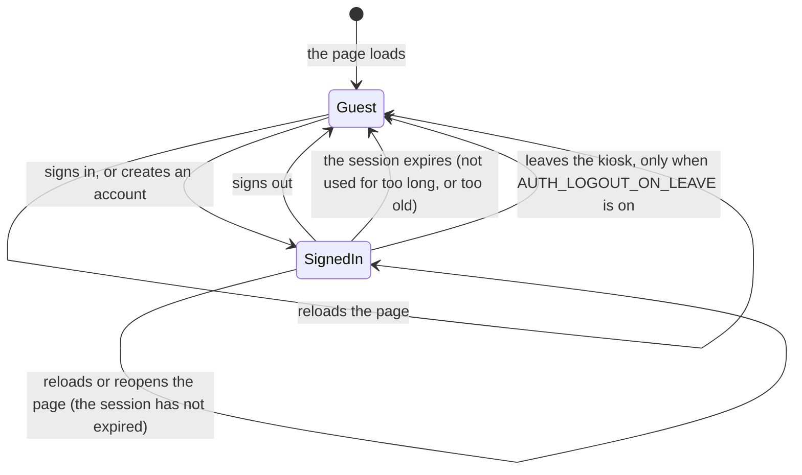
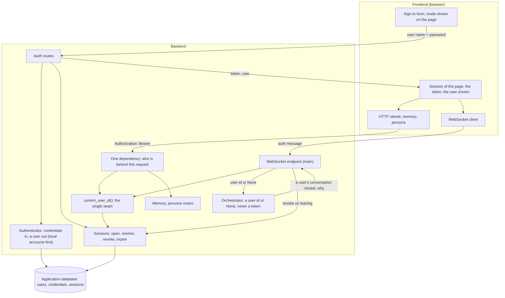
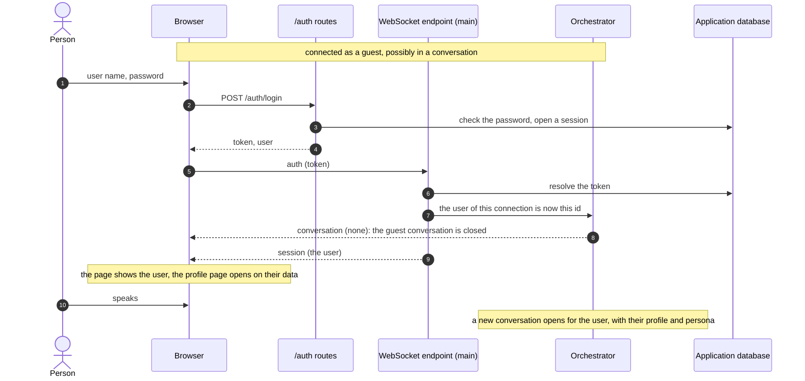
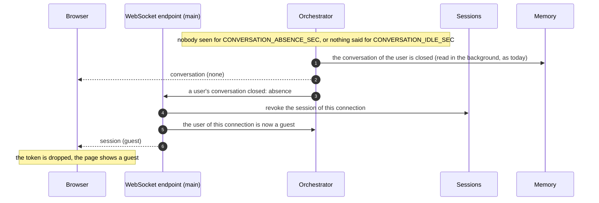
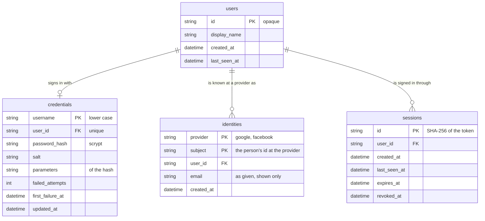

# Sign-in — design

Why and what are in [`plan.md`](plan.md). This file is the shape.

## 1. The two modes

| | Guest | Signed-in user |
|---|---|---|
| How one gets there | Default: first page load, sign-out, an invalid or expired token | Signing in (a local account, or Google / Facebook), then the token is presented; or opening the page with a session that has not expired |
| User id in the backend | `None` | The opaque id of the `users` row |
| Talks to the avatar | Yes | Yes |
| Short-term memory (the conversation in progress) | Yes, in RAM | Yes, in RAM |
| Knowledge base answers | Yes | Yes |
| Profile in the prompt (long-term memory) | No | Yes |
| Persona | The default one | Their fields over the default ones |
| Turns recorded, gathered into proposed facts | No, nothing is written | Yes |
| `/memory`, `/persona` | `401` | Their own data only |
| Profile page | The sign-in form | Their profile and their avatar's persona |

There is no third state. A request or a connection that cannot be tied to a valid
session is a guest; it is never an error to be a guest.



Every arrow starts a new conversation: a conversation belongs to one mode and one user
from its first utterance to its close.

## 2. Where identity is resolved



- `current_user_id()` is still the only function that answers "who is this". Order:
  `AUTH_DEV_USER_ID` when it is set (development, tests); otherwise the token → its
  session, if it exists, is not revoked and has not expired → its user; otherwise
  `None`.
- The HTTP routes of the memory and the persona take the user from one shared
  dependency in `features/accounts/`; it reads the `Authorization` header. A guest is
  `401` there, as today.
- The WebSocket endpoint in `main.py` handles the `auth` message itself: it resolves
  the token and calls the orchestrator with a user id or `None`. Every other message
  goes to the orchestrator untouched.
- The core imports nothing of this. The orchestrator gains one operation (change the
  user of the open connection) and one notification to its wiring (a user's
  conversation closed, and why).

## 3. The session

- **Token**: 32 random bytes from the system generator, given once to the page. The
  database holds its SHA-256, so a copy of the database does not sign anyone in.
- **Kept by the page** in `localStorage`: the person stays signed in across a reload,
  a closed tab and a restart of the browser, until the session expires. The page
  writes every text with `textContent`, which is what keeps a token readable by
  scripts acceptable here; one origin over HTTPS with an HttpOnly cookie is the
  stronger form and is left for the deployment.
- **The session is kept and expires by time.** Whichever comes first ends it:

  | What ends it | Rule | Key |
  |---|---|---|
  | Signing out | The session is revoked at once | |
  | No use | No request and no turn for this long; every use pushes the end back | `AUTH_SESSION_IDLE_MINUTES` (30) |
  | Age | Whatever happened, counted from the sign-in | `AUTH_SESSION_MAX_HOURS` (12) |
  | Leaving the kiosk (optional) | The orchestrator closed the user's conversation for `absence` or `idle` | `AUTH_LOGOUT_ON_LEAVE` (0 = off) |

  Both durations are settings: a kiosk in a public place takes minutes, a device used
  by one person takes days (`AUTH_SESSION_IDLE_MINUTES=43200`,
  `AUTH_SESSION_MAX_HOURS=720`). The expiry is enforced by the server on every use of
  the token; the page is only told.
- **What a kept session means on a shared kiosk**: between the moment a person walks
  away and the moment the session expires, whoever stands in front of the kiosk talks
  to the avatar as that person, with their profile, and can open their profile page.
  The timeout is the only thing that bounds it, unless `AUTH_LOGOUT_ON_LEAVE` is
  switched on. The page shows who is signed in beside the "Hồ sơ" button at all times,
  with "Đăng xuất" one click away.

- **One session per sign-in.** Signing in again elsewhere does not end the first one;
  each ends by the rules above. Expired and revoked rows are deleted at startup and
  when a session of the same user is opened.

### Signing in while talking



### Leaving the kiosk (only with `AUTH_LOGOUT_ON_LEAVE=1`)

Off by default: the session is kept and ends by its timeouts. Switched on, for a kiosk
where nobody should inherit a session:



A conversation closed by the "Cuộc trò chuyện mới" button (`reset`) does not sign out:
the person is still there.

## 4. Accounts

- **Authenticator**: one boundary, a proof of who one is in → a user id, or a refusal.
  Two kinds: `local` (a user name and a password kept here) and external providers
  (Google, Facebook: §4.1). Whatever the kind, the outcome is the same session.
- **Local accounts**: a user name (3 to 32 characters: letters, digits, `.`, `_`, `-`;
  compared without case) and a password (`AUTH_PASSWORD_MIN_CHARS`, 8). The password
  is stored as an scrypt hash with its own random salt and its parameters, so they can
  be raised later; the comparison takes the same time whether it matches or not.
- **Creating an account** at the kiosk: `POST /auth/register`, allowed while
  `AUTH_ALLOW_REGISTRATION` is 1 (the default). It signs the person in at once.
- **Refusals say nothing useful to a guesser**: a wrong user name and a wrong password
  give the same `401` and take the same time. After `AUTH_LOGIN_MAX_ATTEMPTS` (5)
  failures on one user name within `AUTH_LOGIN_WINDOW_MINUTES` (10), further attempts
  on it answer `429` until the window has passed, right password or not.

### 4.1 Google and Facebook

A person can sign in with a Google or a Facebook account instead of a password kept
here, and a signed-in person can link one to the account they already have.

- **How**: the standard OAuth 2 authorization-code flow with PKCE. The backend sends
  the browser to the provider, receives the code on its callback route, exchanges it
  for an access token and asks the provider who the person is (their id at that
  provider, a display name, an email when given). Nothing of the provider is kept
  after that: no access token, no refresh token. The avatar never acts on the person's
  Google or Facebook account; it only learns who they are.
- **No new dependency**: the calls are plain HTTPS requests (`httpx`, already used),
  and the identity is read from the provider's own "who am I" endpoint, so no token
  signature has to be verified here.
- **An identity is (provider, the person's id at that provider)**, never an email. The
  first sign-in with an identity nobody has creates a user; the next ones find it.
- **Linking is explicit.** A signed-in person starts the same flow from the profile
  page and the identity is attached to their account; afterwards either way of signing
  in reaches the same user, the same memory, the same persona. Accounts are never
  merged because two emails look alike: Facebook does not guarantee an email is
  verified, and merging on it would hand an account to whoever controls the address.
  An identity that already belongs to another account is refused (`409`).
- **Unlinking** is allowed while another way of signing in remains.
- **Coming back from the provider**: the callback does not put the session token in a
  URL. It redirects to the page with a one-time code, valid once and for one minute,
  which the page exchanges for the token (`POST /auth/exchange`). The redirect reloads
  the page, so the WebSocket reconnects; the conversation starts anew, as with any
  change of mode.
- **What it needs outside the code**, per provider: an application registered at Google
  / Meta, its client id and secret in `.env`, and the callback URL declared there
  (`https://…` or `http://localhost…`: both providers refuse anything else). The kiosk
  must reach `accounts.google.com` / `facebook.com`. A provider whose keys are not set
  is simply not offered.
- **On a public screen** the person types their Google or Facebook password into the
  kiosk's browser, which they have no reason to trust. Both providers have a flow made
  for this (the kiosk shows a short code or a QR, the person approves on their own
  phone): it plugs in behind the same boundary and is the better form for a shared
  kiosk. It is named here and not designed.

```mermaid
sequenceDiagram
    autonumber
    actor P as Person
    participant F as Browser
    participant A as /auth routes
    participant G as Google or Facebook
    participant D as Application database

    P->>F: "Đăng nhập với Google"
    F->>A: GET /auth/google/start
    A-->>F: redirect to the provider (state, PKCE challenge)
    F->>G: the person signs in and agrees
    G-->>F: redirect to the callback, with a code
    F->>A: GET /auth/google/callback
    A->>G: exchange the code, ask who this is
    G-->>A: id at the provider, display name
    A->>D: find the identity, or create the user; open a session
    A-->>F: redirect to the page with a one-time code
    F->>A: POST /auth/exchange
    A-->>F: token, user
    Note over F: from here on, as after any sign-in
```

## 5. Data

Three new tables in the application database; `users` is unchanged.



`features/accounts/store.py` keeps all their SQL, on SQLAlchemy Core like the rest.

## 6. HTTP routes

A contract between `backend/features/accounts/api.py` and `frontend/src/auth/`.

| Route | Body | Answer |
|---|---|---|
| `POST /auth/register` | `{"username", "password", "display_name"?}` | `201 {"token", "user": {"id", "display_name"}, "expires_at"}`; `409` the user name is taken; `422` a name or a password that is not acceptable; `403` registration is switched off |
| `POST /auth/login` | `{"username", "password"}` | `200`, same shape as register; `401` wrong name or password; `429` too many attempts |
| `POST /auth/logout` | | `204`, with or without a valid token |
| `GET /auth/session` | | `200 {"user": {"id", "display_name"}, "expires_at"}`, or `200 {"user": null}` for a guest |
| `GET /auth/providers` | | `200 {"providers": ["google", ...], "registration": true}`: what the form may offer |
| `GET /auth/{provider}/start` | `?link=1` to attach it to the signed-in account | `302` to the provider; `404` a provider that is not configured |
| `GET /auth/{provider}/callback` | the provider's `code` and `state` | `302` to the page with a one-time code, or with an error name; `409` (as an error name) the identity belongs to another account |
| `POST /auth/exchange` | `{"code"}` | `200`, same shape as login; `401` an unknown, used or expired code |
| `GET /auth/identities` | | `200 {"identities": [{"provider", "email", "created_at"}]}` of the signed-in user; `401` a guest |
| `DELETE /auth/identities/{provider}` | | `204`; `409` it is the only way left to sign in; `401` a guest |

Every route: `502` when the database fails, without its text. The token is read from
`Authorization: Bearer <token>`. `GET /auth/session` is how the page learns, after a
reload, whether the token it kept is still good.

Unchanged: `/memory` and `/persona` (their `401` now means "no valid session"),
`/knowledge` and `/health` (no identity).

## 7. WebSocket messages

| Message | Direction | Shape | Meaning |
|---|---|---|---|
| `auth` | client → server | `{"type": "auth", "token": "<token>" \| null}` | Who is behind this connection from now on; `null` = a guest. Sent after `connected` and whenever the page signs in or out |
| `session` | server → client | `{"type": "session", "user": {"id", "display_name"} \| null}` | The mode the connection is in. Answers every `auth`, and is sent unasked when the server ends the session (leaving, expiry) |

- A connection starts as a guest until its `auth` message is resolved; the page sends
  it before the microphone is streamed.
- An `auth` that changes the user closes the conversation in progress (`user_changed`)
  and cancels the turn that is running; an `auth` naming the user already set changes
  nothing.
- A token that resolves to nobody answers `session` with `null`: the page drops it.

## 8. Keys

In `backend/tuning.py` unless `config.py` is named (secrets and addresses), commented
out in `.env.example`.

| Key | Default | Meaning |
|---|---|---|
| `AUTH_DEV_USER_ID` (`config.py`, existing) | empty | Set: every connection and request is this user, without sign-in (development, tests) |
| `AUTH_ALLOW_REGISTRATION` | 1 | 0: accounts cannot be created at the kiosk |
| `AUTH_PASSWORD_MIN_CHARS` | 8 | Shortest password accepted |
| `AUTH_SESSION_IDLE_MINUTES` | 30 | A session without a request or a turn for this long has expired |
| `AUTH_SESSION_MAX_HOURS` | 12 | A session never lives longer, counted from the sign-in |
| `AUTH_LOGOUT_ON_LEAVE` | 0 | 1: the session also ends when the person leaves or goes silent |
| `AUTH_GOOGLE_CLIENT_ID`, `AUTH_GOOGLE_CLIENT_SECRET` (`config.py`) | empty | The application registered at Google; empty = Google is not offered |
| `AUTH_FACEBOOK_CLIENT_ID`, `AUTH_FACEBOOK_CLIENT_SECRET` (`config.py`) | empty | The application registered at Meta; empty = Facebook is not offered |
| `AUTH_PUBLIC_URL` (`config.py`) | empty | The address of the backend as the provider reaches it back, for the callback |
| `AUTH_PAGE_URL` (`config.py`) | empty | The address of the page the callback returns to |
| `AUTH_LOGIN_MAX_ATTEMPTS` | 5 | Failed sign-ins on one user name before it is held |
| `AUTH_LOGIN_WINDOW_MINUTES` | 10 | The window those attempts are counted in, and how long it is held |

The frontend needs no new `VITE_*` value.

## 9. The page

- Beside the "Hồ sơ" button, the mode: "Khách" with "Đăng nhập", or the display name
  with "Đăng xuất".
- The profile page of a guest shows the sign-in form in place of today's note: user
  name, password, "Đăng nhập", "Tạo tài khoản" while registration is allowed, and one
  button per provider that is configured ("Đăng nhập với Google", "… với Facebook").
- The profile page of a signed-in user has a block "Tài khoản liên kết": the providers
  attached to the account, "Liên kết" for those that are not, "Gỡ" for those that are.
- `frontend/src/auth/`: the session of the page (the token, the user, who to tell when
  it changes), the client of `/auth`, the form. The memory and persona clients and the
  WebSocket client take the token from it; a `401` on any of them, or a `session`
  message with `null`, puts the page back in guest mode.

## 10. What is protected, and what is not

- A password and a token are never written to a log, a span or the capture folder; a
  span names the user by its opaque id only.
- Passwords are hashed, tokens are hashed, the comparison of either is constant-time.
- The provider's flow is protected the usual way: a `state` tied to the browser that
  started it, PKCE, a callback URL fixed in the configuration and never taken from the
  request, a one-time code instead of a token in the URL.
- One user never reaches another's data: this was already true of every store and does
  not change; sign-in only decides which id is used.
- **Not solved here**: the page and the API speak plain HTTP on the dev machine, so a
  password and a token cross the local network in clear; outside `localhost` this needs
  HTTPS (the browser already requires it for the microphone). `CORS_ALLOW_ORIGINS` is
  `*` by default and should name the page's origin in a deployment. The knowledge
  routes stay open to everyone.
