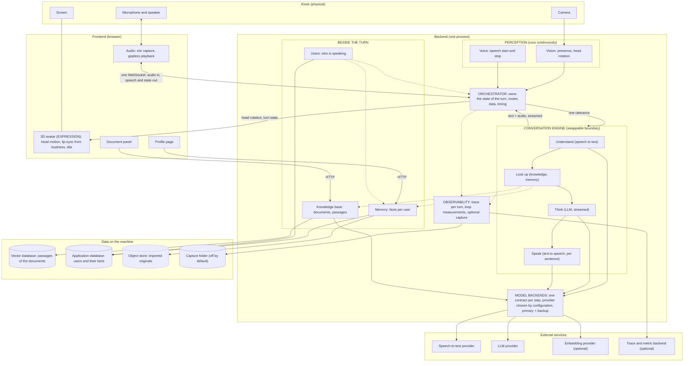
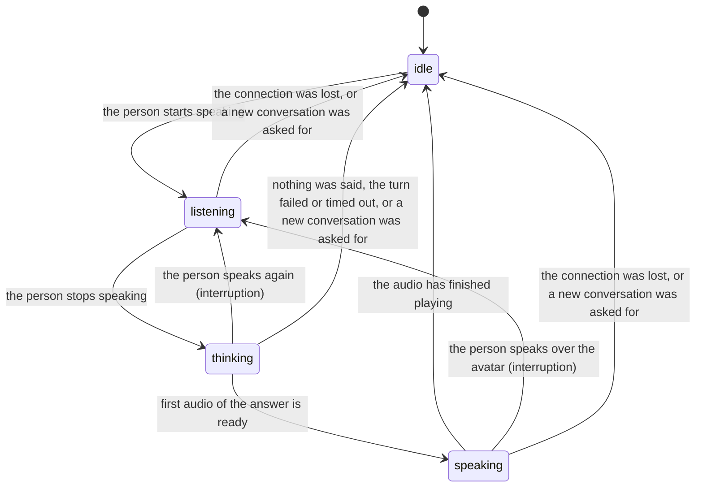
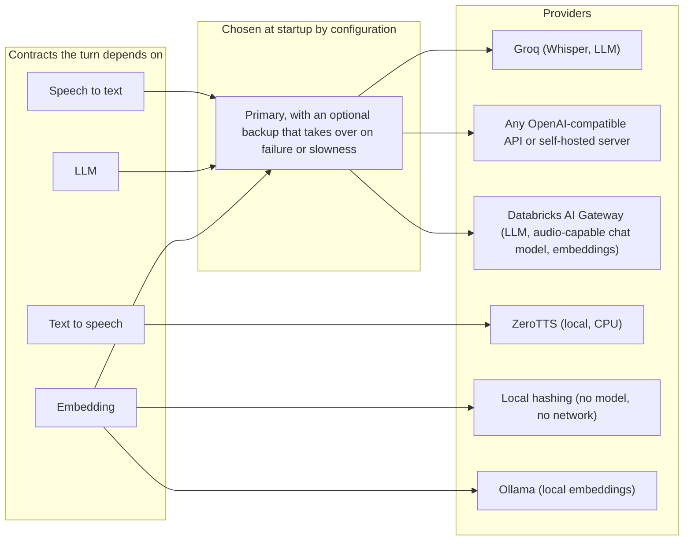
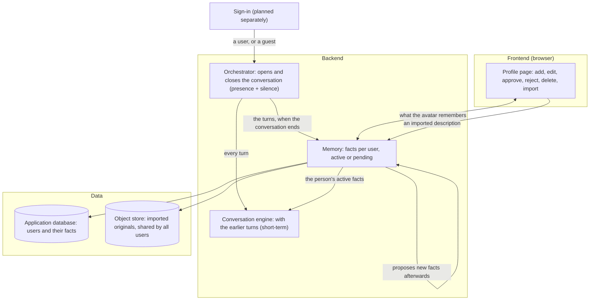
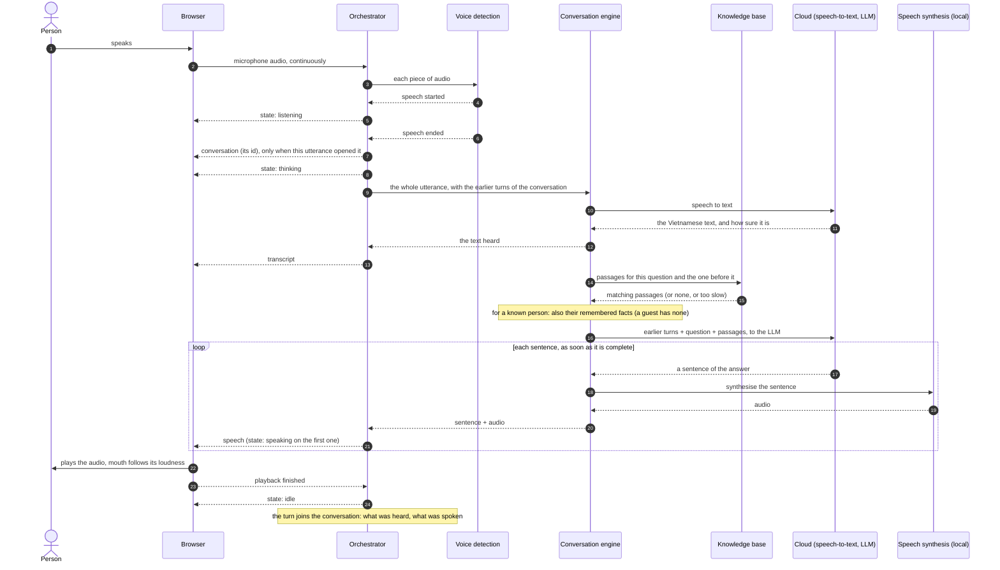
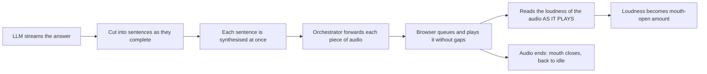
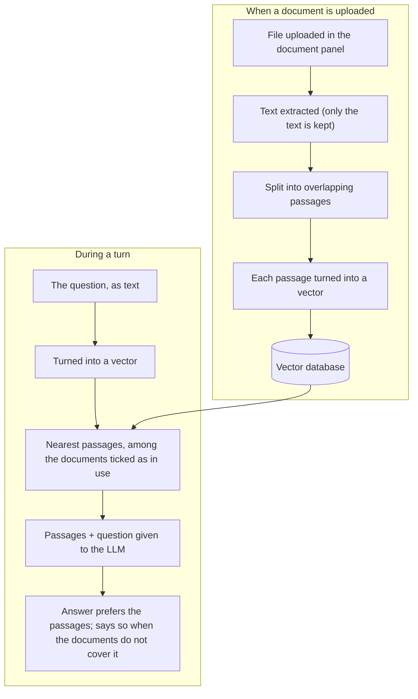
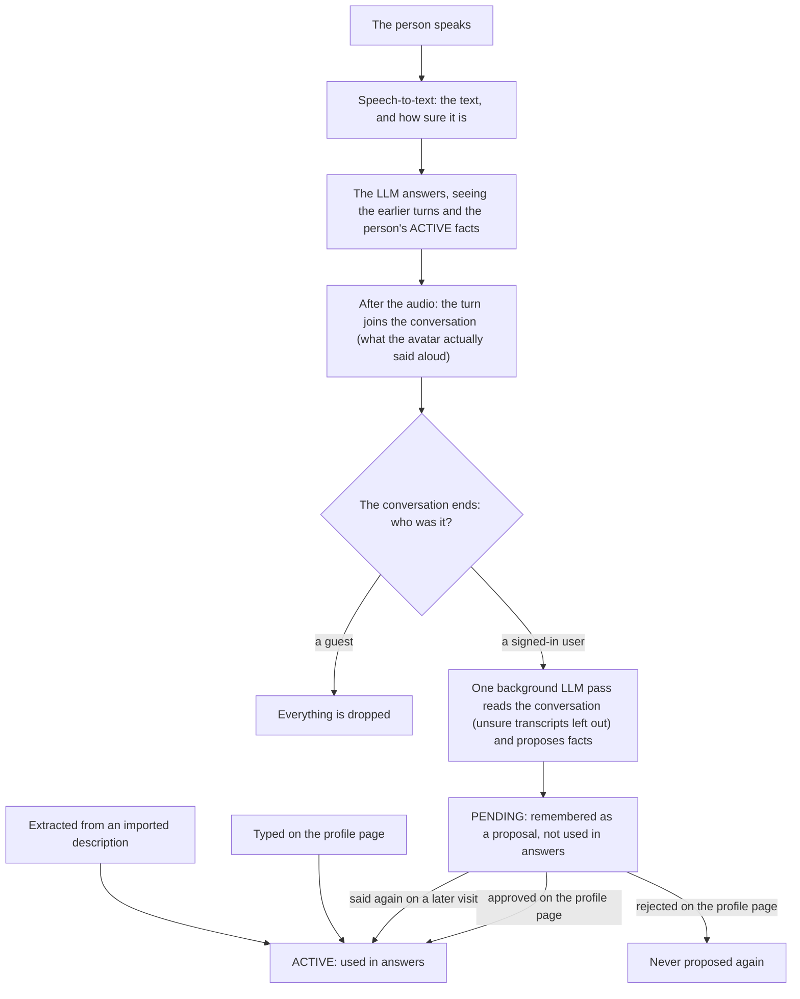
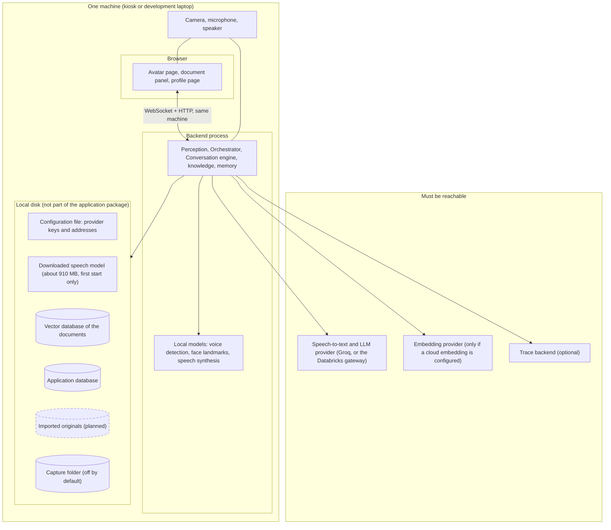

# Architecture — Magic Mirror AI Avatar

> **Altitude:** High-level, PM-reviewable. Describes capabilities, boundaries, and
> data — not functions, classes, or code.
> **Version:** v2 (MVP 1 as built; MVP 2 planned)
> **Status:** Draft — chờ Human Review
> **Architecture records:** each official architecture is logged in `docs/adr/` with
> its context, high-level diagram and consequences. This document is the full detail of
> the current one, [ADR 0002](adr/0002-mvp-2-architecture.md).
> **Reading the diagrams:** solid boxes exist today (MVP 1, and of MVP 2 the short-term
> conversation memory, the application database, the users and the memory of typed
> facts with its profile page). Dashed boxes are planned for MVP 2 and are not built
> yet.

---

## 1. Objectives

**Target.** A kiosk avatar that notices a person standing in front of it, listens to
what they say, and answers back in a natural Vietnamese voice, while an on-screen 3D
avatar turns its head toward the person and moves its mouth in time with the spoken
audio. It answers as a personal work assistant, from its own general knowledge and from
documents the user has uploaded.

**Inputs.**
- Live camera feed: is a person there, and where is their head.
- Live microphone audio: what the person says.
- Documents uploaded in the browser (text, Markdown, CSV, PDF, Word): the internal
  knowledge the avatar may answer from.
- What a known person types on the profile page to describe themselves.
- *Planned (MVP 2):* who the person is (sign-in; today one configured user stands in
  for it), what they import to describe themselves, and what they say about themselves
  in conversation.

**Outputs.**
- A spoken Vietnamese answer played through the speaker, starting on the first sentence
  rather than after the whole answer is ready.
- A 3D avatar that follows the person with its head and lip-syncs to the audio.
- For the operator: a step-by-step record of every turn (what was heard, looked up,
  answered, and how long each step took).

**Scope by milestone.**

| Milestone | Status | What it delivers |
|---|---|---|
| **MVP 1** | Built, demo-ready | One complete spoken turn end to end (presence → listen → understand → answer → speak), interruption by speaking over the avatar, answers from uploaded documents, a backup provider per cloud step, turn tracing |
| **MVP 2** | In progress: the short-term part, the application database, the users and the memory of typed facts with its profile page are built; import, facts gathered from conversations and their approval are planned | Memory: the avatar follows the conversation in progress and remembers a signed-in person across visits; a profile page where the person corrects what is remembered; an application database for users. Customising the character the avatar plays is intended for this milestone and is **not designed yet** |
| Later | Not planned | Sign-in itself, several people talking at the same time, recognising a person by face or voice, tool/function calling, accurate mouth shapes, body gestures and emotion |

**Constraints.**
- **Latency SLA:** end-to-end answer under **10s**; internal target **first audio
  under ~3.5s** (the number the user actually feels).
- **Language:** Vietnamese voice quality is a first-class requirement.
- **Hardware (cross-device):** one codebase for an **Apple Silicon MacBook** (the
  development machine) and a **Windows PC + NVIDIA RTX** (not set up yet).
- **Network:** must work on a restricted company network where some cloud providers
  are blocked — every cloud step can be pointed at another provider by configuration.
- **A turn never dies because an optional part failed.** Knowledge lookup, memory, the
  camera and a primary provider can each fail without stopping the answer.
- **Privacy:** recordings of faces and voices are off by default; a guest is never
  remembered.
- **Architecture principle:** each capability is a cleanly bounded module that *could*
  become its own service later; the product ships as a modular monolith, not a
  distributed system.

---

## 2. Techstacks

| Name | Description | Config / Ability |
|---|---|---|
| Python + async runtime | Backend host process | Runs all backend modules in one process; heavy local work (voice detection, vision, speech synthesis, database) runs beside the main loop so it never stalls it |
| FastAPI + WebSocket + HTTP | The two channels to the frontend | One WebSocket for everything real-time (audio in, speech and head motion out); plain HTTP for managing documents and the profile |
| Camera capture (OpenCV) | Perception — vision input | Reads the webcam; reconnects by itself when the camera drops |
| Face landmarks (MediaPipe) | Perception — vision | Presence of a person and head rotation of the nearest face, about 30 times a second |
| Voice Activity Detection (Silero) | Perception — voice | Marks when the person starts and stops speaking; runs on CPU; keeps the first syllable |
| Speech-to-Text (Whisper, cloud) | Conversation — understand | Vietnamese speech to text. Default provider Groq; alternatives by configuration: any OpenAI-compatible server (including self-hosted), or a chat model that is sent the audio through the Databricks gateway |
| LLM (cloud) | Conversation — think | Produces the Vietnamese answer as a stream. Default provider Groq; alternatives by configuration: any OpenAI-compatible API or the Databricks AI Gateway |
| Text-to-Speech (ZeroTTS, local) | Conversation — voice out | Vietnamese speech synthesised on the machine's CPU, sentence by sentence, faster than real time; no cloud call |
| Backup backends | Resilience of the cloud steps | Speech-to-text, LLM and embedding can each name a backup that takes over when the primary fails or is too slow, and stays in charge for a cool-down period |
| Knowledge base (sqlite-vec) | Answers from uploaded documents | Documents are split into passages and indexed in one embedded vector database file; the user ticks which documents are in use |
| Embedding model | Turns text into vectors for the knowledge base | Chosen by configuration: a no-model local method that works anywhere, any embeddings API, Databricks, or a local Ollama model |
| Observability (OpenTelemetry) | Seeing what a turn did | One trace per turn with a step for each stage and its input and output; counters for the vision and voice loops; sent to any standard backend chosen by configuration |
| Capture (optional) | Evidence for tuning | Stores camera frames, the audio of each turn and its trace on local disk; off by default because it holds faces and voices |
| Device Capability Router | Picks the local-inference backend at startup | Detects Apple Metal / NVIDIA CUDA / CPU. Today every machine uses the cloud for speech-to-text, so the router matters only when a self-hosted speech model is added |
| 3D avatar renderer (Three.js + VRM) | Expression — frontend | Renders the avatar, applies head motion, drives the mouth from audio loudness |
| Web Audio API | Expression — frontend | Captures the microphone, plays the answer without gaps, measures loudness for lip-sync |
| Document panel | Frontend — knowledge | Upload, list, delete documents and tick the ones the avatar may use |
| Conversation memory, short-term *(MVP 2, built)* | The earlier turns of the conversation in progress | Kept in working memory only; bounded to the most recent turns; gone when the conversation ends. Each turn is kept as it happened: what was heard, and the sentences that had actually started to play |
| Application database *(MVP 2, built)* | System and user information: the users, and what the avatar remembers about each of them | Short remembered facts, each *active* (used in answers) or, planned, *pending* (proposed, awaiting approval). Written through one database toolkit (SQLAlchemy Core), so the engine is a configuration choice: a local SQLite file first, PostgreSQL when deployed for many users. Tables are created at startup; there is no migration tool yet |
| Object store *(planned, MVP 2)* | The original files a person imports to describe themselves | One store for all users, holding the files unchanged; who owns a file is recorded in the application database; a local folder first, replaceable by a cloud bucket |
| Profile page *(MVP 2, built in part)* | Frontend — the person's configuration | Shows what the avatar remembers about the person as editable settings: add, edit, delete (built); approve or reject a proposal, import a description (planned) |

---

## 3. Architecture

Three capability blocks on a stable spine. **Perception** feeds the **Orchestrator**,
which drives the **Conversation** engine, whose output flows to **Expression** in the
browser. Two features sit *beside* the turn and are consulted by it: the **knowledge
base** (built) and **memory** (built for typed facts; import and facts gathered from
conversations are planned). Every model the system calls sits behind a
fixed boundary and is chosen by configuration.

*(Mermaid is used instead of ASCII: with knowledge, memory, swappable providers and
observability the system has more planes than ASCII shows clearly.)*

### 3.1 System overview

### 3.2 The turn, as the Orchestrator sees it

Only the Orchestrator changes this state; every other module returns values or events.

**The conversation.** Around the turns the Orchestrator also owns the *conversation*:
the session of one person (a signed-in user, or a guest), which is the unit of
short-term memory.

- It **opens** at the first utterance when none is open.
- Each turn that ends is **recorded** in it, however it ended (completed, interrupted,
  failed, timed out), as long as something was understood: the text heard, and the
  sentences of the answer that had started to play. The apology spoken when the LLM
  fails and a sentence that got no audio are left out.
- Each new utterance is handed to the Conversation engine **with the earlier turns**;
  the engine itself keeps nothing between turns.
- It **closes** when no face was seen for a while (only while the camera works), when
  nobody spoke for a longer while, when another user connects, or when the person
  presses "Cuộc trò chuyện mới". Only that last one may arrive during a turn: the
  answer is then cut as by an interruption. A page reload by the same person does not
  close it.

The WebSocket carries three messages for it, beside the audio, speech and state ones:

| Direction | Message | Meaning |
|---|---|---|
| browser → backend | `conversation_reset` | The person asks for a new conversation |
| backend → browser | `conversation` (an id, or none) | A conversation opened, or the open one closed; also sent right after connecting, with the conversation still open if there is one |
| backend → browser | `transcript` (the text) | What the avatar heard for this turn; not sent when nothing was understood |

What the avatar answers needs no message of its own: each sentence already travels with
its speech.

### 3.3 Model backends: one contract, many providers

Each step that calls a model depends on a contract ("audio in → text out", "text in →
streamed answer out"), never on a provider. Which provider answers is configuration.

### 3.4 Memory beside the turn *(MVP 2, built in part)*

Built so far: the Orchestrator's conversation and the earlier turns given to the
Conversation engine (§3.2); the application database and the users; the Memory holding
the facts a person types on the profile page, and the person's active facts given to
the Conversation engine with each turn. Until sign-in exists, one configured user
stands in for it and everyone else is a guest. Planned: sign-in, import and the object
store, the turns handed over when a conversation ends, the proposed facts and their
approval.

### 3.5 Why these boundaries

- **Capability, not model.** Blocks are drawn by *what they do* (perceive / converse
  / express), so the choice of model lives *inside* a block and can change without
  reshaping the system.
- **Swappable Conversation engine.** Understand → look up → think → speak sits behind
  one boundary with a single contract — "audio in, text + audio out." A unified realtime
  model could replace the whole box later; the Orchestrator and Expression don't care.
- **One owner of the turn.** Only the Orchestrator knows whether the avatar is idle,
  listening, thinking or speaking. That is what makes interruption safe: there is one
  place that cancels an answer.
- **Providers are configuration.** A provider being blocked, slow or replaced is solved
  by a setting, and a backup can stand behind any cloud step. This is what lets the same
  build run on an open network and on a restricted company network.
- **Optional parts stand beside the turn.** The knowledge base and memory are asked for
  help and given a short time to answer; if they are empty, slow or failing, the avatar
  answers without them.
- **Lip-sync lives in the frontend, bound to the audio actually playing.** Mouth
  movement is derived from the loudness of the audio coming out of the speaker, not
  from when a network packet arrived — so it stays in sync regardless of network
  jitter or buffering.
- **Perception is a parallel plane.** Head tracking runs continuously and
  independently of the listen→answer turn; it is not on the critical path to speech.
- **Every step is observable.** Each stage of a turn records what it received, what it
  produced and how long it took, so a slow or wrong answer can be traced to one step.
- **Two memories, two lifetimes.** *Short-term* (built) is the conversation in
  progress: it lets a follow-up question make sense, and it disappears when the
  conversation ends. *Long-term* (built for typed facts) is a small profile of one
  signed-in person that survives across visits.
- **A conversation is defined by the person, not by the connection.** It starts when
  someone speaks and ends when they have walked away, stayed silent long enough, or
  asked for a new one. A page reload does not end it. The Orchestrator owns this
  boundary.
- **The history holds what was heard, not what was generated.** An answer cut by an
  interruption is remembered up to the sentence that had started to play, so the next
  answer does not build on words the person never heard.
- **Identity comes from sign-in, and guests leave no trace** *(built, with one
  configured user standing in for sign-in)*. Long-term memory is keyed by the signed-in
  user, and one user never reads another's. A guest gets the short-term memory only.
- **Three ways into long-term memory, with different trust** *(typing is built, the
  other two are planned)*. What a person
  types, and what is extracted from a description they import, is used at once. What
  the avatar *heard* in a conversation is only a proposal until the person approves it,
  or says it again on a later visit — because speech recognition mishears, and a wrong
  fact would otherwise stay wrong forever.
- **The profile page is the correction point** *(built)*. Everything the avatar
  remembers is visible and editable there, and what the page shows is exactly what the
  language model is given.
- **Imported originals are the source of truth** *(planned)*. The file a person imports
  is kept unchanged in one object store shared by all users; the remembered facts point
  back to it, and its text is re-derived from it rather than stored twice.

---

## 4. Dataflow

### 4.1 One complete turn

Vision is not in this sequence on purpose: head tracking runs all the time, beside it.

### 4.2 The response branch (text → voice → avatar motion)

The flow that carries the sync and latency requirements.

- **Streaming, not wait-for-whole.** Speech starts on the first sentence the LLM
  produces, so the person hears a reply around the first-audio target (~3.5s) instead
  of waiting for the full answer.
- **Amplitude-driven lip-sync.** The mouth opens in proportion to how loud the audio
  is. Simple and cheap; it does not form exact vowel shapes.
- **Dead-air is the real risk, not raw latency.** Because the SLA (10s) is generous,
  the design priority is covering the 2–4s "thinking" gap rather than shaving
  milliseconds.

### 4.3 Knowledge: from an uploaded file to an answer

- Changing the embedding model re-indexes the stored text at the next start; nobody has
  to upload again.
- No match, a slow lookup or a failure → the question goes to the LLM alone.

### 4.4 Memory: how a spoken fact becomes (or does not become) a memory *(planned)*

- **Hearing is not remembering.** A fact reaches the answers only after a human
  approval or a repetition; a single misheard sentence cannot.
- **A conversation never overwrites what is already remembered.** A contradiction
  becomes a proposal to replace, decided by the person.
- **Recordings of the conversation are not kept.** Once the proposals are made, the
  stored turns are deleted; only the short quote behind each fact remains.
- **Memory never costs the turn.** Reading the profile is instant; saving turns and
  extracting facts happen after the audio has been sent.

### 4.5 When something fails

| What fails | What the person experiences | What the system does |
|---|---|---|
| Speech-to-text | No answer to that sentence | The turn ends with an error and the avatar returns to idle, ready for the next sentence |
| LLM | A short spoken apology | A fixed fallback sentence is spoken instead of silence |
| Speech synthesis, for one sentence | That sentence is silent | The sentence is still sent as text; the rest of the answer continues |
| A primary cloud provider | A slightly slower answer, once | The backup takes over and the primary is skipped for a cool-down period |
| Knowledge lookup (empty, slow, failing) | A general answer | The question is answered without the documents |
| Memory (empty, slow, failing) | An answer that does not know them | The turn runs without the profile |
| Application database, at startup | The avatar does not start | Startup stops with the reason: nothing runs on a database it cannot open |
| Camera | The avatar looks straight ahead | The head returns to neutral; the camera is retried; listening and answering are unaffected |
| The person speaks over the avatar | The avatar stops and listens | The running answer is cancelled and a new turn starts |
| The browser connection | A pause, then reconnection | The running turn is cancelled; the browser reconnects by itself |
| A turn that takes too long | An error instead of a late answer | The turn is cut at a fixed limit |

---

## 5. Deployment

**Today: one machine, run locally.** The development MacBook runs both the backend
process and the browser. Windows + RTX and container packaging are not set up yet.

**What runs where.**

| Part | Where | Notes |
|---|---|---|
| Avatar rendering, microphone capture, audio playback, lip-sync | Browser | Needs microphone permission and one click before audio can play |
| Camera reading, presence and head tracking | Backend process | The camera is attached to the machine running the backend |
| Voice detection, speech synthesis | Backend process, on CPU | No GPU needed; the speech model is downloaded once at first start |
| Speech-to-text, LLM | Cloud | The two calls that dominate latency |
| Knowledge base, embeddings | Backend process + local file | Embeddings may be local or a cloud call, by configuration |
| Tracing | Backend process | Sent out only when a trace backend is configured |

**Cross-device.** The application code is the same on Apple Silicon and on
Windows + NVIDIA. Since speech-to-text moved to the cloud, nothing in the turn depends
on a GPU today; the Device Capability Router is kept for the day a self-hosted speech
model is added, and the Windows path still has to be installed and verified on its own
hardware.

**Restricted networks.** On the company network Groq, the speech-model download site
and the frontend package registry are blocked. The system runs there by pointing
speech-to-text, the LLM and the embedding at the Databricks gateway, which is reachable.
The speech model must already be on the machine.

**Known gaps (measured, not assumed).**
- On the Databricks path, first audio was measured at about 5 s and the whole turn at
  about 7–10 s: the first-audio target (~3.5s) is **not met** there, mostly because
  speech-to-text alone takes about 2 s. The Groq path could not be measured from the
  company network.
- The avatar file is supplied per machine; without it the page runs with audio only.

**Path to a multi-user deployment (planned, cheapest step first).**

| Step | Database | Files | When it is needed |
|---|---|---|---|
| 1 | Local SQLite file | Local folder | One kiosk, or a few people taking turns |
| 2 | PostgreSQL on the same machine | Local folder | Several writers at the same time |
| 3 | Managed PostgreSQL | Cloud bucket | More than one backend instance |

Each step is a configuration change for the features that store data. Two things do
**not** follow from the database choice and need their own work before many people can
use the system at once: the backend serves a single connection, and it reads a camera
attached to its own machine.

**Microservice / multi-machine path (not planned).** Each capability block already has a
clean boundary. To scale out later, a block's boundary is exposed over the network
and the block moves to its own service — without redrawing the architecture above.

---

## Backlog

> Change trail. The five parts above describe the *current* intended shape; each change
> is one row here. A change of the overall architecture also has a record in `docs/adr/`.

| Date | Version | What changed in this document | Architecture record | Plan |
|---|---|---|---|---|
| 2026-10-08 | v1 | Initial modular-pipeline architecture: capability blocks, a separated STT → LLM → TTS pipeline behind a swappable boundary, amplitude-driven lip-sync | [0001](adr/0001-mvp-1-architecture.md) | `docs/2026-10-09/modular-pipeline-rebuild/` |
| 2026-10-12 | v1 | Knowledge base (first version): uploaded documents indexed in an embedded vector store and looked up between speech-to-text and the LLM | [0001](adr/0001-mvp-1-architecture.md) | `docs/2026-10-12/knowledge-base/` |
| 2026-10-12 | v2 | Document brought in line with the system as built (cloud speech-to-text, Groq / Databricks LLM, local text-to-speech, backup backends, knowledge base, observability, failure behaviour, deployment); diagrams moved to Mermaid | [0001](adr/0001-mvp-1-architecture.md) | — |
| 2026-10-12 | v2 | MVP 2 architecture (designed, not built): short-term and long-term memory, users, profile page, application database, object store for imports | [0002](adr/0002-mvp-2-architecture.md) | `docs/2026-10-12/conversation-memory/` |
| 2026-10-12 | v2 | Short-term conversation memory built (first slice of MVP 2): the conversation owned by the Orchestrator, the earlier turns given to the engine, the `conversation_reset`, `conversation` and `transcript` messages | [0002](adr/0002-mvp-2-architecture.md) | `docs/2026-10-12/conversation-memory/` |
| 2026-10-12 | v2 | Application database, users and long-term memory of typed facts built (second slice of MVP 2): one database for users and memory items, a configured user standing in for sign-in, the person's active facts given to the LLM with each turn, the profile page and its HTTP routes. Import, the object store, facts gathered from conversations and their approval stay planned | [0002](adr/0002-mvp-2-architecture.md) | `docs/2026-10-12/conversation-memory/` |

**Still deferred:** sign-in, several people at the same time, recognising a person by
face or voice, tool/function calling, accurate mouth shapes, body gestures and emotion,
OCR of scanned documents, hybrid search and re-ranking, summarising very long
conversations, a cloud object store.
