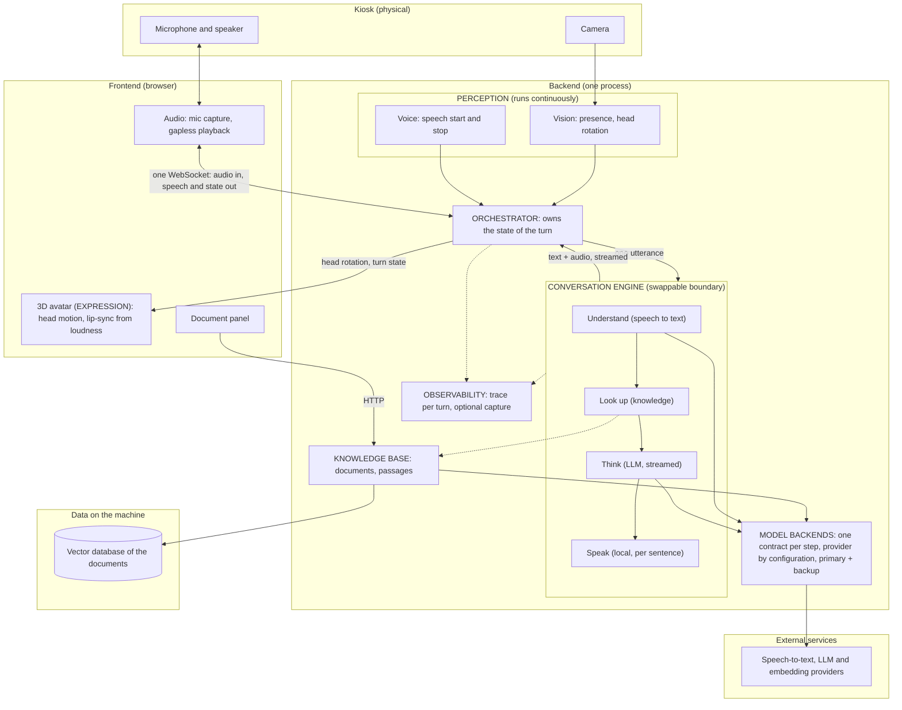

# ADR 0001 — MVP 1 architecture: one spoken turn, with answers from documents

The architecture of the demo-ready MVP 1, as built and pushed (code at commit
`128b038`).

## Context

- **Need.** A kiosk avatar that notices a person, listens, and answers in a natural
  Vietnamese voice while a 3D avatar turns its head and lip-syncs. It must also answer
  from internal documents, not only from the model's general knowledge.
- **Starting point.** A proof of concept built on one multimodal realtime model. It
  gave no control over the voice or over the text between hearing and speaking, tied
  the product to one vendor, and tied the avatar's mouth to network timing.
- **Constraints.** An answer within 10 s and first audio within about 3.5 s. Vietnamese
  voice quality first. One codebase for a MacBook and a Windows + NVIDIA machine. It
  must also run on a company network where some cloud providers and model download
  sites are blocked. One kiosk, one person at a time.

## High-level diagram

The shape in words:

- **Capability blocks, not model blocks**: Perception, Conversation and Expression on a
  spine owned by one Orchestrator, the only holder of the turn's state.
- **A separated pipeline**: speech-to-text, then the LLM, then text-to-speech, behind
  one boundary; the answer is streamed and spoken sentence by sentence.
- **Providers by configuration**: each cloud step depends on a contract and can name a
  backup that takes over when the primary fails or is slow.
- **Speech synthesised locally** on the CPU; speech-to-text and the LLM in the cloud.
- **A knowledge base beside the turn**: uploaded documents in an embedded vector
  database, looked up between hearing and thinking, never allowed to block the answer.
- **Lip-sync in the browser**, from the loudness of the audio actually playing.

## Consequences

**What it gives.**
- Each step can be measured, replaced and given a backup on its own; a model can change
  without reshaping the system.
- The text between the steps is available, which is where the knowledge base plugs in,
  and where memory can.
- The same build runs on an open network and on the restricted one.
- Interruption is safe: one place cancels an answer.
- No optional part can stop a turn: lookup, camera and a primary provider can each fail.

**What it costs.**
- Latency is the sum of three steps. On the Databricks path first audio was measured at
  about 5 s, above the 3.5 s target; the Groq path was not measurable from the company
  network.
- The first start downloads the speech model (about 910 MB) from a site that is blocked
  on the company network.
- The default embedding matches words, not meaning.

**What it leaves open.**
- Every turn is answered alone: the avatar does not follow a conversation and remembers
  nobody.
- There is no notion of who the person is.
- One process serves one connection and reads a camera attached to its own machine.
- The documents are shared by everyone.

## ROI

A low-budget project: the architecture is judged by what it costs to run and to
change, not only by what it does. Quantities below are estimates from the configured
limits, not measurements; prices are left out because they change, so the cost of a
turn is each quantity times the provider's current price.

**What a turn costs to run.**

| Part | Paid for | Cost driver per turn |
|---|---|---|
| Speech-to-text | Cloud, per second of audio | The length of what the person said: a few seconds usually, capped at 30 s |
| LLM | Cloud, per token | About 1,500–2,000 tokens in when passages are found (the passages are most of it), about 100 in without them; about 100 out (2–3 sentences, capped) |
| Text-to-speech | Nothing | Runs on the machine's CPU |
| Embedding | Nothing by default | The default is computed locally; a cloud embedding adds one small call per question |
| Vector database | Nothing | One local file |
| Infrastructure | One machine | No server, no GPU, no managed service |
| Observability | Nothing by default | Only sent out when a trace backend is configured |

**Choices that keep the budget low.**
- Nothing is paid while nobody speaks: the cloud is called only after voice detection
  has heard a complete sentence.
- The step repeated most often per answer (speech, once per sentence) is the free one.
- Embedded stores instead of servers: no fixed monthly cost.
- Providers by configuration: the cheapest provider that passes the quality and latency
  gates can be chosen without code, and a provider's free allowance can be used.

**What was spent, and what it returned.**
- Spent: one rebuild of the proof of concept into separated modules, then the knowledge
  base, the backup backends and tracing.
- Returned: a demo-ready product (one complete spoken turn, answers from documents);
  every later feature plugs into the text between the steps instead of requiring a new
  model; no vendor is locked in.

**Where money can still leak.**
- Passages are the bulk of the LLM bill: the number of passages and their size are the
  first settings to tune.
- Background noise heard as speech is paid for as a full turn.
- The real cost of a turn is not recorded: tokens and audio seconds are not yet counted
  per turn, so the figures above cannot be checked against a bill.

**Verdict.** High return for the money: the only recurring cost is two cloud calls per
spoken sentence, and nothing is paid at rest.
