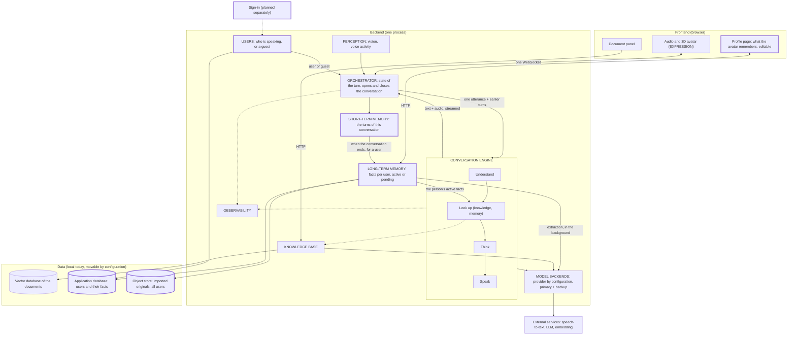

# ADR 0002 — MVP 2 architecture: memory, users and a profile the person controls

The current architecture. It keeps everything of ADR 0001 and adds the parts drawn with
a thick border. Those parts are designed and not built yet; the detail is in
`docs/ARCHITECTURE.md` and the plan `docs/2026-10-12/conversation-memory/`.

## Context

- **Need.** MVP 1 answers every sentence alone. MVP 2 must let the avatar follow the
  conversation in progress and remember a person across visits, as the base for
  customising how it plays its role.
- **Voice makes memory risky.** Speech recognition mishears, and a wrong fact stored as
  true would stay wrong on every later visit. The person must be able to see and
  correct what is remembered.
- **Sign-in does not exist yet** but will provide the user. A guest must be able to
  talk to the avatar without being remembered.
- **Deployment is coming, its shape is not decided.** The app runs on one local machine
  today and is meant to serve many users. Cost and infrastructure must stay minimal
  until real load requires more.
- **Latency.** Nothing added may delay the first audio.

## High-level diagram

The shape in words:

- **Two memories, two lifetimes.** Short-term is the conversation in progress, kept in
  working memory and dropped when it ends. Long-term is a small set of facts about one
  signed-in person.
- **A conversation is bounded by the person**: it opens when someone speaks and closes
  when they leave or stay silent, not when the connection changes.
- **Three sources, two levels of trust.** What a person types or imports is used at
  once. What the avatar hears is a proposal until the person approves it or says it
  again on a later visit.
- **The profile page is the control point**: everything remembered is visible and
  editable there, and it shows exactly what the LLM is given.
- **One application database** for users and their facts, a SQLite file first, with the
  engine chosen by configuration (PostgreSQL at deployment).
- **Imported originals are the source of truth**, kept unchanged in one object store
  shared by all users; ownership is recorded in the database.
- **Memory stands beside the turn**: reading it is instant, writing and extraction
  happen after the audio was sent, and a failure leaves the turn unaffected.

## Consequences

**What it gives.**
- Follow-up questions make sense, and a returning person is addressed as they prefer.
- A single misheard sentence cannot reach the answers.
- The whole flow can be verified locally at no infrastructure cost; moving to a
  database server or a cloud bucket is a configuration change for the features.
- Every fact has a visible origin (typed, imported, heard) and can be removed with its
  source.

**What it costs.**
- Facts gathered from conversations are useless until approved or repeated, so the
  memory fills slowly without the person's help.
- More personal data is held on the machine; deletion must really delete, and access is
  enforced by the application alone.
- Earlier turns and the profile make each LLM request larger, which must be measured
  against the first-audio target.
- One more background LLM call per conversation of a signed-in user.

**What it leaves open.**
- Sign-in itself.
- Serving many people at the same time: the backend still serves one connection and
  reads a camera attached to its own machine.
- Documents per user, and moving the vector index into the application database.
- The design of the customisable role-play that this memory is the base for.
- A run on PostgreSQL: the schema is exercised on SQLite only until there is a
  deployment.

## ROI

Same reading as ADR 0001: estimates from the planned limits, quantities rather than
prices.

**What it adds to the cost of running.**

| Addition | Paid for | Cost driver |
|---|---|---|
| Earlier turns sent to the LLM | Cloud, per token | Grows with the length of the conversation up to the cap on remembered turns: roughly 100–150 tokens per earlier turn |
| The person's profile sent to the LLM | Cloud, per token | A few hundred tokens at most, capped by the number of facts given |
| Gathering facts after a conversation | Cloud, one LLM call per conversation of a signed-in user | The length of the conversation; none for a guest |
| Importing a description | Cloud, one LLM call per import | The length of the imported text, capped |
| Application database, object store | Nothing today | A local file and a local folder |

**Choices that keep the budget low.**
- SQLite and a local folder first: no database server and no storage service are paid
  for until real load requires them, and the move is a configuration change.
- No vector search over the memory: the whole profile is small enough to send, which
  saves an embedding call per turn and a second index.
- No summarising of long conversations: a cap on remembered turns instead of a second
  LLM call per turn.
- Correction on the profile page instead of asking back by voice: no extra spoken turn,
  therefore no extra speech-to-text and LLM calls.
- Guests cost nothing extra: no storage, no gathering.

**Return per part, to build in this order.**

| Part | Build effort | Running cost | Return | Priority |
|---|---|---|---|---|
| 1. Short-term memory | Small | A larger LLM request | High: follow-up questions work, the precondition of any role-play | Build first |
| 2. Profile typed by hand, on the application database | Medium | Almost none | High: the avatar addresses and answers the person as they want, with no risk of mishearing | Build second |
| 3. Import of a description | Medium (object store, file reading) | One LLM call per import | Medium: saves typing; the same result is reachable by hand with part 2 | Decide after 1 and 2 are verified |
| 4. Gathering from conversations | Large (the most logic to get right) | One LLM call per conversation | Uncertain: what it gathers is unused until the person approves it | Decide last, on evidence that people do not fill their profile |

**Where money can leak.**
- Every earlier turn is paid for again on each new turn: the cap on remembered turns is
  the setting to watch.
- Gathering runs on every conversation of a signed-in user, including short ones that
  contain nothing to remember; a minimum length keeps that call for conversations worth
  it.
- A multi-user deployment changes the bill far more than this architecture does: a
  machine that stays on, speech synthesis for several people on one CPU, and the
  session-per-person work that is still open.

**Verdict.** Parts 1 and 2 carry most of the value for the least money and no new
infrastructure. Parts 3 and 4 are where the build effort and the recurring calls are;
they should be confirmed by use before they are built.
