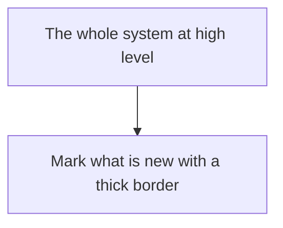

# ADR NNNN — <title>

One sentence: which architecture this is, and what it keeps from the previous record.

## Context

What made this architecture necessary: the need, the starting point, the constraints.

## High-level diagram

The shape in words: one bullet per boundary or rule that defines this architecture.

## Consequences

**What it gives.**

**What it costs.**

**What it leaves open.**

## ROI

*Optional: keep this section when cost decides what is built, delete it otherwise.*

**What it costs to run.** A table: part, what is paid for, the cost driver. Quantities,
not prices.

**Choices that keep the budget low.**

**Return per part.** Build effort, running cost, return, priority.

**Where money can leak.**

**Verdict.**
